# FlexiWork - Nhật ký Dự án & Kiến trúc Chức năng (Project Progress & Architecture)

> **Tài liệu theo dõi tiến độ, kiến trúc chức năng và ma trận phân quyền hệ thống FlexiWork.**  
> *Thời gian cập nhật: 12/11/2026*

---

## 1. Tổng quan & Phạm vi Đề tài (Scope & Boundaries)

**FlexiWork** là hệ thống quản lý ca kíp và chấm công trực tuyến đa nền tảng:
* **Web Admin Portal:** Dành cho Quản trị viên (`Admin`), Bộ phận Nhân sự (`HR`), Quản lý chi nhánh / Cửa hàng trưởng (`Manager`).
* **Mobile App / Web Responsive (BYOD):** Dành cho Nhân viên (`Employee`) và Quản lý khi thao tác trên thiết bị di động cá nhân.

> [!IMPORTANT]
> **Phạm vi giới hạn dự án (Scope Boundary):**
> * Đề tài tập trung tối ưu bài toán chấm công thông minh, quản lý ca kíp linh hoạt, giao việc theo ca, tổng hợp bảng công tự động và **tính lương tạm tính rút gọn** từ bảng công.
> * **Không bao gồm:** Tính toán chi tiết bảo hiểm xã hội (BHXH) hay thuế TNCN phức tạp (lương rút gọn chỉ gồm: công × đơn giá + phụ cấp + OT − phạt).
> * **Không bao gồm:** Công cụ quản lý dự án đa cấp (Kanban, biểu đồ Gantt chuyên sâu).
> * **Không bao gồm:** Cuộc gọi thoại hoặc video call nội bộ.

---

## 2. Danh mục 7 Phân hệ Chức năng Cốt lõi

> Đối chiếu `docs/UML.md` (9 phân hệ, 39 UC): UML tách "Hệ thống & Danh mục" và "Hồ sơ Nhân sự" thành 2 phân hệ — ở đây gộp vào 2.1; Phân hệ 8 (Bảng lương rút gọn) tương ứng mục 2.7.

### 2.1. Phân hệ Quản lý Hồ sơ & Tổ chức (Web Admin)
* **Quản lý danh sách chi nhánh / cửa hàng:** Khai báo thông tin hành chính, thiết lập tâm tọa độ vĩ độ/kinh độ, bán kính chấm công hợp lệ (GPS Geofencing) và danh sách địa chỉ phần cứng Wi-Fi BSSID nội bộ.
* **Quản lý cơ cấu phòng ban & chức danh:** Thiết lập cơ cấu tổ chức, chức vụ chuyên môn và đơn giá công theo giờ.
* **Quản lý hồ sơ nhân sự:** Quản lý thông tin cá nhân, chức danh, hợp đồng lao động, chi nhánh trực thuộc và trạng thái tài khoản (Active/Locked).
* **Khởi tạo tài khoản & Phân quyền người dùng (RBAC):** Gửi email mời kích hoạt tài khoản và phân quyền truy cập theo vai trò (`Admin`, `Manager`, `Employee`, `HR`).
* **Đăng ký dữ liệu Face ID:** Nhân viên chụp và cập nhật ảnh chân dung mẫu phục vụ đối soát nhận diện khuôn mặt.

### 2.2. Phân hệ Quản lý Ca kíp & Chấm công Trực tuyến (Web Admin & Mobile App)
* **Cấu hình loại ca làm việc & Quy tắc vi phạm:** Khai báo khung giờ các loại ca linh hoạt: ca hành chính, ca xoay, ca gãy, ca bán thời gian; định mức đi muộn/về sớm cho phép và quy tắc trừ công/phạt.
* **Phân ca & Xếp lịch làm việc:** Hỗ trợ Cửa hàng trưởng/Quản lý xếp lịch làm việc theo chu kỳ tuần hoặc tháng cho từng chi nhánh và công bố lịch làm việc chính thức.
* **Chấm công đa lớp chống gian lận (Mobile App - BYOD):** Nhân viên thực hiện Check-in / Check-out với cơ chế xác minh 3 lớp đồng thời:
  1. *Lớp 1 (GPS Geofencing):* Kiểm tra tọa độ thiết bị nằm trong bán kính cho phép của chi nhánh.
  2. *Lớp 2 (Wi-Fi BSSID):* Kiểm tra mã định danh phần cứng router Wi-Fi nội bộ để ngăn chặn phần mềm giả lập Fake GPS.
  3. *Lớp 3 (Selfie Face ID):* Chụp ảnh selfie nhận diện khuôn mặt qua AI (`FW.AiService`), đối soát với ảnh mẫu để ngăn ngừa chấm công hộ (Buddy Punching).
* **Tra cứu nhật ký & bảng công:** Nhân viên theo dõi thời gian vào/ra, số phút đi muộn/về sớm của cá nhân; Quản lý/HR tra cứu toàn bộ dữ liệu minh chứng chấm công (ảnh selfie, tọa độ, sai số khoảng cách, địa chỉ MAC Wi-Fi).

### 2.3. Phân hệ Quản lý Đơn từ & Phê duyệt (Web Admin & Mobile App)
* **Khởi tạo đơn điện tử (Mobile App):** Cho phép nhân viên tạo đơn trực tuyến: xin nghỉ phép (hưởng lương/không lương), đơn xin đổi ca làm việc, đơn giải trình đi muộn/về sớm, đăng ký làm thêm giờ (OT) kèm lý do và ảnh minh chứng.
* **Phê duyệt trực tuyến (Web Admin & Mobile App):** Quản lý/HR tiếp nhận thông báo tức thì, kiểm tra nội dung và thực hiện phê duyệt hoặc từ chối kèm phản hồi.
* **Tự động cập nhật công & Quỹ phép:** Khi đơn được duyệt, hệ thống tự động trừ quỹ ngày phép khả dụng, gán trạng thái nghỉ hợp lệ lên lịch làm việc và bảng công.

### 2.4. Phân hệ Quản lý Công việc theo ca (Shift Task Management)
* **Thiết lập danh mục công việc chuẩn:** Quản lý tạo danh mục checklist các đầu việc cần làm đầu ca, trong ca hoặc cuối ca gán theo từng vị trí làm việc.
* **Theo dõi To-do List cá nhân (Mobile App):** Nhân viên xem danh sách các đầu việc được giao trong ca trực hiện tại.
* **Tích chọn hoàn thành kèm ảnh minh chứng:** Nhân viên đánh dấu hoàn thành từng đầu việc và chụp ảnh hiện trường (ví dụ: quầy thu ngân, kho hàng sạch sẽ) gửi lên hệ thống.
* **Báo cáo tiến độ theo thời gian thực:** Quản lý theo dõi trực quan tỷ lệ hoàn thành công việc theo từng ca trực.

### 2.5. Phân hệ Trao đổi Nội bộ Thời gian thực (Realtime Chat & Notification)
* **Trò chuyện trực tiếp (Direct Chat 1-1):** Nhắn tin văn bản và hình ảnh riêng giữa hai nhân sự trong nội bộ.
* **Nhóm chat (Group Chat):** Tạo các nhóm trao đổi tùy chỉnh giữa nhiều nhân viên hoặc nhóm chat tự động theo từng chi nhánh/phòng ban.
* **Thông báo đẩy tức thì (Push Notification):** Đẩy thông báo theo thời gian thực qua SignalR khi có tin nhắn mới, lịch ca mới, hoặc kết quả phê duyệt đơn từ.

### 2.6. Phân hệ Báo cáo & Tổng hợp Bảng công (Web Admin)
* **Dashboard giám sát quân số:** Trực quan hóa tình hình quân số thời gian thực: số nhân sự đang làm việc, tỷ lệ đi làm đúng giờ, số ca vắng mặt hoặc đi muộn theo từng chi nhánh.
* **Tự động tổng hợp bảng công:** Tự động gom dữ liệu chấm công thô, so khớp với khung ca và đơn từ hợp lệ để tính toán chính xác số giờ làm việc, thời gian đi muộn, về sớm, giờ OT và ngày công quy đổi.
* **Trích xuất dữ liệu (Export):** Hỗ trợ xuất dữ liệu bảng công chi tiết ra định dạng file **Excel (.xlsx)** hoặc **PDF** phục vụ cho bộ phận kế toán/nhân sự tính lương.

### 2.7. Phân hệ Bảng lương Rút gọn (Web Admin & Mobile App) — UML Phân hệ 8
* **Cấu hình mức lương & phụ cấp (UC 8.1):** Lương tháng (nhân viên toàn thời gian) hoặc đơn giá giờ theo chức vụ (bán thời gian, có thể ghi đè theo từng nhân viên); phụ cấp ca gãy/ca đêm, phụ cấp cố định; hệ số OT; định mức phạt.
* **Tự động gom dữ liệu (UC 8.2):** Lấy ngày công, giờ công, giờ OT, số ca gãy/đêm, phút vi phạm từ bảng công tháng đã khóa (Phân hệ 2.6).
* **Tính lương tạm tính (UC 8.3):** `(Công thực tế × Đơn giá) + Phụ cấp + OT − Tiền phạt`, lưu chi tiết từng khoản để đối soát.
* **Chốt & phát hành phiếu lương (UC 8.4):** Chốt kỳ lương, gửi phiếu lương điện tử qua email, nhân viên xem trên Mobile, xuất Excel cho kế toán.

---

## 3. Sơ đồ Phân rã Chức năng (BFD - Business Function Decomposition)

```mermaid
flowchart TD
    ROOT["Hệ thống Quản lý Chấm công & Phân ca FlexiWork"]

    ROOT --> M1["1. Quản lý Hồ sơ & Tổ chức (Web Admin)"]
    ROOT --> M2["2. Quản lý Ca kíp & Chấm công (Web & Mobile)"]
    ROOT --> M3["3. Quản lý Đơn từ & Phê duyệt (Web & Mobile)"]
    ROOT --> M4["4. Quản lý Công việc theo ca (Web & Mobile)"]
    ROOT --> M5["5. Trao đổi Thời gian thực (Web & Mobile)"]
    ROOT --> M6["6. Báo cáo & Bảng công (Web Admin)"]
    ROOT --> M7["7. Bảng lương Rút gọn (Web & Mobile)"]

    %% Module 1
    M1 --> M1_1["1.1 Quản lý Chi nhánh & Geofencing / Wi-Fi"]
    M1 --> M1_2["1.2 Quản lý Phòng ban, Chức vụ & Đơn giá công"]
    M1 --> M1_3["1.3 Quản lý Hồ sơ Nhân sự & Hợp đồng"]
    M1 --> M1_4["1.4 Khởi tạo Tài khoản & Phân quyền RBAC"]

    %% Module 2
    M2 --> M2_1["2.1 Cấu hình Loại ca & Quy tắc vi phạm"]
    M2 --> M2_2["2.2 Phân ca & Xếp lịch làm việc theo chu kỳ"]
    M2 --> M2_3["2.3 Chấm công 3 lớp (GPS + Wi-Fi BSSID + Face ID)"]
    M2 --> M2_4["2.4 Tra cứu Nhật ký & Bảng công chi tiết"]

    %% Module 3
    M3 --> M3_1["3.1 Khởi tạo Đơn điện tử kèm minh chứng"]
    M3 --> M3_2["3.2 Quy trình Phê duyệt / Từ chối đa cấp"]
    M3 --> M3_3["3.3 Tự động cấn trừ Quỹ phép & Cập nhật Bảng công"]

    %% Module 4
    M4 --> M4_1["4.1 Thiết lập Checklist công việc chuẩn theo ca"]
    M4 --> M4_2["4.2 To-do List cá nhân theo ca trực"]
    M4 --> M4_3["4.3 Check hoàn thành kèm ảnh minh chứng"]
    M4 --> M4_4["4.4 Dashboard giám sát tiến độ Task realtime"]

    %% Module 5
    M5 --> M5_1["5.1 Nhắn tin trực tiếp 1-1"]
    M5 --> M5_2["5.2 Chat nhóm theo Chi nhánh / Tùy chỉnh"]
    M5 --> M5_3["5.3 Thông báo đẩy tức thì (SignalR)"]

    %% Module 6
    M6 --> M6_1["6.1 Dashboard giám sát quân số thời gian thực"]
    M6 --> M6_2["6.2 Báo cáo vi phạm (Đi muộn / Về sớm / Vắng mặt)"]
    M6 --> M6_3["6.3 Tự động tổng hợp dữ liệu Bảng công"]
    M6 --> M6_4["6.4 Trích xuất Bảng công ra Excel (.xlsx) / PDF"]

    %% Module 7
    M7 --> M7_1["7.1 Cấu hình Mức lương, Phụ cấp & Hệ số OT"]
    M7 --> M7_2["7.2 Tính Bảng lương tạm tính từ Bảng công"]
    M7 --> M7_3["7.3 Chốt kỳ lương & Gửi phiếu lương điện tử"]
    M7 --> M7_4["7.4 Xuất Bảng lương ra Excel cho Kế toán"]
```



---

## 4. Ma trận Phân quyền Người dùng (RBAC Matrix)

### 4.1. Quy ước vai trò & ký hiệu
* **Vai trò:**
  * `Admin`: Quản trị viên cao nhất hệ thống.
  * `HR`: Quản lý nhân sự toàn doanh nghiệp.
  * `Manager`: Quản lý chi nhánh / Cửa hàng trưởng (phạm vi theo chi nhánh phụ trách).
  * `Employee`: Nhân viên (chỉ thao tác trên dữ liệu cá nhân).
* **Quyền hạn:**
  * `C` (Create): Tạo mới
  * `R` (Read): Xem / Tra cứu
  * `U` (Update): Chỉnh sửa
  * `D` (Delete): Xóa
  * `A` (Approve/Reject): Phê duyệt / Từ chối
  * `E` (Execute): Thực thi tác vụ (chấm công, nộp đơn, xuất báo cáo)
  * `-`: Không có quyền truy cập

### 4.2. Bảng Ma trận Phân quyền

| Phân hệ & Chức năng chi tiết | Nền tảng | Admin | HR | Manager | Employee |
| :--- | :---: | :---: | :---: | :---: | :---: |
| **1. Quản lý Hồ sơ & Tổ chức** | | | | | |
| - Quản lý Chi nhánh, GPS Geofence, Wi-Fi BSSID | Web | `CRUD` | `R` | `R` *(theo CN)* | `-` |
| - Quản lý Phòng ban, Chức danh & Đơn giá công | Web | `CRUD` | `CRUD` | `R` | `-` |
| - Quản lý Danh sách Hồ sơ Nhân sự | Web | `CRUD` | `CRUD` | `R` *(theo CN)* | `-` |
| - Mời nhân viên & Cấp phát tài khoản | Web | `CRUD` | `CRUD` | `-` | `-` |
| - Cấu hình vai trò & Phân quyền (RBAC) | Web | `CRUD` | `R` | `-` | `-` |
| - Cập nhật thông tin cá nhân & Ảnh mẫu Face ID | Mobile/Web | `RU` | `RU` | `RU` | `RU` *(Cá nhân)* |
| **2. Quản lý Ca kíp & Chấm công** | | | | | |
| - Cấu hình Khung giờ ca làm việc & Quy tắc phạt | Web | `CRUD` | `CRUD` | `R` | `-` |
| - Phân ca & Xếp lịch làm việc (Tuần/Tháng) | Web | `CRUD` | `CRUD` | `CRUD` *(theo CN)* | `-` |
| - Xuất bản (Publish) Lịch làm việc | Web | `CRUD` | `CRUD` | `CRUD` *(theo CN)* | `-` |
| - Tra cứu Lịch làm việc cá nhân & chi nhánh | Mobile/Web | `R` | `R` | `R` *(theo CN)* | `R` *(Cá nhân)* |
| - Chấm công 3 lớp (GPS + Wi-Fi + Face ID) | Mobile | `-` | `-` | `E` *(nếu có ca)* | `E` |
| - Tra cứu Nhật ký chấm công chi tiết (Ảnh, GPS, MAC) | Web | `R` | `R` | `R` *(theo CN)* | `R` *(Cá nhân)* |
| - Quản lý & Khóa bảng công chi nhánh | Web | `CRUD` | `CRUD` | `U` *(Xác nhận)* | `-` |
| **3. Quản lý Đơn từ & Phê duyệt** | | | | | |
| - Khởi tạo Đơn (Nghỉ phép, Đổi ca, OT, Giải trình) | Mobile/Web | `C` | `C` | `C` | `C` *(Cá nhân)* |
| - Theo dõi tiến trình xử lý đơn cá nhân | Mobile/Web | `R` | `R` | `R` | `R` *(Cá nhân)* |
| - Phê duyệt / Từ chối đơn từ | Web/Mobile | `A` | `A` | `A` *(theo CN)* | `-` |
| - Cấu hình Danh mục đơn & Quy trình duyệt | Web | `CRUD` | `CRUD` | `-` | `-` |
| - Quản lý & Điều chỉnh Quỹ phép nhân viên | Web | `CRUD` | `CRUD` | `R` *(theo CN)* | `R` *(Cá nhân)* |
| **4. Quản lý Công việc theo ca (Shift Tasks)** | | | | | |
| - Thiết lập Danh mục Checklist công việc mẫu | Web | `CRUD` | `R` | `CRUD` *(theo CN)* | `-` |
| - Giao Checklist việc cho nhân viên theo ca | Web/Mobile | `CRUD` | `R` | `CRUD` *(theo CN)* | `-` |
| - Xem To-do List cá nhân trong ca trực | Mobile | `R` | `R` | `R` | `R` *(Cá nhân)* |
| - Tích hoàn thành Task & Upload ảnh minh chứng | Mobile | `-` | `-` | `E` | `E` |
| - Giám sát tiến độ hoàn thành Task thời gian thực | Web/Mobile | `R` | `R` | `R` *(theo CN)* | `-` |
| **5. Trao đổi Thời gian thực (Chat & Notification)** | | | | | |
| - Nhắn tin trực tiếp 1-1 (Direct Chat) | Mobile/Web | `CRUD` | `CRUD` | `CRUD` | `CRUD` |
| - Tạo và quản lý Nhóm chat tùy chỉnh | Mobile/Web | `CRUD` | `CRUD` | `CRUD` | `CRUD` |
| - Nhóm chat tự động theo Chi nhánh / Phòng ban | Mobile/Web | `R` | `R` | `R` | `R` |
| - Tiếp nhận thông báo đẩy tức thì (SignalR) | Mobile/Web | `R` | `R` | `R` | `R` |
| **6. Báo cáo & Tổng hợp Bảng công** | | | | | |
| - Dashboard giám sát quân số Realtime | Web | `R` | `R` | `R` *(theo CN)* | `-` |
| - Báo cáo vi phạm (Đi muộn, về sớm, vắng) | Web | `R` | `R` | `R` *(theo CN)* | `-` |
| - Tổng hợp số giờ công, công quy đổi, giờ OT | Web | `R` | `CRUD` | `R` *(theo CN)* | `R` *(Cá nhân)* |
| - Trích xuất file Bảng công (Excel / PDF) | Web | `E` | `E` | `E` *(theo CN)* | `-` |
| **7. Bảng lương Rút gọn** | | | | | |
| - Cấu hình Mức lương, Phụ cấp, Hệ số OT, Mức phạt | Web | `CRUD` | `CRUD` | `-` | `-` |
| - Tính & Xem Bảng lương tạm tính | Web | `CRUD` | `CRUD` | `R` *(theo CN)* | `-` |
| - Chốt kỳ lương & Gửi phiếu lương | Web | `E` | `E` | `-` | `-` |
| - Xem phiếu lương cá nhân | Mobile/Web | `R` | `R` | `R` | `R` *(Cá nhân)* |
| - Xuất Bảng lương ra Excel | Web | `E` | `E` | `-` | `-` |

---

## 5. Kiến trúc Kỹ thuật & Luồng Xử lý Trọng yếu

```
[Mobile App (BYOD)]                   [Web Admin Portal]
        │                                      │
        │ HTTPS (JWT)                          │ HTTPS (JWT)
        ▼                                      ▼
┌─────────────────────────────────────────────────────────────┐
│                    FW.API (.NET Core)                       │
│  - Controllers & Endpoints          - SignalR Hub           │
│  - Application Services             - Background Jobs       │
└──────────────┬───────────────────────────────┬──────────────┘
               │                               │
        REST API (HTTP)                        │ Dapper (Micro-ORM)
               │                               │
               ▼                               ▼
┌───────────────────────────────┐     ┌───────────────────────┐
│         FW.AiService          │     │       MySQL 8.0       │
│  - Python FastAPI             │     │  - Relational Schema  │
│  - Face Detection & Embeddings│     │  - Attendance Logs    │
│  - Anti-spoofing / Cosine Sim │     │  - Tasks, Shifts, etc.│
└───────────────────────────────┘     └───────────────────────┘
```

1. **Quy trình Chấm công 3 lớp (Mobile $\rightarrow$ Backend $\rightarrow$ AI Service):**
   * **Bước 1 (Thu thập):** Ứng dụng Mobile đọc tọa độ GPS, mã Wi-Fi BSSID (nếu có kết nối Wi-Fi) và kích hoạt camera chụp Selfie trực tiếp.
   * **Bước 2 (Kiểm tra Lớp 1 & Lớp 2):** Backend kiểm tra công thức Haversine với tọa độ gốc của chi nhánh (sai số $\le$ bán kính cấu hình). Tiếp tục đối soát BSSID với danh sách điểm truy cập hợp lệ để chặn Fake GPS.
   * **Bước 3 (Kiểm tra Lớp 3):** Backend gửi ảnh selfie sang `FW.AiService` để phát hiện khuôn mặt và so sánh vector đặc trưng (Face Embeddings) với ảnh mẫu đã đăng ký của nhân viên (Cosine Similarity $\ge$ ngưỡng tin cậy).
   * **Bước 4 (Ghi nhận & Realtime):** Lưu bản ghi điểm danh kèm minh chứng (ảnh, tọa độ, địa chỉ MAC). Phát tín hiệu qua SignalR tới Web Admin của Quản lý chi nhánh để cập nhật bảng giám sát quân số.

2. **Cơ chế Đồng bộ & Realtime (SignalR):**
   * Quản lý nhóm kênh (Hub Groups) theo `Branch_{Id}` và `User_{Id}`.
   * Đảm bảo thông tin cập nhật tức thì khi có: ca mới được xếp, đơn xin nghỉ được duyệt, hoặc checklist công việc hoàn thành.

---

## 6. Kế hoạch & Bảng Theo dõi Tiến độ (Actionable Checklist)

> **Quy ước:**
> * Mỗi cấp bậc là một **lát cắt dọc** hoàn chỉnh: Backend API + Web Admin + Mobile App. Kết thúc mỗi cấp bậc có bản chạy được để demo (theo phương pháp Agile tại Mục 1.5 khóa luận).
> * Mỗi task backend có logic tính toán phải kèm **unit test** trong `FW.UnitTests`.
> * `[Tùy chọn]`: chỉ thực hiện khi còn thời gian; có thể đưa vào "Hướng phát triển" (Chương 5).

> **Tổng quan Tiến độ Hiện tại:**
> * **Giai đoạn đang thực hiện:** CẤP BẬC 2 - Khung ca, Xếp lịch & Dữ liệu Face ID
> * **Tiến độ tổng thể:** `12 / 47` Nhiệm vụ hoàn thành (`26%`)
> * **Hành động tiếp theo:** Thực hiện **Task 2.1** (Entities & Repository `Shift`, `Schedule`, `FaceProfile`; bổ sung schema ca/lịch). Việc nhỏ đang chờ: bản đồ chọn tâm geofence trên form chi nhánh (Leaflet + OpenStreetMap).

### Các quyết định cần chốt

| Quyết định | Ảnh hưởng tới | Đề xuất mặc định |
| :--- | :--- | :--- |
| Manager phụ trách 1 hay nhiều chi nhánh | Task 1.3, 1.5 | 1 chi nhánh (`users.branch_id`) |
| ~~Múi giờ lưu trữ~~ | Task 1.2, 3.2, 5.3 | ✅ **Đã chốt:** giờ Việt Nam (UTC+7) — `SET time_zone` mỗi kết nối + `IDateTimeProvider` |
| Xử lý khi 1 lớp chấm công không đạt | Task 3.2 | GPS + Face bắt buộc; sai Wi-Fi → `pending_approval` |
| Ca gãy | Task 2.2 | Tách thành 2 ca trong cùng ngày |
| Đơn đổi ca cần đồng nghiệp đồng ý trước | Task 4.2 | Có |
| Chống giả mạo khuôn mặt (liveness) | Task 6.2 | `[Tùy chọn]` |
| Phát hiện "trùng thiết bị" (1 điện thoại chấm công cho nhiều người) | Task 3.2 | Có — lưu mã thiết bị khi check-in, cảnh báo trên Dashboard |
| ~~Giao diện Web Admin~~ | Task 1.6 trở đi | ✅ **Đã chốt:** tham khảo bố cục HRM iPOS, thương hiệu & hình ảnh riêng FlexiWork, bỏ Tuyển dụng/Bảng giá, Hợp đồng gộp vào hồ sơ NV, Lương → Bảng công (lương tạm tính) |
| ~~Thư viện giao diện Web Admin~~ | Toàn bộ Web | ✅ **Đã chốt (12/11/2026):** nâng **React 18 → 19**, **Tailwind 3 → 4**, dùng hệ thống thiết kế **Astryx** của Meta (`@astryxdesign/core` 0.7.14, đang beta — ghim cố định phiên bản). Theme `flexiwork` kế thừa `neutral`: màu nhấn xanh `#2563EB`, font **Be Vietnam Pro** (Figtree gốc thiếu dấu tiếng Việt), gói ngôn ngữ `vi-VN`, chế độ sáng/tối. Mobile giữ React Native (Astryx chỉ cho web) |
| ~~Phân hệ Bảng lương rút gọn (UML Phân hệ 8)~~ | Task 5.4, 5.5 | ✅ **Đã chốt (12/11/2026):** đưa vào phạm vi, không gồm thuế TNCN/BHXH |
| Cách tính lương | Task 5.4, 5.5 | Toàn thời gian: `lương tháng ÷ công chuẩn × ngày công`; bán thời gian: `giờ công × đơn giá giờ` (chức vụ, ghi đè được theo NV); OT ngày thường × 1,5; phạt theo quy tắc vi phạm (Task 2.2) |
| Vai trò HR (UML UC 1.6 mới ghi 3 vai trò) | Task K.2 | Giữ 4 vai trò; sửa UC 1.6 trong UML/Chương 3 thêm HR |
| Nhóm chat tùy chỉnh (UML UC 7.2) | Task 5.2 | Vẫn `[Tùy chọn]`; nhóm tự động theo chi nhánh là bắt buộc |
| ~~Công cụ bổ sung ngoài Chương 2~~ | Cấp 2–6 | ✅ **Đã chốt:** Excel → **ClosedXML** (MIT); PDF → **QuestPDF**; biểu đồ → **Recharts**; bản đồ → **Leaflet + OpenStreetMap** (tìm địa chỉ: Nominatim) thay Google Maps; ngày giờ Web → **dayjs**; push → **expo-notifications + Expo Push**; Fake GPS → cờ `mocked` của `expo-location`; mã thiết bị → **expo-application**; ảnh minh chứng → `expo-image-picker` + `expo-image-manipulator`; tác vụ nền → `BackgroundService` (.NET) |
| ~~Gửi email~~ | Task 1.3, 5.5, 6.3 | ✅ **Đã chốt:** local dùng Gmail + App Password (SMTP/MailKit); cloud dùng **Brevo HTTP API** (`BrevoEmailService`, ưu tiên khi có `Brevo:ApiKey`) vì Render gói free chặn cổng SMTP |
| ~~Redis khi triển khai~~ | Task 6.3 | ✅ **Đã chốt:** **Render Key Value** (khai báo trong `render.yaml`); backend đọc được cả URL `redis://` / `rediss://` |
| ~~Triển khai sớm~~ | Task 6.3 | ✅ **Đã chốt (12/11/2026):** đưa Web (Vercel) + API (Render, Docker) + MySQL (TiDB Cloud) lên cloud ngay để phát hiện lỗi sớm; AI Service lên cloud ở Task 2.4 (kiểm tra RAM), EAS Build ở Task 3.4. Không seed tài khoản mẫu trên cloud — Admin đầu tiên tạo từ biến môi trường `Bootstrap__*`. Hướng dẫn: `docs/DEPLOY.md` |
| ~~CSDL trên cloud~~ | Task 6.3 | ✅ **Đã chốt (13/11/2026):** Aiven ngừng MySQL free (không tạo mới từ 06/11/2026, tắt dịch vụ cũ 21/12/2026) → dùng **TiDB Cloud Starter** (AWS Singapore, tương thích giao thức MySQL 8, free 5 GiB + 50 triệu RU/tháng). Giữ nguyên MySQL 8 trên máy dev, `MySqlConnector` và toàn bộ SQL; đã chạy đạt 33/33 test tích hợp trên TiDB v8.5. Không chuyển PostgreSQL (phải viết lại schema + ~57 câu SQL, mất tìm kiếm không dấu). Lưu ý: TiDB bắt buộc SSL, cổng 4000, ID tự tăng có thể nhảy cóc. Chương 2 khóa luận: thay "Aiven" bằng "TiDB Cloud" |

---

### 📌 CẤP BẬC 0: Nền tảng Kiến trúc & Hạ tầng (Foundation) `[5/5]` ✅ HOÀN THÀNH
- [x] **Task 0.1:** Khởi tạo Solution `.NET 8` Clean Architecture (`FW.Backend.sln`, `FW.Domain`, `FW.Application`, `FW.Infrastructure`, `FW.API`), khóa phiên bản SDK qua `global.json` (`8.0.427`), thiết lập Project References và kiểm tra biên dịch thành công.
- [x] **Task 0.2:** Xây dựng Base Domain Entities (`BaseEntity`, `IAuditableEntity`, `ISoftDelete`, `BaseAuditableEntity`, `IGenericRepository`) trong `FW.Domain`.
- [x] **Task 0.3:** Xây dựng Common Models & Response Wrappers (`ApiResponse<T>`, `PaginatedResult<T>`) cùng Custom Exceptions (`AppException`, `NotFoundException`, `BadRequestException`, `UnauthorizedException`, `ForbiddenException`) trong `FW.Application`.
- [x] **Task 0.4:** Cấu hình Data Access Layer trong `FW.Infrastructure` (Dapper + MySqlConnector, `DbConnectionFactory`), đăng ký DI extension methods, chuỗi kết nối trong `appsettings.json`, cấu hình CORS, JWT Bearer Swagger, `GlobalExceptionMiddleware` và test API `HealthCheckController` trong `FW.API`.
- [x] **Task 0.5:** Dựng khung toàn dự án theo công nghệ trong khóa luận:
  - *Backend:* xác thực JWT Bearer (kèm token qua query cho SignalR), `ApiControllerBase`, `CurrentUserService`, Settings (Jwt, Smtp, Redis, Cloudinary, AiService), dịch vụ hạ tầng `SmtpEmailService` (MailKit), `RedisCacheService`, `CloudinaryStorageService`, `FaceRecognitionClient`; thư mục `Features/<Module>`; project `FW.UnitTests` (xUnit); `Dockerfile`; tách bí mật sang `appsettings.Development.json` (không commit).
  - *Web:* React 18 + TS + Vite + Tailwind + Zustand + Axios + SignalR — router, `ProtectedRoute` theo vai trò, `AdminLayout`, `apiClient`, `signalrClient`, `vercel.json`.
  - *Mobile:* Expo SDK 58 + Expo Router + TS — `expo-camera`, `expo-location`, NetInfo (BSSID), `expo-secure-store`, quyền camera/vị trí/Wi-Fi trong `app.json`.
  - *Hạ tầng:* `docker-compose.yml` (MySQL + Redis + AI Service + API), `.env.example`, `README.md`.

---

### 📌 CẤP BẬC 1: Tổ chức, Người dùng & Bảo mật `[7/7]` ✅ HOÀN THÀNH
> 🎯 **Demo:** Đăng nhập Web Admin theo vai trò; quản lý chi nhánh, phòng ban, chức vụ, nhân sự; nhân viên đăng nhập trên Mobile.

- [x] **Task 1.1:** Định nghĩa Enums & Entities (`User`, `Role`, `UserRole`, `Department`, `Position`, `Branch`, `BranchWifi`) trong `FW.Domain`.
  - Enums dạng hằng chuỗi (`RoleNames`, `UserStatus`, `BranchStatus`) khớp giá trị VARCHAR trong CSDL (Dapper ghi enum C# thành số nguyên).
  - Bổ sung vai trò `ROLE_HR` (seed id 4); Manager phụ trách 1 chi nhánh theo `users.branch_id`.
  - Bổ sung cột `updated_at` cho `branch_wifis`, `departments`, `positions` để mọi bảng danh mục dùng chung `BaseAuditableEntity`.
  - Unit test `EntitySchemaMappingTests` đối chiếu 2 chiều thuộc tính Entity ↔ cột trong `flexiwork_schema.sql`.
- [x] **Task 1.2:** Data Access nền tảng trong `FW.Infrastructure`:
  - `BaseRepository<T>` (Dapper): tự sinh SQL CRUD từ `EntityMap` (PascalCase ↔ snake_case), xóa mềm tự động với Entity có `ISoftDelete`, phân trang (`PagedQuery` → `PaginatedResult<T>`), tìm kiếm LIKE có thoát ký tự đặc biệt.
  - `DbSession` (scoped) cài đặt `IUnitOfWork`: một kết nối + transaction dùng chung cho mọi repository trong request; `ExecuteInTransactionAsync` tự commit/rollback, hỗ trợ lồng nhau.
  - Repository: `BranchRepository`, `BranchWifiRepository`, `DepartmentRepository`, `PositionRepository`, `RoleRepository`, `UserRepository` (lọc theo chi nhánh/phòng ban/chức vụ/trạng thái/vai trò, `SetRolesAsync` trong transaction). Kiểm tra trùng mã/email xét cả bản ghi đã xóa mềm vì ràng buộc UNIQUE.
  - Interface repository chuyển từ `FW.Domain/Interfaces` sang `FW.Application/Common/Interfaces/Persistence` (để dùng `PaginatedResult`).
  - Múi giờ: `MySqlDbConnectionFactory` chạy `SET time_zone = '+07:00'` mỗi lần mở kết nối; `IDateTimeProvider` trả giờ Việt Nam.
  - Project `FW.IntegrationTests` (9 test trên MySQL thật, CSDL riêng `flexiwork_test`, bật bằng biến môi trường `FW_TEST_DB`).
- [x] **Task 1.3:** Xác thực & Phân quyền:
  - API `/api/auth`: `login`, `me`, `change-password`, `forgot-password`, `reset-password` (`AuthService`).
  - Đăng nhập BCrypt; JWT (HMAC-SHA256) claims `sub`, `email`, `name`, `employee_code`, `branch_id`, `role` (tắt `MapInboundClaims` để tên claim khớp 2 phía). Khóa đăng nhập 15 phút sau 5 lần sai; cùng thông báo lỗi cho sai email/sai mật khẩu.
  - Quên mật khẩu: OTP 6 số qua email (MailKit), lưu cache dạng băm SHA-256, hiệu lực 5 phút, dùng 1 lần, tối đa 5 lần nhập sai, chờ 60 giây giữa các lần gửi; không tiết lộ email có tồn tại hay không.
  - Quy tắc mật khẩu (`PasswordPolicy`): ≥ 8 ký tự, có chữ cái và chữ số, không khoảng trắng.
  - Phân quyền: nhóm vai trò `RoleNames.AdminOrHr`, `RoleNames.Managers` cho `[Authorize(Roles=...)]`; phạm vi chi nhánh `AccessScopeExtensions` (`GetBranchScope`, `EnsureCanAccessBranch`): Admin/HR toàn công ty, Manager chỉ chi nhánh của mình.
  - Lỗi 400 (validate), 401, 403 đều trả `ApiResponse`; JSON giữ nguyên tiếng Việt.
  - Seed: hash BCrypt thật cho mật khẩu `Admin@123`, thêm tài khoản HR (`hr@flexiwork.vn`).
  - Môi trường dev: cache bộ nhớ khi chưa có Redis, email ghi ra console khi chưa cấu hình SMTP.
  - Test: 31 unit test mới (AuthService, PasswordPolicy, phạm vi chi nhánh, BCrypt, JWT) + 5 integration test (đăng nhập 4 tài khoản mẫu, đặt lại mật khẩu trên MySQL).
- [x] **Task 1.4:** API Chi nhánh (tọa độ Lat/Long, bán kính Geofence, danh sách Wi-Fi BSSID), Phòng ban, Chức vụ & đơn giá công.
  - `/api/branches` (+ `/{id}/wifis`), `/api/departments`, `/api/positions`: danh sách phân trang + tìm kiếm, chi tiết, thêm, sửa, xóa mềm.
  - Phân quyền đúng ma trận RBAC: chi nhánh — Admin ghi, HR xem toàn bộ, Manager chỉ xem chi nhánh của mình (kể cả khi cố tình lọc chi nhánh khác); phòng ban/chức vụ — Admin & HR ghi, Manager xem; Employee không truy cập.
  - Ràng buộc nghiệp vụ: mã chi nhánh/phòng ban chuẩn hóa chữ hoa và không trùng; tên chức danh không trùng; tọa độ hợp lệ, bán kính 10–5000 m; BSSID chuẩn hóa về `XX:XX:XX:XX:XX:XX` (chấp nhận `-` hoặc liền nhau), không trùng trong chi nhánh; không xóa chi nhánh/phòng ban/chức vụ đang có nhân sự; xóa chi nhánh xóa luôn Wi-Fi (transaction).
  - Lỗi đầu vào (JSON sai, thiếu body, sai kiểu) trả thông báo tiếng Việt thay vì thông báo kỹ thuật tiếng Anh.
  - Test: 12 unit test (BSSID) + 7 integration test (nghiệp vụ & phạm vi theo vai trò); kiểm tra API thật với 4 vai trò (200/201/400/403/404).
- [x] **Task 1.5:** API Hồ sơ Nhân sự: thêm mới kèm **email mời kích hoạt tài khoản**, phân vai trò, gán chi nhánh/phòng ban/chức vụ, khóa/mở tài khoản, tìm kiếm & phân trang; cập nhật thông tin cá nhân và ảnh đại diện (Cloudinary).
  - `/api/users`: danh sách (lọc chi nhánh/phòng ban/chức vụ/trạng thái/vai trò), chi tiết (kèm tên chi nhánh, phòng ban, chức vụ, vai trò), tạo, sửa, `PATCH /status` (active/suspended/left), `PUT /roles` (chỉ Admin), `POST /reissue-password`, xóa mềm. `/api/profile` (+ `/avatar`): tự xem/sửa SĐT/ảnh đại diện. `/api/roles`: danh mục vai trò kèm cờ được phép gán.
  - Tạo tài khoản: sinh **mật khẩu tạm** ngẫu nhiên (12 ký tự, bỏ ký tự dễ nhầm) gửi qua email, cờ `must_change_password` buộc đổi ở lần đăng nhập đầu (trả về trong `login`/`me`); lỗi SMTP không làm mất tài khoản (báo để HR cấp lại mật khẩu).
  - Quy tắc: Admin gán mọi vai trò; HR chỉ gán Employee/Manager và không quản lý tài khoản Admin; Manager chỉ xem nhân sự chi nhánh mình; Manager bắt buộc thuộc một chi nhánh; không tự khóa/tự xóa/tự đổi vai trò; mã NV & email không trùng; chi nhánh/phòng ban/chức vụ phải tồn tại.
  - Schema `users`: thêm `employment_type` (full_time/part_time), `hire_date`, `must_change_password`.
  - Ảnh đại diện JPG/PNG/WEBP ≤ 5 MB; khi phát triển chưa có Cloudinary thì lưu cục bộ và phục vụ tại `/uploads`.
  - Test: 8 unit test (sinh mật khẩu, quy tắc quản lý tài khoản) + 8 integration test; kiểm tra API thật (tạo NV → mật khẩu tạm → đăng nhập → ảnh đại diện → khóa → cấp lại mật khẩu).
- [x] **Task 1.6:** Web Admin: màn hình đăng nhập, quên mật khẩu, menu theo vai trò; quản lý Chi nhánh (kèm Wi-Fi), Phòng ban, Chức vụ, Nhân sự.
  - Bố cục tham khảo HRM iPOS (header tối, sidebar nhóm thu gọn, Dashboard thẻ thống kê) với thương hiệu, logo, hình minh họa SVG riêng của FlexiWork; menu theo 6 phân hệ, mục chưa làm hiển thị trang "đang phát triển".
  - Xác thực: đăng nhập, quên mật khẩu 2 bước (email → OTP + mật khẩu mới), **bắt buộc đổi mật khẩu tạm** (chặn mọi trang khác), đổi mật khẩu chủ động, tự đăng xuất khi token hết hạn/401.
  - Trang: Tổng quan (khung số liệu, chờ dữ liệu Cấp 3/5), Nhân viên (lọc chi nhánh/phòng ban/vai trò/trạng thái; thêm kèm vai trò; sửa; khóa/mở; cấp lại mật khẩu; phân quyền; xóa; xem chi tiết), Chi nhánh (Geofence: lấy vị trí hiện tại, xem bản đồ; quản lý Wi-Fi BSSID), Phòng ban, Chức vụ & đơn giá, Hồ sơ cá nhân (SĐT, ảnh đại diện).
  - Hiển thị theo vai trò: Admin đầy đủ; HR không gán Admin/HR, không thao tác tài khoản Admin, không phân quyền; Manager chỉ xem chi nhánh mình; Employee thấy trang hướng dẫn dùng app di động.
  - Kỹ thuật: MVVM (hook `usePagedList` làm ViewModel), Zustand (`authStore`, `lookupStore`, `toastStore`), Axios client chuẩn hóa `ApiError`, bộ component UI dùng chung (Button, Form, Modal, DataTable, Badge, Toaster), icon `lucide-react`.
  - **Làm lại giao diện bằng Astryx (12/11/2026):** React 19 + Tailwind 4; khung `AppShell` + `TopNav` + `SideNav` thu gọn được; form/bảng/hộp thoại/toast/phân trang dùng component Astryx; lớp mỏng `components/ui` (PageHeader, DataTable, Modal/ConfirmDialog, Badge, ListCard) giữ API cũ cho các trang; `LinkProvider` nối react-router; `ToastBridge` chuyển `toast.*` sang Astryx; nút chuyển giao diện sáng/tối (lưu theo người dùng). Kiểm thử lại bằng Chrome: tạo NV, xem chi tiết, Wi-Fi, sửa chi nhánh, chế độ tối, buộc đổi mật khẩu tạm, phân quyền hiển thị Manager/HR, menu tài khoản — không lỗi console.
  - Kiểm thử bằng trình duyệt thật (Chrome headless, playwright-core): 18 màn hình, luồng tạo NV → mật khẩu tạm → buộc đổi mật khẩu, phân quyền hiển thị theo Admin/HR/Manager/Employee.
- [x] **Task 1.7:** Mobile App: đăng nhập, lưu phiên bảo mật (SecureStore), khung điều hướng tab, màn hình hồ sơ cá nhân.
  - Định tuyến theo phiên bằng `Stack.Protected` (Expo Router): chưa đăng nhập → Đăng nhập / Quên mật khẩu; đang dùng **mật khẩu tạm** → chỉ màn hình đổi mật khẩu (không vào được tab, có nút đăng xuất); đã đăng nhập → 5 tab: Trang chủ, Lịch ca, Chấm công, Đơn từ, Cá nhân (+ màn hình Công việc, Tin nhắn chờ Cấp 4–5).
  - Phiên lưu trong `expo-secure-store` (iOS Keychain / Android Keystore) qua Zustand `persist`; giữ màn hình khởi động tới khi đọc xong phiên; `useSessionGuard`: token hết hạn → đăng xuất, mở lại app → đồng bộ `/auth/me` (bị khóa → 401 → đăng xuất; được cấp lại mật khẩu → buộc đổi mật khẩu).
  - Quên mật khẩu 2 bước (OTP 6 số, đếm ngược 60 giây gửi lại khớp backend), đổi mật khẩu chủ động, kiểm tra mật khẩu khớp `PasswordPolicy`.
  - Trang chủ: lời chào, đồng hồ, nút chấm công nhanh, thẻ "Ca làm hôm nay" (chờ Cấp 2), lối tắt. Hồ sơ: thông tin công việc, đổi ảnh đại diện (chụp hoặc chọn ảnh, cắt vuông, JPEG trên iOS), sửa SĐT (ràng buộc khớp backend), đổi mật khẩu, đăng xuất có xác nhận.
  - Kỹ thuật: MVVM (`useProfile` làm ViewModel), bộ component dùng chung (`Screen`, `Button`, `TextField`, `Notice`, `Card`, `Badge`, `Avatar`), theme màu đồng bộ Web Admin, icon `@expo/vector-icons`; `react-native-web` để xem thử trên trình duyệt (bản web lưu phiên vào localStorage).
  - Kiểm thử: `tsc` sạch, đóng gói Android (`expo export`) thành công; chạy bản web khổ 390×844 với backend thật (Chrome headless): 14 màn hình — chuyển hướng khi chưa đăng nhập, sai mật khẩu, giữ phiên sau khi tải lại, tab, sửa SĐT, tải ảnh đại diện, đăng xuất, NV mới bị buộc đổi mật khẩu tạm (không vào được tab), quên mật khẩu bằng OTP → đăng nhập bằng mật khẩu mới.

---

### 📌 CẤP BẬC 2: Khung ca, Xếp lịch & Dữ liệu Face ID `[0/6]`
> 🎯 **Demo:** Quản lý xếp và công bố lịch tuần trên Web; nhân viên xem lịch và đăng ký khuôn mặt trên Mobile.

- [ ] **Task 2.1:** Entities & Repository `Shift`, `Schedule`, `FaceProfile`. Bổ sung schema: `shifts.branch_id` (NULL = ca dùng chung), số phút cho phép đi muộn/về sớm, trạng thái nháp/công bố của lịch (`schedules`).
- [ ] **Task 2.2:** API Khung ca & Quy tắc vi phạm: ca hành chính, ca xoay, ca gãy, ca đêm qua ngày, giờ nghỉ, hệ số công; cấu hình mức trừ công/phạt khi đi muộn, về sớm.
- [ ] **Task 2.3:** API Phân ca & Xếp lịch: xếp theo tuần/tháng, chống trùng và chồng giờ giữa các ca, chuyển nháp → công bố, xem lịch cá nhân / chi nhánh.
- [ ] **Task 2.4:** Đăng ký Face ID: nhận ảnh mẫu → lưu Cloudinary → `FW.AiService` trích xuất vector 512 chiều → lưu `face_profiles`; sửa vector mẫu trong seed cho đủ 512 chiều.
- [ ] **Task 2.5:** Web Admin: quản lý khung ca & quy tắc; lưới xếp lịch theo tuần cho từng chi nhánh; công bố lịch.
- [ ] **Task 2.6:** Mobile App: xem lịch ca cá nhân; chụp ảnh đăng ký Face ID.

---

### 📌 CẤP BẬC 3: LÕI CHẤM CÔNG 3 LỚP (3-Factor Attendance Engine) `[0/5]`
> 🎯 **Demo:** Nhân viên check-in/check-out trên điện thoại thật; Quản lý xem nhật ký kèm minh chứng trên Web.

- [ ] **Task 3.1:** Entity `AttendanceLog`; helper tính khoảng cách Haversine và xác minh Wi-Fi BSSID (kèm unit test).
- [ ] **Task 3.2:** Engine Check-in / Check-out:
  - Kiểm tra 3 lớp: GPS $\le$ bán kính, Wi-Fi BSSID hợp lệ, Face ID match $\ge$ ngưỡng tin cậy (qua `FaceRecognitionClient`).
  - Xử lý khi một lớp không đạt (từ chối hoặc `pending_approval`) theo quyết định đã chốt.
  - So khớp với ca (`schedules`) để tính `late_minutes`, `early_minutes`, `actual_work_hours`; lưu đầy đủ minh chứng vào `attendance_logs`.
- [ ] **Task 3.3:** API Tra cứu Nhật ký Chấm công: nhân viên xem lịch sử bản thân; Quản lý / HR tra cứu theo chi nhánh kèm ảnh, tọa độ, khoảng cách, BSSID.
- [ ] **Task 3.4:** Mobile App: màn hình chấm công (lấy GPS + BSSID + chụp selfie), hiển thị kết quả từng lớp xác minh; lịch sử chấm công cá nhân.
- [ ] **Task 3.5:** Web Admin: nhật ký chấm công có bộ lọc; xem chi tiết minh chứng; duyệt các bản ghi `pending_approval`.

---

### 📌 CẤP BẬC 4: Đơn từ, Phê duyệt & Công việc theo ca `[0/5]`
> 🎯 **Demo:** Nhân viên gửi đơn trên Mobile → Quản lý duyệt trên Web → quỹ phép và lịch tự cập nhật; checklist ca trực có ảnh minh chứng.

- [ ] **Task 4.1:** API Đơn từ: CRUD loại đơn (`leave_types`); tạo đơn nghỉ phép, đổi ca, OT (có giờ bắt đầu/kết thúc), giải trình đi muộn/về sớm kèm ảnh minh chứng. Bổ sung schema cho đơn OT.
- [ ] **Task 4.2:** Quy trình Phê duyệt (transaction): Quản lý duyệt theo chi nhánh, HR duyệt toàn bộ; tự động trừ quỹ phép (`leave_balances`), cập nhật `schedules` / `attendance_logs`, hoán đổi lịch khi đổi ca; HR điều chỉnh quỹ phép.
- [ ] **Task 4.3:** API Checklist công việc: mẫu checklist theo ca (`shift_tasks`); tự động gán khi nhân viên vào ca; tích hoàn thành kèm ảnh hiện trường; API tiến độ theo ca.
- [ ] **Task 4.4:** Mobile App: tạo & theo dõi đơn từ; to-do list ca trực, tích hoàn thành và chụp ảnh minh chứng.
- [ ] **Task 4.5:** Web Admin: duyệt/từ chối đơn, quản lý loại đơn & quỹ phép; quản lý checklist mẫu; giám sát tiến độ task theo ca.

---

### 📌 CẤP BẬC 5: Realtime, Bảng công, Bảng lương & Báo cáo `[0/10]`
> 🎯 **Demo:** Thông báo & chat tức thì giữa Web và Mobile; dashboard quân số realtime; chốt bảng công tháng → tính lương tạm tính → gửi phiếu lương; xuất Excel.

- [ ] **Task 5.1:** `NotificationHub` + bảng `notifications`: lưu và đẩy thông báo (kết quả duyệt đơn, lịch mới, check-in, task được giao); API danh sách, đánh dấu đã đọc.
- [ ] **Task 5.2:** `ChatHub` + API hội thoại: chat 1-1 (văn bản, hình ảnh), nhóm tự động theo chi nhánh, lịch sử tin nhắn. Nhóm chat tùy chỉnh `[Tùy chọn]`.
- [ ] **Task 5.3:** Thuật toán Tổng hợp Bảng công tháng (`monthly_timesheets`) từ `attendance_logs`, `schedules`, `leave_requests` (ngày công, giờ OT, phút vi phạm, nghỉ có/không lương, số ca gãy/đêm); quy trình Quản lý xác nhận → HR khóa bảng công (kèm unit test).
- [ ] **Task 5.4:** Cấu hình lương (UC 8.1): bổ sung schema — lương tháng / đơn giá giờ riêng theo nhân viên (`users`), danh mục phụ cấp & phụ cấp theo nhân viên, hệ số OT, kỳ lương (`payroll_periods`) và phiếu lương chi tiết từng khoản (`payslips`, `payslip_items`); API CRUD cấu hình.
- [ ] **Task 5.5:** Tính & chốt Bảng lương rút gọn (UC 8.2–8.4): gom dữ liệu từ bảng công đã khóa → `(công × đơn giá) + phụ cấp + OT − phạt` (kèm unit test); tính lại khi còn nháp; chốt kỳ lương (transaction); gửi phiếu lương HTML qua email (MailKit); API phiếu lương cá nhân.
- [ ] **Task 5.6:** Dashboard quân số realtime theo chi nhánh; báo cáo vi phạm (đi muộn, về sớm, vắng mặt); báo cáo sử dụng quỹ phép.
- [ ] **Task 5.7:** Xuất bảng công & bảng lương ra Excel (`.xlsx`, ClosedXML). Xuất PDF (QuestPDF) `[Tùy chọn]`.
- [ ] **Task 5.8:** Web Admin: dashboard (Recharts), bảng công & khóa công, cấu hình lương & phụ cấp, bảng lương & chốt kỳ, báo cáo, chat, trung tâm thông báo.
- [ ] **Task 5.9:** Mobile App: thông báo, chat, bảng công cá nhân trong tháng, phiếu lương cá nhân.
- [ ] **Task 5.10:** `[Tùy chọn]` Push Notification khi ứng dụng đang đóng (Expo Push).

---

### 📌 CẤP BẬC 6: Hoàn thiện, Triển khai & Thực nghiệm `[0/5]`
> 🎯 **Demo:** Hệ thống chạy trên môi trường cloud; có số liệu thực nghiệm cho Chương 4.

- [ ] **Task 6.1:** Tác vụ nền (`BackgroundService`): tự đánh dấu vắng mặt khi hết ca, xử lý quên check-out, khởi tạo quỹ phép đầu năm.
- [ ] **Task 6.2:** Gia cố `FW.AiService`: tắt chế độ dự phòng (fallback) ngoài môi trường dev, ngưỡng nhận diện cấu hình được, xác thực Backend ↔ AI Service bằng API key. Chống giả mạo khuôn mặt (liveness) `[Tùy chọn]`.
- [ ] **Task 6.3:** Triển khai: MySQL trên TiDB Cloud, Backend + AI Service trên Render (kiểm tra RAM cho InsightFace), Web trên Vercel, bản build Android (EAS) để demo.
  - *Đã chuẩn bị (12/11/2026):* `render.yaml` (API Docker + Key Value), `FW.Frontend/mobile/eas.json`, `docs/DEPLOY.md` (TiDB Cloud → Brevo → Cloudinary → Render → Vercel → EAS); backend: `BrevoEmailService`, `RedisConnectionParser` (URL `redis://`), `BootstrapAdminService` (Admin đầu tiên từ biến môi trường), `flexiwork_seed_production.sql` (chỉ vai trò + loại đơn), ForwardedHeaders sau proxy, cờ `Swagger:Enabled`; Dockerfile không phụ thuộc `global.json`. Kiểm thử chế độ Production cục bộ: tạo Admin tự động, đăng nhập qua Redis, tài khoản mẫu không tồn tại, CORS chỉ nhận domain khai báo, gọi được API Brevo. Còn lại: người dùng tạo tài khoản dịch vụ và điền biến môi trường; AI Service; EAS Build.
- [ ] **Task 6.4:** Dữ liệu demo quy mô 30–80 nhân sự (seed mở rộng: nhiều chi nhánh, lịch 1 tháng, lịch sử chấm công, đơn từ).
- [ ] **Task 6.5:** Thực nghiệm trên thiết bị thật: chấm công đúng vị trí, ngoài bán kính, dùng Fake GPS, sai Wi-Fi, người khác chụp hộ; đo tỷ lệ nhận diện và thời gian xử lý; đối soát bảng công — làm số liệu cho Chương 4.

---

### 📝 SONG SONG: Viết Khóa luận `[0/4]`
- [ ] **Task K.1:** Sửa Chương 1–2:
  - Loại bỏ nội dung còn sót từ dự án SOSMap: `Post`, `RescueTask`, `Comment`, "mạng xã hội cứu trợ", "SosReport", feed bài đăng, Flat Threading bình luận, FilterJson, Optimistic UI; Google Maps "tính thời gian đến điểm cứu hộ" → Leaflet/OpenStreetMap chọn tâm geofence.
  - Điền chỗ trống "mô hình (…)"; thống nhất Clean Architecture; chỉ dùng **SignalR** (bỏ Socket.io).
  - Bổ sung công nghệ đang dùng: Mobile (Expo, expo-camera/location, NetInfo, SecureStore), `FW.AiService` (FastAPI + InsightFace), xUnit, ClosedXML/QuestPDF, Recharts, Expo Push.
  - Mục Frontend: **React 18 → React 19**; **Tailwind CSS v4** (cascade layers, cấu hình bằng CSS); thêm **hệ thống thiết kế Astryx** (Meta): component có trợ năng (accessibility), design token qua CSS variables (Dynamic Theming), chế độ sáng/tối, đa ngôn ngữ; giải thích vì sao chọn design system thay vì tự viết component.
  - Mục 1.4.2: thêm phân hệ Bảng lương rút gọn cho khớp `docs/UML.md`.
- [ ] **Task K.2:** Chương 3: quy trình TO-BE, biểu đồ Use Case (theo `docs/UML.md`, UC 1.6 thêm vai trò HR), BFD, ERD, biểu đồ tuần tự (chấm công 3 lớp, duyệt đơn, tính lương), thiết kế kiến trúc & CSDL. Công cụ vẽ: draw.io / StarUML.
- [ ] **Task K.3:** Chương 4: môi trường cài đặt, giao diện Web Admin & Mobile App, kết quả thực nghiệm (từ Task 6.5).
- [ ] **Task K.4:** Chương 5 & phần đầu: kết luận, hạn chế, hướng phát triển; cập nhật tóm tắt, mục lục, danh mục viết tắt/hình/bảng; sửa lời cam đoan ("nhóm tác giả" → cá nhân).
