# FlexiWork - Nhật ký Dự án & Kiến trúc Chức năng (Project Progress & Architecture)

> **Tài liệu theo dõi tiến độ, kiến trúc chức năng và ma trận phân quyền hệ thống FlexiWork.**  
> *Thời gian cập nhật: 04/11/2026*

---

## 1. Tổng quan & Phạm vi Đề tài (Scope & Boundaries)

**FlexiWork** là hệ thống quản lý ca kíp và chấm công trực tuyến đa nền tảng:
* **Web Admin Portal:** Dành cho Quản trị viên (`Admin`), Bộ phận Nhân sự (`HR`), Quản lý chi nhánh / Cửa hàng trưởng (`Manager`).
* **Mobile App / Web Responsive (BYOD):** Dành cho Nhân viên (`Employee`) và Quản lý khi thao tác trên thiết bị di động cá nhân.

> [!IMPORTANT]
> **Phạm vi giới hạn dự án (Scope Boundary):**
> * Đề tài tập trung tối ưu bài toán chấm công thông minh, quản lý ca kíp linh hoạt, giao việc theo ca và chuẩn bị dữ liệu bảng công tự động.
> * **Không bao gồm:** Tính toán chi tiết bảo hiểm xã hội (BHXH) hay thuế TNCN phức tạp.
> * **Không bao gồm:** Công cụ quản lý dự án đa cấp (Kanban, biểu đồ Gantt chuyên sâu).
> * **Không bao gồm:** Cuộc gọi thoại hoặc video call nội bộ.

---

## 2. Danh mục 6 Phân hệ Chức năng Cốt lõi

### 2.1. Phân hệ Quản lý Hồ sơ & Tổ chức (Web Admin)
* **Quản lý danh sách chi nhánh / cửa hàng:** Khai báo thông tin hành chính, thiết lập tâm tọa độ vĩ độ/kinh độ, bán kính chấm công hợp lệ (GPS Geofencing) và danh sách địa chỉ phần cứng Wi-Fi BSSID nội bộ.
* **Quản lý cơ cấu phòng ban & chức danh:** Thiết lập cơ cấu tổ chức, chức vụ chuyên môn và đơn giá công theo giờ.
* **Quản lý hồ sơ nhân sự:** Quản lý thông tin cá nhân, chức danh, hợp đồng lao động, chi nhánh trực thuộc và trạng thái tài khoản (Active/Locked).
* **Khởi tạo tài khoản & Phân quyền người dùng (RBAC):** Gửi email mời kích hoạt tài khoản và phân quyền truy cập theo vai trò (`Admin`, `Manager`, `Employee`, `HR`).
* **Đăng ký dữ liệu Face ID:** Nhân viên chụp và cập nhật ảnh chân dung mẫu phục vụ đối soát nhận diện khuôn mặt.

### 2.2. Phân hệ Quản lý Ca kíp & Chấm công Trực tuyến (Web Admin & Mobile App)
* **Cấu hình loại ca làm việc & Quy tắc vi phạm:** Khai báo khung giờ các loại ca linh hoạt: ca hành chính, ca xoay, ca gãy, ca bán thời gian; định mức đi muộn/về sớm cho phép và quy tắc trừ công/phạt.
* **Phân ca & Xếp lịch làm việc:** Hỗ trợ Cửa hàng trưởng/Quản lý xếp lịch làm việc theo chu kỳ tuần hoặc tháng cho từng chi nhánh và công bố lịch làm việc chính thức.
* **Chấm công đa lớp chống gian lận (Mobile App - BYOD):** Nhân viên thực hiện Check-in / Check-out với cơ chế xác minh 3 lớp đồng thời:
  1. *Lớp 1 (GPS Geofencing):* Kiểm tra tọa độ thiết bị nằm trong bán kính cho phép của chi nhánh.
  2. *Lớp 2 (Wi-Fi BSSID):* Kiểm tra mã định danh phần cứng router Wi-Fi nội bộ để ngăn chặn phần mềm giả lập Fake GPS.
  3. *Lớp 3 (Selfie Face ID):* Chụp ảnh selfie nhận diện khuôn mặt qua AI (`FW.AiService`), đối soát với ảnh mẫu để ngăn ngừa chấm công hộ (Buddy Punching).
* **Tra cứu nhật ký & bảng công:** Nhân viên theo dõi thời gian vào/ra, số phút đi muộn/về sớm của cá nhân; Quản lý/HR tra cứu toàn bộ dữ liệu minh chứng chấm công (ảnh selfie, tọa độ, sai số khoảng cách, địa chỉ MAC Wi-Fi).

### 2.3. Phân hệ Quản lý Đơn từ & Phê duyệt (Web Admin & Mobile App)
* **Khởi tạo đơn điện tử (Mobile App):** Cho phép nhân viên tạo đơn trực tuyến: xin nghỉ phép (hưởng lương/không lương), đơn xin đổi ca làm việc, đơn giải trình đi muộn/về sớm, đăng ký làm thêm giờ (OT) kèm lý do và ảnh minh chứng.
* **Phê duyệt trực tuyến (Web Admin & Mobile App):** Quản lý/HR tiếp nhận thông báo tức thì, kiểm tra nội dung và thực hiện phê duyệt hoặc từ chối kèm phản hồi.
* **Tự động cập nhật công & Quỹ phép:** Khi đơn được duyệt, hệ thống tự động trừ quỹ ngày phép khả dụng, gán trạng thái nghỉ hợp lệ lên lịch làm việc và bảng công.

### 2.4. Phân hệ Quản lý Công việc theo ca (Shift Task Management)
* **Thiết lập danh mục công việc chuẩn:** Quản lý tạo danh mục checklist các đầu việc cần làm đầu ca, trong ca hoặc cuối ca gán theo từng vị trí làm việc.
* **Theo dõi To-do List cá nhân (Mobile App):** Nhân viên xem danh sách các đầu việc được giao trong ca trực hiện tại.
* **Tích chọn hoàn thành kèm ảnh minh chứng:** Nhân viên đánh dấu hoàn thành từng đầu việc và chụp ảnh hiện trường (ví dụ: quầy thu ngân, kho hàng sạch sẽ) gửi lên hệ thống.
* **Báo cáo tiến độ theo thời gian thực:** Quản lý theo dõi trực quan tỷ lệ hoàn thành công việc theo từng ca trực.

### 2.5. Phân hệ Trao đổi Nội bộ Thời gian thực (Realtime Chat & Notification)
* **Trò chuyện trực tiếp (Direct Chat 1-1):** Nhắn tin văn bản và hình ảnh riêng giữa hai nhân sự trong nội bộ.
* **Nhóm chat (Group Chat):** Tạo các nhóm trao đổi tùy chỉnh giữa nhiều nhân viên hoặc nhóm chat tự động theo từng chi nhánh/phòng ban.
* **Thông báo đẩy tức thì (Push Notification):** Đẩy thông báo theo thời gian thực qua SignalR khi có tin nhắn mới, lịch ca mới, hoặc kết quả phê duyệt đơn từ.

### 2.6. Phân hệ Báo cáo & Tổng hợp Bảng công (Web Admin)
* **Dashboard giám sát quân số:** Trực quan hóa tình hình quân số thời gian thực: số nhân sự đang làm việc, tỷ lệ đi làm đúng giờ, số ca vắng mặt hoặc đi muộn theo từng chi nhánh.
* **Tự động tổng hợp bảng công:** Tự động gom dữ liệu chấm công thô, so khớp với khung ca và đơn từ hợp lệ để tính toán chính xác số giờ làm việc, thời gian đi muộn, về sớm, giờ OT và ngày công quy đổi.
* **Trích xuất dữ liệu (Export):** Hỗ trợ xuất dữ liệu bảng công chi tiết ra định dạng file **Excel (.xlsx)** hoặc **PDF** phục vụ cho bộ phận kế toán/nhân sự tính lương.

---

## 3. Sơ đồ Phân rã Chức năng (BFD - Business Function Decomposition)

```mermaid
flowchart TD
    ROOT["Hệ thống Quản lý Chấm công & Phân ca FlexiWork"]

    ROOT --> M1["1. Quản lý Hồ sơ & Tổ chức (Web Admin)"]
    ROOT --> M2["2. Quản lý Ca kíp & Chấm công (Web & Mobile)"]
    ROOT --> M3["3. Quản lý Đơn từ & Phê duyệt (Web & Mobile)"]
    ROOT --> M4["4. Quản lý Công việc theo ca (Web & Mobile)"]
    ROOT --> M5["5. Trao đổi Thời gian thực (Web & Mobile)"]
    ROOT --> M6["6. Báo cáo & Bảng công (Web Admin)"]

    %% Module 1
    M1 --> M1_1["1.1 Quản lý Chi nhánh & Geofencing / Wi-Fi"]
    M1 --> M1_2["1.2 Quản lý Phòng ban, Chức vụ & Đơn giá công"]
    M1 --> M1_3["1.3 Quản lý Hồ sơ Nhân sự & Hợp đồng"]
    M1 --> M1_4["1.4 Khởi tạo Tài khoản & Phân quyền RBAC"]

    %% Module 2
    M2 --> M2_1["2.1 Cấu hình Loại ca & Quy tắc vi phạm"]
    M2 --> M2_2["2.2 Phân ca & Xếp lịch làm việc theo chu kỳ"]
    M2 --> M2_3["2.3 Chấm công 3 lớp (GPS + Wi-Fi BSSID + Face ID)"]
    M2 --> M2_4["2.4 Tra cứu Nhật ký & Bảng công chi tiết"]

    %% Module 3
    M3 --> M3_1["3.1 Khởi tạo Đơn điện tử kèm minh chứng"]
    M3 --> M3_2["3.2 Quy trình Phê duyệt / Từ chối đa cấp"]
    M3 --> M3_3["3.3 Tự động cấn trừ Quỹ phép & Cập nhật Bảng công"]

    %% Module 4
    M4 --> M4_1["4.1 Thiết lập Checklist công việc chuẩn theo ca"]
    M4 --> M4_2["4.2 To-do List cá nhân theo ca trực"]
    M4 --> M4_3["4.3 Check hoàn thành kèm ảnh minh chứng"]
    M4 --> M4_4["4.4 Dashboard giám sát tiến độ Task realtime"]

    %% Module 5
    M5 --> M5_1["5.1 Nhắn tin trực tiếp 1-1"]
    M5 --> M5_2["5.2 Chat nhóm theo Chi nhánh / Tùy chỉnh"]
    M5 --> M5_3["5.3 Thông báo đẩy tức thì (SignalR)"]

    %% Module 6
    M6 --> M6_1["6.1 Dashboard giám sát quân số thời gian thực"]
    M6 --> M6_2["6.2 Báo cáo vi phạm (Đi muộn / Về sớm / Vắng mặt)"]
    M6 --> M6_3["6.3 Tự động tổng hợp dữ liệu Bảng công"]
    M6 --> M6_4["6.4 Trích xuất Bảng công ra Excel (.xlsx) / PDF"]
```



---

## 4. Ma trận Phân quyền Người dùng (RBAC Matrix)

### 4.1. Quy ước vai trò & ký hiệu
* **Vai trò:**
  * `Admin`: Quản trị viên cao nhất hệ thống.
  * `HR`: Quản lý nhân sự toàn doanh nghiệp.
  * `Manager`: Quản lý chi nhánh / Cửa hàng trưởng (phạm vi theo chi nhánh phụ trách).
  * `Employee`: Nhân viên (chỉ thao tác trên dữ liệu cá nhân).
* **Quyền hạn:**
  * `C` (Create): Tạo mới
  * `R` (Read): Xem / Tra cứu
  * `U` (Update): Chỉnh sửa
  * `D` (Delete): Xóa
  * `A` (Approve/Reject): Phê duyệt / Từ chối
  * `E` (Execute): Thực thi tác vụ (chấm công, nộp đơn, xuất báo cáo)
  * `-`: Không có quyền truy cập

### 4.2. Bảng Ma trận Phân quyền

| Phân hệ & Chức năng chi tiết | Nền tảng | Admin | HR | Manager | Employee |
| :--- | :---: | :---: | :---: | :---: | :---: |
| **1. Quản lý Hồ sơ & Tổ chức** | | | | | |
| - Quản lý Chi nhánh, GPS Geofence, Wi-Fi BSSID | Web | `CRUD` | `R` | `R` *(theo CN)* | `-` |
| - Quản lý Phòng ban, Chức danh & Đơn giá công | Web | `CRUD` | `CRUD` | `R` | `-` |
| - Quản lý Danh sách Hồ sơ Nhân sự | Web | `CRUD` | `CRUD` | `R` *(theo CN)* | `-` |
| - Mời nhân viên & Cấp phát tài khoản | Web | `CRUD` | `CRUD` | `-` | `-` |
| - Cấu hình vai trò & Phân quyền (RBAC) | Web | `CRUD` | `R` | `-` | `-` |
| - Cập nhật thông tin cá nhân & Ảnh mẫu Face ID | Mobile/Web | `RU` | `RU` | `RU` | `RU` *(Cá nhân)* |
| **2. Quản lý Ca kíp & Chấm công** | | | | | |
| - Cấu hình Khung giờ ca làm việc & Quy tắc phạt | Web | `CRUD` | `CRUD` | `R` | `-` |
| - Phân ca & Xếp lịch làm việc (Tuần/Tháng) | Web | `CRUD` | `CRUD` | `CRUD` *(theo CN)* | `-` |
| - Xuất bản (Publish) Lịch làm việc | Web | `CRUD` | `CRUD` | `CRUD` *(theo CN)* | `-` |
| - Tra cứu Lịch làm việc cá nhân & chi nhánh | Mobile/Web | `R` | `R` | `R` *(theo CN)* | `R` *(Cá nhân)* |
| - Chấm công 3 lớp (GPS + Wi-Fi + Face ID) | Mobile | `-` | `-` | `E` *(nếu có ca)* | `E` |
| - Tra cứu Nhật ký chấm công chi tiết (Ảnh, GPS, MAC) | Web | `R` | `R` | `R` *(theo CN)* | `R` *(Cá nhân)* |
| - Quản lý & Khóa bảng công chi nhánh | Web | `CRUD` | `CRUD` | `U` *(Xác nhận)* | `-` |
| **3. Quản lý Đơn từ & Phê duyệt** | | | | | |
| - Khởi tạo Đơn (Nghỉ phép, Đổi ca, OT, Giải trình) | Mobile/Web | `C` | `C` | `C` | `C` *(Cá nhân)* |
| - Theo dõi tiến trình xử lý đơn cá nhân | Mobile/Web | `R` | `R` | `R` | `R` *(Cá nhân)* |
| - Phê duyệt / Từ chối đơn từ | Web/Mobile | `A` | `A` | `A` *(theo CN)* | `-` |
| - Cấu hình Danh mục đơn & Quy trình duyệt | Web | `CRUD` | `CRUD` | `-` | `-` |
| - Quản lý & Điều chỉnh Quỹ phép nhân viên | Web | `CRUD` | `CRUD` | `R` *(theo CN)* | `R` *(Cá nhân)* |
| **4. Quản lý Công việc theo ca (Shift Tasks)** | | | | | |
| - Thiết lập Danh mục Checklist công việc mẫu | Web | `CRUD` | `R` | `CRUD` *(theo CN)* | `-` |
| - Giao Checklist việc cho nhân viên theo ca | Web/Mobile | `CRUD` | `R` | `CRUD` *(theo CN)* | `-` |
| - Xem To-do List cá nhân trong ca trực | Mobile | `R` | `R` | `R` | `R` *(Cá nhân)* |
| - Tích hoàn thành Task & Upload ảnh minh chứng | Mobile | `-` | `-` | `E` | `E` |
| - Giám sát tiến độ hoàn thành Task thời gian thực | Web/Mobile | `R` | `R` | `R` *(theo CN)* | `-` |
| **5. Trao đổi Thời gian thực (Chat & Notification)** | | | | | |
| - Nhắn tin trực tiếp 1-1 (Direct Chat) | Mobile/Web | `CRUD` | `CRUD` | `CRUD` | `CRUD` |
| - Tạo và quản lý Nhóm chat tùy chỉnh | Mobile/Web | `CRUD` | `CRUD` | `CRUD` | `CRUD` |
| - Nhóm chat tự động theo Chi nhánh / Phòng ban | Mobile/Web | `R` | `R` | `R` | `R` |
| - Tiếp nhận thông báo đẩy tức thì (SignalR) | Mobile/Web | `R` | `R` | `R` | `R` |
| **6. Báo cáo & Tổng hợp Bảng công** | | | | | |
| - Dashboard giám sát quân số Realtime | Web | `R` | `R` | `R` *(theo CN)* | `-` |
| - Báo cáo vi phạm (Đi muộn, về sớm, vắng) | Web | `R` | `R` | `R` *(theo CN)* | `-` |
| - Tổng hợp số giờ công, công quy đổi, giờ OT | Web | `R` | `CRUD` | `R` *(theo CN)* | `R` *(Cá nhân)* |
| - Trích xuất file Bảng công (Excel / PDF) | Web | `E` | `E` | `E` *(theo CN)* | `-` |

---

## 5. Kiến trúc Kỹ thuật & Luồng Xử lý Trọng yếu

```
[Mobile App (BYOD)]                   [Web Admin Portal]
        │                                      │
        │ HTTPS (JWT)                          │ HTTPS (JWT)
        ▼                                      ▼
┌─────────────────────────────────────────────────────────────┐
│                    FW.API (.NET Core)                       │
│  - Controllers & Endpoints          - SignalR Hub           │
│  - Application Services             - Background Jobs       │
└──────────────┬───────────────────────────────┬──────────────┘
               │                               │
        REST API (HTTP)                        │ Dapper (Micro-ORM)
               │                               │
               ▼                               ▼
┌───────────────────────────────┐     ┌───────────────────────┐
│         FW.AiService          │     │       MySQL 8.0       │
│  - Python FastAPI             │     │  - Relational Schema  │
│  - Face Detection & Embeddings│     │  - Attendance Logs    │
│  - Anti-spoofing / Cosine Sim │     │  - Tasks, Shifts, etc.│
└───────────────────────────────┘     └───────────────────────┘
```

1. **Quy trình Chấm công 3 lớp (Mobile $\rightarrow$ Backend $\rightarrow$ AI Service):**
   * **Bước 1 (Thu thập):** Ứng dụng Mobile đọc tọa độ GPS, mã Wi-Fi BSSID (nếu có kết nối Wi-Fi) và kích hoạt camera chụp Selfie trực tiếp.
   * **Bước 2 (Kiểm tra Lớp 1 & Lớp 2):** Backend kiểm tra công thức Haversine với tọa độ gốc của chi nhánh (sai số $\le$ bán kính cấu hình). Tiếp tục đối soát BSSID với danh sách điểm truy cập hợp lệ để chặn Fake GPS.
   * **Bước 3 (Kiểm tra Lớp 3):** Backend gửi ảnh selfie sang `FW.AiService` để phát hiện khuôn mặt và so sánh vector đặc trưng (Face Embeddings) với ảnh mẫu đã đăng ký của nhân viên (Cosine Similarity $\ge$ ngưỡng tin cậy).
   * **Bước 4 (Ghi nhận & Realtime):** Lưu bản ghi điểm danh kèm minh chứng (ảnh, tọa độ, địa chỉ MAC). Phát tín hiệu qua SignalR tới Web Admin của Quản lý chi nhánh để cập nhật bảng giám sát quân số.

2. **Cơ chế Đồng bộ & Realtime (SignalR):**
   * Quản lý nhóm kênh (Hub Groups) theo `Branch_{Id}` và `User_{Id}`.
   * Đảm bảo thông tin cập nhật tức thì khi có: ca mới được xếp, đơn xin nghỉ được duyệt, hoặc checklist công việc hoàn thành.

---

## 6. Kế hoạch & Bảng Theo dõi Tiến độ Triển khai Backend (Actionable Checklist)

> **Tổng quan Tiến độ Hiện tại:**
> * **Giai đoạn đang thực hiện:** CẤP BẬC 1 - Tổ chức, Người dùng & Bảo mật (Identity & Organization)
> * **Tiến độ tổng thể:** `4 / 25` Nhiệm vụ hoàn thành (`16%`)
> * **Hành động tiếp theo:** Thực hiện **Task 1.1** (Định nghĩa Enums & Entities cho nhóm Identity & Master Data trong `FW.Domain`).

---

### 📌 CẤP BẬC 0: Nền tảng Kiến trúc & Hạ tầng (Foundation) `[4/4]` ✅ HOÀN THÀNH
- [x] **Task 0.1:** Khởi tạo Solution `.NET 8` Clean Architecture (`FW.Backend.sln`, `FW.Domain`, `FW.Application`, `FW.Infrastructure`, `FW.API`), khóa phiên bản SDK qua `global.json` (`8.0.427`), thiết lập Project References và kiểm tra biên dịch thành công.
- [x] **Task 0.2:** Xây dựng Base Domain Entities (`BaseEntity`, `IAuditableEntity`, `ISoftDelete`, `BaseAuditableEntity`, `IGenericRepository`) trong `FW.Domain`.
- [x] **Task 0.3:** Xây dựng Common Models & Response Wrappers (`ApiResponse<T>`, `PaginatedResult<T>`) cùng Custom Exceptions (`AppException`, `NotFoundException`, `BadRequestException`, `UnauthorizedException`, `ForbiddenException`) trong `FW.Application`.
- [x] **Task 0.4:** Cấu hình Data Access Layer trong `FW.Infrastructure` (Dapper + MySqlConnector, `DbConnectionFactory`), đăng ký DI extension methods, chuỗi kết nối trong `appsettings.json`, cấu hình CORS, JWT Bearer Swagger, `GlobalExceptionMiddleware` và test API `HealthCheckController` trong `FW.API`.

---

### 📌 CẤP BẬC 1: Tổ chức, Người dùng & Bảo mật (Identity & Organization) `[0/5]`
- [ ] **Task 1.1:** Định nghĩa Enums & Entities (`User`, `Role`, `UserRole`, `Department`, `Position`, `Branch`, `BranchWifi`) trong `FW.Domain`.
- [ ] **Task 1.2:** Triển khai Repository & Data Access cho nhóm bảng Master Data (`BranchRepository`, `UserRepository`, ...) trong `FW.Infrastructure`.
- [ ] **Task 1.3:** Triển khai Authentication Service: Đăng nhập, cấp phát JWT Token (kèm claims: `UserId`, `Roles`, `BranchId`), mã hóa mật khẩu BCrypt trong `FW.Application`.
- [ ] **Task 1.4:** Triển khai CRUD API Chi nhánh (Tọa độ Lat/Long, bán kính Geofence, Wi-Fi BSSID) và CRUD Phòng ban / Chức vụ trong `FW.API`.
- [ ] **Task 1.5:** Triển khai Quản lý Hồ sơ Nhân sự: Thêm mới, phân vai trò (`Admin`, `HR`, `Manager`, `Employee`), gán chi nhánh và khóa/mở tài khoản trong `FW.API`.

---

### 📌 CẤP BẬC 2: Khung ca, Xếp lịch làm việc & Dữ liệu Face ID `[0/4]`
- [ ] **Task 2.1:** Định nghĩa Entities (`Shift`, `Schedule`, `FaceProfile`) và Repository tương ứng trong `FW.Domain` & `FW.Infrastructure`.
- [ ] **Task 2.2:** Nghiệp vụ Quản lý Khung ca (`shifts`): CRUD ca làm việc, tính toán khung giờ ca, ca đêm, ca gãy, hệ số công.
- [ ] **Task 2.3:** Nghiệp vụ Phân ca & Xếp lịch (`schedules`): Xếp lịch làm việc theo chu kỳ tuần/tháng cho nhân viên, kiểm tra ràng buộc chống trùng ca (`uq_user_shift_date`), API công bố và xem lịch.
- [ ] **Task 2.4:** Đăng ký Face ID Profile: API nhận ảnh mẫu từ nhân viên, tích hợp client gọi sang `FW.AiService` trích xuất vector khuôn mặt và lưu vào bảng `face_profiles`.

---

### 📌 CẤP BẬC 3: LÕI CHẤM CÔNG 3 LỚP (3-Factor Attendance Engine) `[0/4]`
- [ ] **Task 3.1:** Định nghĩa Entity `AttendanceLog` và xây dựng Helper tính toán khoảng cách GPS Geofencing (Công thức Haversine) và xác minh Wi-Fi BSSID.
- [ ] **Task 3.2:** Tích hợp Client giao tiếp với `FW.AiService`: Gửi ảnh selfie check-in để phát hiện khuôn mặt và so khớp độ tương đồng Cosine Similarity với vector Face ID gốc.
- [ ] **Task 3.3:** Xây dựng Engine Check-in / Check-out:
  - Kiểm tra đồng thời 3 lớp: GPS $\le$ Bán kính, Wi-Fi BSSID hợp lệ, Face ID match $\ge$ Ngưỡng tin cậy.
  - So khớp tự động với ca làm việc (`schedules`) để tính toán: `late_minutes`, `early_minutes`, `actual_work_hours`.
  - Ghi nhận bản ghi đầy đủ minh chứng vào `attendance_logs`.
- [ ] **Task 3.4:** API Tra cứu Nhật ký Chấm công: Cho nhân viên xem lịch sử bản thân; cho Quản lý / HR tra cứu toàn bộ log kèm minh chứng ảnh, tọa độ và MAC Wi-Fi.

---

### 📌 CẤP BẬC 4: Đơn từ, Phê duyệt & Công việc theo ca (Workflow & Shift Tasks) `[0/4]`
- [ ] **Task 4.1:** Nghiệp vụ Quản lý Đơn từ (`leave_requests`, `leave_types`, `leave_balances`): Tạo đơn xin nghỉ, đổi ca, làm thêm giờ OT, giải trình đi muộn/về sớm kèm tệp minh chứng.
- [ ] **Task 4.2:** Quy trình Phê duyệt Đơn từ: API Quản lý/HR phê duyệt/từ chối; tự động cấn trừ quỹ phép (`leave_balances`), cập nhật trạng thái hợp lệ lên `schedules` và `attendance_logs`.
- [ ] **Task 4.3:** Quản lý Mẫu Checklist công việc (`shift_tasks`): Tạo danh mục công việc chuẩn cần làm gắn theo từng loại ca trực.
- [ ] **Task 4.4:** Thực hiện & Giám sát Task theo ca (`shift_task_assignments`): Tự động gán task khi vào ca, API nhân viên tích hoàn thành kèm ảnh minh chứng hiện trường, API theo dõi tiến độ ca trực.

---

### 📌 CẤP BẬC 5: Realtime Hubs, Tổng hợp Bảng công & Báo cáo `[0/4]`
- [ ] **Task 5.1:** Triển khai SignalR Hubs (`NotificationHub`, `ChatHub`): Đẩy thông báo tức thì khi có kết quả duyệt đơn, lịch mới, check-in thành công; hỗ trợ phòng chat 1-1 và chat nhóm chi nhánh.
- [ ] **Task 5.2:** Thuật toán Tổng hợp Bảng công tháng (`monthly_timesheets`): Tự động gom dữ liệu từ `attendance_logs`, `schedules` và `leave_requests` tính tổng ngày công, giờ OT, số phút vi phạm.
- [ ] **Task 5.3:** Dashboard Giám sát Quân số Realtime: Thống kê số lượng nhân sự đang làm việc, đi muộn, vắng mặt theo chi nhánh thời gian thực.
- [ ] **Task 5.4:** Trích xuất Bảng công ra Excel: Service xuất báo cáo bảng công chi tiết toàn chi nhánh / công ty ra file định dạng `.xlsx`.


