# FlexiWork - Nhật ký Dự án & Kiến trúc Chức năng (Project Progress & Architecture)

> **Tài liệu theo dõi tiến độ, kiến trúc chức năng và ma trận phân quyền hệ thống FlexiWork.**  
> *Thời gian cập nhật: 17/11/2026*

---

## 1. Tổng quan & Phạm vi Đề tài (Scope & Boundaries)

**FlexiWork** là hệ thống quản lý ca kíp và chấm công trực tuyến đa nền tảng:
* **Web Admin Portal:** Dành cho Quản trị viên (`Admin`), Bộ phận Nhân sự (`HR`), Quản lý chi nhánh / Cửa hàng trưởng (`Manager`).
* **Mobile App / Web Responsive (BYOD):** Dành cho Nhân viên (`Employee`) và Quản lý khi thao tác trên thiết bị di động cá nhân.

> [!IMPORTANT]
> **Phạm vi giới hạn dự án (Scope Boundary):**
> * Đề tài tập trung tối ưu bài toán chấm công thông minh, quản lý ca kíp linh hoạt, giao việc theo ca, tổng hợp bảng công tự động và **tính lương tạm tính rút gọn** từ bảng công.
> * **Không bao gồm:** Tính toán chi tiết bảo hiểm xã hội (BHXH) hay thuế TNCN phức tạp (lương rút gọn chỉ gồm: công × đơn giá + phụ cấp + OT − phạt).
> * **Không bao gồm:** Công cụ quản lý dự án đa cấp (Kanban, biểu đồ Gantt chuyên sâu).
> * **Không bao gồm:** Cuộc gọi thoại hoặc video call nội bộ.

---

## 2. Danh mục 8 Phân hệ Chức năng

> Đối chiếu `docs/UML.md` (11 phân hệ, 54 UC): UML tách "Xác thực", "Hệ thống & Danh mục", "Hồ sơ Nhân sự" thành 3 phân hệ — ở đây gộp vào 2.1; Phân hệ 8 (Bảng lương rút gọn) tương ứng mục 2.7; Phân hệ 10 (Trợ lý AI & Phân tích) tương ứng mục 2.8.

### 2.1. Phân hệ Quản lý Hồ sơ & Tổ chức (Web Admin)
* **Quản lý danh sách chi nhánh / cửa hàng:** Khai báo thông tin hành chính, thiết lập tâm tọa độ vĩ độ/kinh độ, bán kính chấm công hợp lệ (GPS Geofencing) và danh sách địa chỉ phần cứng Wi-Fi BSSID nội bộ.
* **Quản lý cơ cấu phòng ban & chức danh:** Thiết lập cơ cấu tổ chức, chức vụ chuyên môn và đơn giá công theo giờ.
* **Quản lý hồ sơ nhân sự:** Quản lý thông tin cá nhân, chức danh, hợp đồng lao động, chi nhánh trực thuộc và trạng thái tài khoản (Active/Locked).
* **Khởi tạo tài khoản & Phân quyền người dùng (RBAC):** Gửi email mời kích hoạt tài khoản và phân quyền truy cập theo vai trò (`Admin`, `Manager`, `Employee`, `HR`).
* **Đăng ký dữ liệu Face ID:** Nhân viên chụp và cập nhật ảnh chân dung mẫu phục vụ đối soát nhận diện khuôn mặt.

### 2.2. Phân hệ Quản lý Ca kíp & Chấm công Trực tuyến (Web Admin & Mobile App)
* **Cấu hình loại ca làm việc & Quy tắc vi phạm:** Khai báo khung giờ các loại ca linh hoạt: ca hành chính, ca xoay, ca gãy, ca bán thời gian; định mức đi muộn/về sớm cho phép và quy tắc trừ công/phạt.
* **Phân ca & Xếp lịch làm việc:** Hỗ trợ Cửa hàng trưởng/Quản lý xếp lịch làm việc theo chu kỳ tuần hoặc tháng cho từng chi nhánh và công bố lịch làm việc chính thức.
* **Chấm công đa lớp chống gian lận (Mobile App - BYOD):** Nhân viên thực hiện Check-in / Check-out với cơ chế xác minh 3 lớp đồng thời:
  1. *Lớp 1 (GPS Geofencing):* Kiểm tra tọa độ thiết bị nằm trong bán kính cho phép của chi nhánh.
  2. *Lớp 2 (Wi-Fi BSSID):* Kiểm tra mã định danh phần cứng router Wi-Fi nội bộ để ngăn chặn phần mềm giả lập Fake GPS.
  3. *Lớp 3 (Selfie Face ID):* Chụp ảnh selfie nhận diện khuôn mặt qua mô hình nhận diện chạy trong backend (ONNX), đối soát với ảnh mẫu để ngăn ngừa chấm công hộ (Buddy Punching).
* **Tra cứu nhật ký & bảng công:** Nhân viên theo dõi thời gian vào/ra, số phút đi muộn/về sớm của cá nhân; Quản lý/HR tra cứu toàn bộ dữ liệu minh chứng chấm công (ảnh selfie, tọa độ, sai số khoảng cách, địa chỉ MAC Wi-Fi).

### 2.3. Phân hệ Quản lý Đơn từ & Phê duyệt (Web Admin & Mobile App)
* **Khởi tạo đơn điện tử (Mobile App):** Cho phép nhân viên tạo đơn trực tuyến: xin nghỉ phép (hưởng lương/không lương), đơn xin đổi ca làm việc, đơn giải trình đi muộn/về sớm, đăng ký làm thêm giờ (OT) kèm lý do và ảnh minh chứng.
* **Phê duyệt trực tuyến (Web Admin & Mobile App):** Quản lý/HR tiếp nhận thông báo tức thì, kiểm tra nội dung và thực hiện phê duyệt hoặc từ chối kèm phản hồi.
* **Tự động cập nhật công & Quỹ phép:** Khi đơn được duyệt, hệ thống tự động trừ quỹ ngày phép khả dụng, gán trạng thái nghỉ hợp lệ lên lịch làm việc và bảng công.

### 2.4. Phân hệ Quản lý Công việc theo ca (Shift Task Management)
* **Thiết lập danh mục công việc chuẩn:** Quản lý tạo danh mục checklist các đầu việc cần làm đầu ca, trong ca hoặc cuối ca gán theo từng vị trí làm việc.
* **Theo dõi To-do List cá nhân (Mobile App):** Nhân viên xem danh sách các đầu việc được giao trong ca trực hiện tại.
* **Tích chọn hoàn thành kèm ảnh minh chứng:** Nhân viên đánh dấu hoàn thành từng đầu việc và chụp ảnh hiện trường (ví dụ: quầy thu ngân, kho hàng sạch sẽ) gửi lên hệ thống.
* **Báo cáo tiến độ theo thời gian thực:** Quản lý theo dõi trực quan tỷ lệ hoàn thành công việc theo từng ca trực.

### 2.5. Phân hệ Trao đổi Nội bộ Thời gian thực (Realtime Chat & Notification)
* **Trò chuyện trực tiếp (Direct Chat 1-1):** Nhắn tin văn bản và hình ảnh riêng giữa hai nhân sự trong nội bộ.
* **Nhóm chat (Group Chat):** Tạo các nhóm trao đổi tùy chỉnh giữa nhiều nhân viên hoặc nhóm chat tự động theo từng chi nhánh/phòng ban.
* **Thông báo đẩy tức thì (Push Notification):** Đẩy thông báo theo thời gian thực qua SignalR khi có tin nhắn mới, lịch ca mới, hoặc kết quả phê duyệt đơn từ.

### 2.6. Phân hệ Báo cáo & Tổng hợp Bảng công (Web Admin)
* **Dashboard giám sát quân số:** Trực quan hóa tình hình quân số thời gian thực: số nhân sự đang làm việc, tỷ lệ đi làm đúng giờ, số ca vắng mặt hoặc đi muộn theo từng chi nhánh.
* **Tự động tổng hợp bảng công:** Tự động gom dữ liệu chấm công thô, so khớp với khung ca và đơn từ hợp lệ để tính toán chính xác số giờ làm việc, thời gian đi muộn, về sớm, giờ OT và ngày công quy đổi.
* **Trích xuất dữ liệu (Export):** Hỗ trợ xuất dữ liệu bảng công chi tiết ra định dạng file **Excel (.xlsx)** phục vụ cho bộ phận kế toán/nhân sự tính lương.

### 2.7. Phân hệ Bảng lương Rút gọn (Web Admin & Mobile App) — UML Phân hệ 8
* **Cấu hình mức lương & phụ cấp (UC 8.1):** Lương tháng (nhân viên toàn thời gian) hoặc đơn giá giờ theo chức vụ (bán thời gian, có thể ghi đè theo từng nhân viên); phụ cấp ca gãy/ca đêm, phụ cấp cố định; hệ số OT; định mức phạt.
* **Tự động gom dữ liệu (UC 8.2):** Lấy ngày công, giờ công, giờ OT, số ca gãy/đêm, phút vi phạm từ bảng công tháng đã khóa (Phân hệ 2.6).
* **Tính lương tạm tính (UC 8.3):** `(Công thực tế × Đơn giá) + Phụ cấp + OT − Tiền phạt`, lưu chi tiết từng khoản để đối soát.
* **Chốt & phát hành phiếu lương (UC 8.4):** Chốt kỳ lương, gửi phiếu lương điện tử qua email, nhân viên xem trên Mobile, xuất Excel cho kế toán.

### 2.8. Phân hệ Trợ lý AI & Phân tích (Mobile App & Web Admin) — UML Phân hệ 10
* **Trợ lý nhân sự (UC 10.1–10.2):** Chatbot dùng LLM (Claude API) + Function Calling: nhân viên hỏi công, phép, lịch ca bằng ngôn ngữ tự nhiên; nói "xin nghỉ ca sáng thứ 5 vì bận thi" → trợ lý trích xuất ngày/ca/lý do và tạo **bản nháp** đơn, nhân viên bấm xác nhận mới gửi. Mọi công cụ chạy với quyền của người hỏi.
* **Cảnh báo nguy cơ nghỉ việc (UC 10.3–10.4):** Tác vụ nền hằng tuần chấm điểm 0–100 từ biến động hành vi chấm công/đơn từ so với chính nhân viên đó, kèm lý do; Quản lý/HR xem danh sách "nhân sự cần quan tâm". Phương pháp chấm điểm có giải thích (không huấn luyện mô hình vì không có dữ liệu thật về người đã nghỉ).

---

## 3. Sơ đồ Phân rã Chức năng (BFD - Business Function Decomposition)

```mermaid
flowchart TD
    ROOT["Hệ thống Quản lý Chấm công & Phân ca FlexiWork"]

    ROOT --> M0["0. Xác thực & Tài khoản (Web & Mobile)"]
    ROOT --> M1["1. Quản lý Hồ sơ & Tổ chức (Web Admin)"]
    ROOT --> M2["2. Quản lý Ca kíp & Chấm công (Web & Mobile)"]
    ROOT --> M3["3. Quản lý Đơn từ & Phê duyệt (Web & Mobile)"]
    ROOT --> M4["4. Quản lý Công việc theo ca (Web & Mobile)"]
    ROOT --> M5["5. Trao đổi Thời gian thực (Web & Mobile)"]
    ROOT --> M6["6. Báo cáo & Bảng công (Web Admin)"]
    ROOT --> M7["7. Bảng lương Rút gọn (Web & Mobile)"]
    ROOT --> M8["8. Trợ lý AI & Phân tích (Mobile & Web)"]

    %% Module 0
    M0 --> M0_1["0.1 Đăng nhập / Đăng xuất (khóa tạm khi sai nhiều lần)"]
    M0 --> M0_2["0.2 Đổi mật khẩu (thu hồi phiên thiết bị khác)"]
    M0 --> M0_3["0.3 Quên mật khẩu bằng OTP qua email"]

    %% Module 1
    M1 --> M1_1["1.1 Quản lý Chi nhánh & Geofencing / Wi-Fi"]
    M1 --> M1_2["1.2 Quản lý Phòng ban, Chức vụ & Đơn giá công"]
    M1 --> M1_3["1.3 Quản lý Hồ sơ Nhân sự & Hợp đồng"]
    M1 --> M1_4["1.4 Khởi tạo Tài khoản & Phân quyền RBAC"]

    %% Module 2
    M2 --> M2_1["2.1 Cấu hình Loại ca & Quy tắc vi phạm"]
    M2 --> M2_2["2.2 Phân ca & Xếp lịch làm việc theo chu kỳ"]
    M2 --> M2_3["2.3 Chấm công 3 lớp (GPS + Wi-Fi BSSID + Face ID)"]
    M2 --> M2_4["2.4 Tra cứu Nhật ký & Bảng công chi tiết"]

    %% Module 3
    M3 --> M3_1["3.1 Khởi tạo Đơn điện tử kèm minh chứng"]
    M3 --> M3_2["3.2 Quy trình Phê duyệt / Từ chối đa cấp"]
    M3 --> M3_3["3.3 Tự động cấn trừ Quỹ phép & Cập nhật Bảng công"]

    %% Module 4
    M4 --> M4_1["4.1 Thiết lập Checklist công việc chuẩn theo ca"]
    M4 --> M4_2["4.2 To-do List cá nhân theo ca trực"]
    M4 --> M4_3["4.3 Check hoàn thành kèm ảnh minh chứng"]
    M4 --> M4_4["4.4 Dashboard giám sát tiến độ Task realtime"]

    %% Module 5
    M5 --> M5_1["5.1 Nhắn tin trực tiếp 1-1"]
    M5 --> M5_2["5.2 Chat nhóm theo Chi nhánh / Tùy chỉnh"]
    M5 --> M5_3["5.3 Thông báo đẩy tức thì (SignalR)"]

    %% Module 6
    M6 --> M6_1["6.1 Dashboard giám sát quân số thời gian thực"]
    M6 --> M6_2["6.2 Báo cáo vi phạm (Đi muộn / Về sớm / Vắng mặt)"]
    M6 --> M6_3["6.3 Tự động tổng hợp dữ liệu Bảng công"]
    M6 --> M6_4["6.4 Trích xuất Bảng công ra Excel (.xlsx)"]

    %% Module 7
    M7 --> M7_1["7.1 Cấu hình Mức lương, Phụ cấp & Hệ số OT"]
    M7 --> M7_2["7.2 Tính Bảng lương tạm tính từ Bảng công"]
    M7 --> M7_3["7.3 Chốt kỳ lương & Gửi phiếu lương điện tử"]
    M7 --> M7_4["7.4 Xuất Bảng lương ra Excel cho Kế toán"]

    %% Module 8
    M8 --> M8_1["8.1 Trợ lý nhân sự: hỏi đáp công, phép, lịch ca"]
    M8 --> M8_2["8.2 Tạo đơn từ qua hội thoại (bản nháp + xác nhận)"]
    M8 --> M8_3["8.3 Chấm điểm & cảnh báo nguy cơ nghỉ việc"]
```



---

## 4. Ma trận Phân quyền Người dùng (RBAC Matrix)

### 4.1. Quy ước vai trò & ký hiệu
* **Vai trò:**
  * `Admin`: Quản trị viên cao nhất hệ thống.
  * `HR`: Quản lý nhân sự toàn doanh nghiệp.
  * `Manager`: Quản lý chi nhánh / Cửa hàng trưởng (phạm vi theo chi nhánh phụ trách).
  * `Employee`: Nhân viên (chỉ thao tác trên dữ liệu cá nhân).
* **Quyền hạn:**
  * `C` (Create): Tạo mới
  * `R` (Read): Xem / Tra cứu
  * `U` (Update): Chỉnh sửa
  * `D` (Delete): Xóa
  * `A` (Approve/Reject): Phê duyệt / Từ chối
  * `E` (Execute): Thực thi tác vụ (chấm công, nộp đơn, xuất báo cáo)
  * `-`: Không có quyền truy cập

### 4.2. Bảng Ma trận Phân quyền

| Phân hệ & Chức năng chi tiết | Nền tảng | Admin | HR | Manager | Employee |
| :--- | :---: | :---: | :---: | :---: | :---: |
| **0. Xác thực & Tài khoản** | | | | | |
| - Đăng nhập, đăng xuất, đổi mật khẩu, quên mật khẩu (OTP) | Mobile/Web | `E` | `E` | `E` | `E` *(Cá nhân)* |
| - Cấp lại mật khẩu tạm cho nhân viên | Web | `E` | `E` | `-` | `-` |
| **1. Quản lý Hồ sơ & Tổ chức** | | | | | |
| - Quản lý Chi nhánh, GPS Geofence, Wi-Fi BSSID | Web | `CRUD` | `R` | `R` *(theo CN)* | `-` |
| - Quản lý Phòng ban, Chức danh & Đơn giá công | Web | `CRUD` | `CRUD` | `R` | `-` |
| - Quản lý Danh sách Hồ sơ Nhân sự | Web | `CRUD` | `CRUD` | `R` *(theo CN)* | `-` |
| - Mời nhân viên & Cấp phát tài khoản | Web | `CRUD` | `CRUD` | `-` | `-` |
| - Cấu hình vai trò & Phân quyền (RBAC) | Web | `CRUD` | `R` | `-` | `-` |
| - Cập nhật thông tin cá nhân & Ảnh mẫu Face ID | Mobile/Web | `RU` | `RU` | `RU` | `RU` *(Cá nhân)* |
| **2. Quản lý Ca kíp & Chấm công** | | | | | |
| - Cấu hình Khung giờ ca làm việc | Web | `CRUD` | `CRUD` | `CRUD` *(ca riêng của CN; ca dùng chung chỉ `R`)* | `-` |
| - Cấu hình Số công chuẩn & Quy tắc phạt | Web | `CRUD` | `CRUD` | `R` | `-` |
| - Phân ca & Xếp lịch làm việc (Tuần/Tháng) | Web | `CRUD` | `CRUD` | `CRUD` *(theo CN)* | `-` |
| - Xuất bản (Publish) Lịch làm việc | Web | `CRUD` | `CRUD` | `CRUD` *(theo CN)* | `-` |
| - Tra cứu Lịch làm việc cá nhân & chi nhánh | Mobile/Web | `R` | `R` | `R` *(theo CN)* | `R` *(Cá nhân)* |
| - Chấm công 3 lớp (GPS + Wi-Fi + Face ID) | Mobile | `-` | `-` | `E` *(nếu có ca)* | `E` |
| - Tra cứu Nhật ký chấm công chi tiết (Ảnh, GPS, MAC) | Web | `R` | `R` | `R` *(theo CN)* | `R` *(Cá nhân)* |
| - Quản lý & Khóa bảng công chi nhánh | Web | `CRUD` | `CRUD` | `U` *(Xác nhận)* | `-` |
| - Duyệt bản ghi chấm công chờ xác nhận | Web | `A` | `A` | `A` *(theo CN)* | `-` |
| **3. Quản lý Đơn từ & Phê duyệt** | | | | | |
| - Khởi tạo Đơn (Nghỉ phép, Đổi ca, OT, Giải trình) | Mobile/Web | `C` | `C` | `C` | `C` *(Cá nhân)* |
| - Theo dõi tiến trình xử lý đơn cá nhân | Mobile/Web | `R` | `R` | `R` | `R` *(Cá nhân)* |
| - Phê duyệt / Từ chối đơn từ | Web/Mobile | `A` | `A` | `A` *(theo CN)* | `-` |
| - Đồng ý / Từ chối đề nghị đổi ca của đồng nghiệp | Mobile | `-` | `-` | `A` | `A` *(Cá nhân)* |
| - Cấu hình Danh mục đơn & Quy trình duyệt | Web | `CRUD` | `CRUD` | `-` | `-` |
| - Quản lý & Điều chỉnh Quỹ phép nhân viên | Web | `CRUD` | `CRUD` | `R` *(theo CN)* | `R` *(Cá nhân)* |
| **4. Quản lý Công việc theo ca (Shift Tasks)** | | | | | |
| - Thiết lập Danh mục Checklist công việc mẫu | Web | `CRUD` | `R` | `CRUD` *(theo CN)* | `-` |
| - Giao Checklist việc cho nhân viên theo ca | Web/Mobile | `CRUD` | `R` | `CRUD` *(theo CN)* | `-` |
| - Xem To-do List cá nhân trong ca trực | Mobile | `R` | `R` | `R` | `R` *(Cá nhân)* |
| - Tích hoàn thành Task & Upload ảnh minh chứng | Mobile | `-` | `-` | `E` | `E` |
| - Giám sát tiến độ hoàn thành Task thời gian thực | Web/Mobile | `R` | `R` | `R` *(theo CN)* | `-` |
| **5. Trao đổi Thời gian thực (Chat & Notification)** | | | | | |
| - Nhắn tin trực tiếp 1-1 (Direct Chat) | Mobile/Web | `CRUD` | `CRUD` | `CRUD` | `CRUD` |
| - Tạo và quản lý Nhóm chat tùy chỉnh | Mobile/Web | `CRUD` | `CRUD` | `CRUD` | `CRUD` |
| - Nhóm chat tự động theo Chi nhánh / Phòng ban | Mobile/Web | `R` | `R` | `R` | `R` |
| - Tiếp nhận thông báo đẩy tức thì (SignalR) | Mobile/Web | `R` | `R` | `R` | `R` |
| - Xem danh sách thông báo & đánh dấu đã đọc | Mobile/Web | `RU` | `RU` | `RU` | `RU` *(Cá nhân)* |
| **6. Báo cáo & Tổng hợp Bảng công** | | | | | |
| - Dashboard giám sát quân số Realtime | Web | `R` | `R` | `R` *(theo CN)* | `-` |
| - Báo cáo vi phạm (Đi muộn, về sớm, vắng) | Web | `R` | `R` | `R` *(theo CN)* | `-` |
| - Tổng hợp số giờ công, công quy đổi, giờ OT | Web | `R` | `CRUD` | `R` *(theo CN)* | `R` *(Cá nhân)* |
| - Trích xuất file Bảng công (Excel) | Web | `E` | `E` | `E` *(theo CN)* | `-` |
| **7. Bảng lương Rút gọn** | | | | | |
| - Cấu hình Mức lương, Phụ cấp, Hệ số OT, Mức phạt | Web | `CRUD` | `CRUD` | `-` | `-` |
| - Tính & Xem Bảng lương tạm tính | Web | `CRUD` | `CRUD` | `R` *(theo CN)* | `-` |
| - Chốt kỳ lương & Gửi phiếu lương | Web | `E` | `E` | `-` | `-` |
| - Xem phiếu lương cá nhân | Mobile/Web | `R` | `R` | `R` | `R` *(Cá nhân)* |
| - Xuất Bảng lương ra Excel | Web | `E` | `E` | `-` | `-` |
| **8. Trợ lý AI & Phân tích** | | | | | |
| - Hỏi đáp với trợ lý (chỉ dữ liệu trong phạm vi quyền của mình) | Mobile/Web | `E` | `E` | `E` *(theo CN)* | `E` *(Cá nhân)* |
| - Tạo bản nháp đơn qua hội thoại (phải bấm xác nhận) | Mobile | `C` | `C` | `C` | `C` *(Cá nhân)* |
| - Xem cảnh báo nhân sự cần quan tâm | Web | `R` | `R` | `R` *(theo CN)* | `-` |
| - Cấu hình trọng số / ngưỡng cảnh báo | Web | `U` | `U` | `-` | `-` |

---

## 5. Kiến trúc Kỹ thuật & Luồng Xử lý Trọng yếu

```
[Mobile App (BYOD)]                   [Web Admin Portal]
        │                                      │
        │ HTTPS (JWT)                          │ HTTPS (JWT)
        ▼                                      ▼
┌─────────────────────────────────────────────────────────────┐
│                    FW.API (.NET Core)                       │
│  - Controllers & Endpoints          - SignalR Hub           │
│  - Application Services             - Background Jobs       │
└──────────────┬───────────────────────────────┬──────────────┘
               │                               │
        REST API (HTTP)                        │ Dapper (Micro-ORM)
               │                               │
               ▼                               ▼
┌───────────────────────────────┐     ┌───────────────────────┐
│ Nhận diện khuôn mặt (ONNX)    │     │       MySQL 8.0       │
│ - Chạy trong Backend (.NET)   │     │  - Relational Schema  │
│ - Face Detection & Embeddings │     │  - Attendance Logs    │
│ - Cosine Similarity           │     │  - Tasks, Shifts, etc.│
└───────────────────────────────┘     └───────────────────────┘
```

1. **Quy trình Chấm công 3 lớp (Mobile $\rightarrow$ Backend $\rightarrow$ Mô hình nhận diện):**
   * **Bước 1 (Thu thập):** Ứng dụng Mobile đọc tọa độ GPS, mã Wi-Fi BSSID (nếu có kết nối Wi-Fi) và kích hoạt camera chụp Selfie trực tiếp.
   * **Bước 2 (Kiểm tra Lớp 1 & Lớp 2):** Backend kiểm tra công thức Haversine với tọa độ gốc của chi nhánh (sai số $\le$ bán kính cấu hình). Tiếp tục đối soát BSSID với danh sách điểm truy cập hợp lệ để chặn Fake GPS.
   * **Bước 3 (Kiểm tra Lớp 3):** Backend chạy mô hình nhận diện (ONNX Runtime, ngay trong backend) trên ảnh selfie để phát hiện khuôn mặt và so sánh vector đặc trưng (Face Embeddings) với ảnh mẫu đã đăng ký của nhân viên (Cosine Similarity $\ge$ ngưỡng tin cậy).
   * **Bước 4 (Ghi nhận & Realtime):** Lưu bản ghi điểm danh kèm minh chứng (ảnh, tọa độ, địa chỉ MAC). Phát tín hiệu qua SignalR tới Web Admin của Quản lý chi nhánh để cập nhật bảng giám sát quân số.

2. **Cơ chế Đồng bộ & Realtime (SignalR):**
   * Quản lý nhóm kênh (Hub Groups) theo `Branch_{Id}` và `User_{Id}`.
   * Đảm bảo thông tin cập nhật tức thì khi có: ca mới được xếp, đơn xin nghỉ được duyệt, hoặc checklist công việc hoàn thành.

---

## 6. Kế hoạch & Bảng Theo dõi Tiến độ (Actionable Checklist)

> **Quy ước:**
> * Mỗi cấp bậc là một **lát cắt dọc** hoàn chỉnh: Backend API + Web Admin + Mobile App. Kết thúc mỗi cấp bậc có bản chạy được để demo (theo phương pháp Agile tại Mục 1.5 khóa luận).
> * Mỗi task backend có logic tính toán phải kèm **unit test** trong `FW.UnitTests`.
> * `[Tùy chọn]`: chỉ thực hiện khi còn thời gian; có thể đưa vào "Hướng phát triển" (Chương 5).

> **Tổng quan Tiến độ Hiện tại:**
> * **Giai đoạn đang thực hiện:** CẤP BẬC 6 (Cấp 3, 4, 5 đã xong)
> * **Tiến độ tổng thể:** `41 / 52` Nhiệm vụ hoàn thành (`79%`)
> * **Hành động tiếp theo:** **Task 6.4** (dữ liệu demo 30–80 nhân sự) rồi **6.5** (thực nghiệm trên thiết bị thật, gồm đo lại ngưỡng khuôn mặt bằng ảnh của nhóm — xem `docs/FACE_THRESHOLD.md`). Trước buổi báo cáo: bật UptimeRobot (xem Task 6.3). Việc nhỏ còn lại: kéo ghim trực tiếp trên bản đồ (Leaflet).

### Các quyết định cần chốt

| Quyết định | Ảnh hưởng tới | Đề xuất mặc định |
| :--- | :--- | :--- |
| Manager phụ trách 1 hay nhiều chi nhánh | Task 1.3, 1.5 | 1 chi nhánh (`users.branch_id`) |
| ~~Múi giờ lưu trữ~~ | Task 1.2, 3.2, 5.3 | ✅ **Đã chốt:** giờ Việt Nam (UTC+7) — `SET time_zone` mỗi kết nối + `IDateTimeProvider` |
| ~~Xử lý khi 1 lớp chấm công không đạt~~ | Task 3.2 | ✅ **Đã chốt (15/11/2026):** GPS + khuôn mặt bắt buộc (không đạt → từ chối, không lưu bản ghi); sai Wi-Fi **hoặc không đọc được Wi-Fi** (tắt Wi-Fi, thiếu quyền vị trí, iOS trong Expo Go) → vẫn ghi nhận nhưng `pending_approval`, **không có ngoại lệ** cho iPhone; chi nhánh chưa khai báo Wi-Fi → bỏ qua lớp 2. Vị trí giả lập (cờ `mocked`) hoặc sai số GPS > 100 m → từ chối |
| ~~Ca gãy~~ | Task 2.2 | ✅ **Đã chốt:** tách thành 2 ca trong cùng ngày (ca nối tiếp không tính chồng giờ). Ca xoay là cách xếp lịch (Task 2.3), không phải thuộc tính của ca |
| ~~Quyền khai báo khung ca~~ | Task 2.2 | ✅ **Đã chốt (14/11/2026):** Admin/HR quản lý mọi ca (dùng chung + ca riêng của chi nhánh); Quản lý chi nhánh thêm/sửa/xóa ca riêng của chi nhánh mình (UC 3.1), chỉ xem ca dùng chung. Ca đã được xếp lịch không đổi được giờ, giờ nghỉ, hệ số công, ca đêm, chi nhánh — tạo ca mới thay thế; còn lịch từ hôm nay trở đi thì không xóa được. Ca dài tối đa 16 giờ |
| ~~Quy tắc vi phạm~~ | Task 2.2 | ✅ **Đã chốt (14/11/2026):** áp dụng toàn công ty, **theo bậc** (`violation_rules`: từ X phút → trừ Y công / phạt Z đồng, chỉ áp dụng bậc cao nhất thỏa mãn, bậc sau không nhẹ hơn bậc trước). Vượt số phút cho phép của ca thì tính **toàn bộ** số phút muộn/sớm. Số công chuẩn tháng ở `system_settings.standard_work_days` (mặc định 26). Mặc định: muộn/sớm từ 1' phạt 20.000đ, từ 15' phạt 50.000đ, từ 60' trừ 0,5 công + 50.000đ |
| ~~Đơn đổi ca cần đồng nghiệp đồng ý trước~~ | Task 4.1, 4.2 | ✅ **Đã chốt (17/11/2026):** có — đơn đổi ca ở trạng thái `pending_peer`, đồng nghiệp đồng ý mới chuyển `pending` tới Quản lý; từ chối → `peer_declined` (kết thúc). Hỗ trợ cả **đổi ca 2 chiều** và **nhờ làm thay** (không nhận ca lại) |
| ~~Quy tắc tạo đơn~~ | Task 4.1 | ✅ **Đã chốt (17/11/2026):** loại đơn có **nhóm** (nghỉ / đổi ca / OT / giải trình) — HR đặt tên tùy ý, nghiệp vụ theo nhóm. **Nghỉ** tính theo ngày (gồm 2 đầu, không có nửa ngày), tối đa 30 ngày / đơn, xin bù tối đa 7 ngày trước, xin trước tối đa 1 năm; loại trừ phép năm: không vắt sang năm sau, ngày xin ≤ quỹ còn lại − ngày của đơn đang chờ; chưa khởi tạo quỹ phép → mặc định `system_settings.annual_leave_days` = 12. **OT** 30 phút – 12 giờ, được qua nửa đêm, không trùng ca đã xếp (nối tiếp sau ca thì được), không trùng OT khác; bù tối đa 7 ngày, trước tối đa 60 ngày. **Đổi ca** chỉ ca đã công bố, chưa bắt đầu, cùng chi nhánh; người nhận ca không bị trùng / chồng giờ; kiểm tra lại khi đồng nghiệp đồng ý. **Giải trình** lượt chấm công đi muộn / về sớm / chờ duyệt của chính mình trong 7 ngày, mỗi lượt 1 đơn. Ảnh minh chứng tùy chọn, bắt buộc với loại được cấu hình (VD nghỉ ốm). Rút đơn khi chưa duyệt |
| ~~Quy tắc bảng công tháng~~ | Task 5.3, 5.5 | ✅ **Đã chốt (17/11/2026):** ngày công = Σ hệ số công của các ca đã làm − công bị trừ theo bậc vi phạm; ca vắng không tính; ca thiếu check-out không tính (cần xử lý); lượt chấm công **chờ duyệt chặn xác nhận** bảng công; đơn giải trình đã duyệt miễn vi phạm; nghỉ đã duyệt chia có / không lương theo loại đơn. Quy trình `draft → confirmed (Quản lý) → locked (HR, chỉ khi tháng đã kết thúc) → finalized (chốt lương)`; đã khóa thì chặn duyệt thêm chấm công / đơn của tháng đó, muốn sửa phải mở lại (HR) kèm lý do |
| ~~Quy tắc tính & chốt bảng lương~~ | Task 5.5 | ✅ **Đã chốt (17/11/2026):** chỉ tính từ bảng công **đã khóa**; ngày nghỉ **có lương tính như ngày công** (bán thời gian quy đổi 8 giờ / công); thực nhận = lương + phụ cấp + OT − phạt, không chặn số âm; phiếu là ảnh chụp lúc tính. Kỳ lương theo tháng, toàn doanh nghiệp (một kỳ mỗi tháng). Chốt khi tháng đã kết thúc, **không còn bảng công chưa khóa và không ai thiếu cấu hình lương**, tính lại lần cuối trong transaction; chốt xong **không mở lại** (cần sửa thì tạo điều chỉnh ở kỳ sau). Nhân viên xem phiếu trong ứng dụng ngay khi kỳ chốt; email phiếu lương gửi riêng (có thể lỗi / gửi lại), trạng thái `sent` chỉ nghĩa là đã gửi email |
| ~~Định nghĩa dashboard & báo cáo vi phạm~~ | Task 5.6, 5.8 | ✅ **Đã chốt (17/11/2026):** dashboard tính tại lúc gọi (giao diện làm mới định kỳ) — không dùng hub riêng; chỉ xét lịch **đã công bố**. Vi phạm: đi muộn / về sớm theo quy tắc vi phạm hiện hành (vượt số phút cho phép của ca), **vắng mặt = ca đã kết thúc mà không chấm công và không nghỉ phép**; lượt bị từ chối không tính có mặt cũng không tính vắng; đơn giải trình đã duyệt được miễn. Tỷ lệ vi phạm = ca vi phạm ÷ ca đã có kết quả (có mặt + vắng). Báo cáo quỹ phép chỉ tính nhân viên đang hoạt động; cảnh báo "còn ít phép" khi còn ≤ 2 ngày |
| ~~Chống giả mạo khuôn mặt (liveness)~~ | Task 6.2 | ❌ **Loại khỏi phạm vi (17/11/2026)** — xem mục *Đã loại khỏi phạm vi* |
| ~~Phát hiện "trùng thiết bị" (1 điện thoại chấm công cho nhiều người)~~ | Task 3.2 | ✅ **Đã chốt (15/11/2026):** lưu mã thiết bị mỗi lượt; người thứ hai check-in trên cùng điện thoại trong cùng ngày công → `pending_approval`, ghi chú mã nhân viên đã dùng máy đó (Quản lý duyệt ở UC 4.6, cảnh báo trên Dashboard ở Cấp 5) |
| ~~Giao diện Web Admin~~ | Task 1.6 trở đi | ✅ **Đã chốt:** tham khảo bố cục HRM iPOS, thương hiệu & hình ảnh riêng FlexiWork, bỏ Tuyển dụng/Bảng giá, Hợp đồng gộp vào hồ sơ NV, Lương → Bảng công (lương tạm tính) |
| ~~Thư viện giao diện Web Admin~~ | Toàn bộ Web | ✅ **Đã chốt (12/11/2026):** nâng **React 18 → 19**, **Tailwind 3 → 4**, dùng hệ thống thiết kế **Astryx** của Meta (`@astryxdesign/core` 0.7.14, đang beta — ghim cố định phiên bản). Theme `flexiwork` kế thừa `neutral`: màu nhấn xanh `#2563EB`, font **Be Vietnam Pro** (Figtree gốc thiếu dấu tiếng Việt), gói ngôn ngữ `vi-VN`, chế độ sáng/tối. Mobile giữ React Native (Astryx chỉ cho web) |
| ~~Phân hệ Bảng lương rút gọn (UML Phân hệ 8)~~ | Task 5.4, 5.5 | ✅ **Đã chốt (12/11/2026):** đưa vào phạm vi, không gồm thuế TNCN/BHXH |
| ~~Cách tính lương~~ | Task 5.4, 5.5 | ✅ **Đã chốt (17/11/2026):** **Toàn thời gian** = `lương tháng ÷ số công chuẩn × ngày công thực tế`; **bán thời gian** = `giờ công × đơn giá giờ`. Đơn giá giờ = mức riêng của nhân viên nếu có, ngược lại theo chức vụ (`positions.base_salary_per_hour`). **OT** = giờ OT × đơn giá giờ × hệ số OT (mặc định 1,5; chỉnh 1 – 5); đơn giá giờ để tính OT của nhân viên toàn thời gian = lương tháng ÷ công chuẩn ÷ 8 giờ (chưa có lương tháng thì dùng đơn giá giờ). **Phụ cấp** = số lượng × mức tiền, số lượng theo cách tính: cố định tháng (1) / mỗi ca đêm / mỗi ngày ca gãy (lấy từ bảng công); phụ cấp "áp dụng cho tất cả" hoặc gán riêng cho nhân viên (có thể đặt mức riêng). Phạt = tổng tiền phạt của bảng công (quy tắc vi phạm, Task 2.2). Tiền là số đồng nguyên. Lương là dữ liệu nhạy cảm: chỉ Admin / HR xem và sửa, không ai tự sửa lương của mình |
| Vai trò HR (UML UC 1.6 mới ghi 3 vai trò) | Task K.2 | Giữ 4 vai trò; sửa UC 1.6 trong UML/Chương 3 thêm HR |
| ~~Nhóm chat tùy chỉnh (UML UC 7.2)~~ | Task 5.8 | ✅ **Đã làm (17/11/2026)** — xem Task 5.8 |
| ~~Công cụ bổ sung ngoài Chương 2~~ | Cấp 2–6 | ✅ **Đã chốt:** Excel → **ClosedXML** (MIT); biểu đồ → **Recharts**; bản đồ → **Leaflet + OpenStreetMap** (tìm địa chỉ: Nominatim) thay Google Maps; ngày giờ Web → **dayjs**; push → **expo-notifications + Expo Push**; Fake GPS → cờ `mocked` của `expo-location`; mã thiết bị → **expo-application**; ảnh minh chứng → `expo-image-picker` + `expo-image-manipulator`; tác vụ nền → `BackgroundService` (.NET) |
| ~~Gửi email~~ | Task 1.3, 5.5, 6.3 | ✅ **Đã chốt:** local dùng Gmail + App Password (SMTP/MailKit); cloud dùng **Brevo HTTP API** (`BrevoEmailService`, ưu tiên khi có `Brevo:ApiKey`) vì Render gói free chặn cổng SMTP |
| ~~Redis khi triển khai~~ | Task 6.3 | ✅ **Đã chốt:** **Render Key Value** (khai báo trong `render.yaml`); backend đọc được cả URL `redis://` / `rediss://` |
| ~~Thu hồi phiên khi đổi mật khẩu~~ | Task 1.x (bổ sung) | ✅ **Đã chốt (14/11/2026):** đổi mật khẩu vẫn chỉ cần mật khẩu hiện tại (OTP chỉ cho "Quên mật khẩu"), bổ sung: (1) email thông báo "Mật khẩu vừa được thay đổi" sau đổi/đặt lại mật khẩu; (2) cột `users.password_changed_at` + claim JWT `pwd_stamp` — token cấp trước lần đổi/đặt lại/cấp lại mật khẩu bị từ chối 401 (kiểm tra ở `OnTokenValidated`, cache Redis 30 phút), thiết bị đang đổi nhận token mới. Migration `001_users_password_changed_at.sql`. Chương 2 (bảo mật) nêu cơ chế này |
| ~~Triển khai sớm~~ | Task 6.3 | ✅ **Đã chốt (12/11/2026):** đưa Web (Vercel) + API (Render, Docker) + MySQL (TiDB Cloud) lên cloud ngay để phát hiện lỗi sớm; AI Service lên cloud ở Task 2.4 (kiểm tra RAM), EAS Build ở Task 3.4. Không seed tài khoản mẫu trên cloud — Admin đầu tiên tạo từ biến môi trường `Bootstrap__*`. Hướng dẫn: `docs/DEPLOY.md` |
| ~~Nơi chạy nhận diện khuôn mặt~~ | Task 2.4, 6.3 | ✅ **Đã chốt (15/11/2026, thay quyết định Hugging Face cùng ngày):** Hugging Face Spaces yêu cầu gói PRO (9 USD/tháng) để chạy Docker → nhận diện chạy **ngay trong backend .NET** bằng ONNX Runtime với bộ mô hình InsightFace **buffalo_sc** (SCRFD det_500m + ArcFace w600k_mbf), xử lý ảnh viết bằng C# (SkiaSharp đọc ảnh — bỏ ImageSharp vì bản 3.x có lỗ hổng chưa vá, bản 4.x cần bản quyền trả phí). Đối chiếu InsightFace gốc: cosine 0,9998–0,9999, lệch điểm mốc < 0,1 px. Đo với giới hạn Render free (0,1 CPU, 512 MB): ~0,6–0,85 s/lần, backend ~151 MB RAM; image Docker 418 MB (chỉ thư viện linux-x64). Interface `IFaceRecognitionService` chỉ còn cách cài đặt `Onnx`; microservice `FW.AiService` (Python / FastAPI) đã **xóa ngày 18/11/2026** vì thừa. Render chỉ còn `flexiwork-api`, giữ thức bằng UptimeRobot |
| ~~Phân bổ chức năng AI~~ | Task 2.4, Cấp 7 | ✅ **Đã chốt (15/11/2026):** Face ID → chạy trong backend (ONNX, xem dòng trên). **Chatbot** → backend .NET gọi **Claude API** (SDK chính thức cho C#, mô hình mặc định Claude Opus 5.5, giới hạn chi tiêu trên Console): công cụ tái sử dụng service sẵn có, chạy với quyền người hỏi, AI chỉ tạo **bản nháp** đơn — người dùng xác nhận. Đặt ở backend (Singapore, cùng TiDB) thay vì dịch vụ riêng để tránh nhiều vòng gọi xuyên lục địa và không phải chuyển token người dùng qua thêm một tầng. **Cảnh báo nghỉ việc** → tác vụ nền backend, chấm điểm có giải thích (không học máy: không có dữ liệu nhãn người đã nghỉ) |
| ~~CSDL trên cloud~~ | Task 6.3 | ✅ **Đã chốt (13/11/2026):** Aiven ngừng MySQL free (không tạo mới từ 06/11/2026, tắt dịch vụ cũ 21/12/2026) → dùng **TiDB Cloud Starter** (AWS Singapore, tương thích giao thức MySQL 8, free 5 GiB + 50 triệu RU/tháng). Giữ nguyên MySQL 8 trên máy dev, `MySqlConnector` và toàn bộ SQL; đã chạy đạt 33/33 test tích hợp trên TiDB v8.5. Không chuyển PostgreSQL (phải viết lại schema + ~57 câu SQL, mất tìm kiếm không dấu). Lưu ý: TiDB bắt buộc SSL, cổng 4000, ID tự tăng có thể nhảy cóc. Chương 2 khóa luận: thay "Aiven" bằng "TiDB Cloud" |

---

### 📌 CẤP BẬC 0: Nền tảng Kiến trúc & Hạ tầng (Foundation) `[5/5]` ✅ HOÀN THÀNH
- [x] **Task 0.1:** Khởi tạo Solution `.NET 8` Clean Architecture (`FW.Backend.sln`, `FW.Domain`, `FW.Application`, `FW.Infrastructure`, `FW.API`), khóa phiên bản SDK qua `global.json` (`8.0.427`), thiết lập Project References và kiểm tra biên dịch thành công.
- [x] **Task 0.2:** Xây dựng Base Domain Entities (`BaseEntity`, `IAuditableEntity`, `ISoftDelete`, `BaseAuditableEntity`, `IGenericRepository`) trong `FW.Domain`.
- [x] **Task 0.3:** Xây dựng Common Models & Response Wrappers (`ApiResponse<T>`, `PaginatedResult<T>`) cùng Custom Exceptions (`AppException`, `NotFoundException`, `BadRequestException`, `UnauthorizedException`, `ForbiddenException`) trong `FW.Application`.
- [x] **Task 0.4:** Cấu hình Data Access Layer trong `FW.Infrastructure` (Dapper + MySqlConnector, `DbConnectionFactory`), đăng ký DI extension methods, chuỗi kết nối trong `appsettings.json`, cấu hình CORS, JWT Bearer Swagger, `GlobalExceptionMiddleware` và test API `HealthCheckController` trong `FW.API`.
- [x] **Task 0.5:** Dựng khung toàn dự án theo công nghệ trong khóa luận:
  - *Backend:* xác thực JWT Bearer (kèm token qua query cho SignalR), `ApiControllerBase`, `CurrentUserService`, Settings (Jwt, Smtp, Redis, Cloudinary), dịch vụ hạ tầng `SmtpEmailService` (MailKit), `RedisCacheService`, `CloudinaryStorageService`, `FaceRecognitionClient`; thư mục `Features/<Module>`; project `FW.UnitTests` (xUnit); `Dockerfile`; tách bí mật sang `appsettings.Development.json` (không commit).
  - *Web:* React 18 + TS + Vite + Tailwind + Zustand + Axios + SignalR — router, `ProtectedRoute` theo vai trò, `AdminLayout`, `apiClient`, `signalrClient`, `vercel.json`.
  - *Mobile:* Expo SDK 58 + Expo Router + TS — `expo-camera`, `expo-location`, NetInfo (BSSID), `expo-secure-store`, quyền camera/vị trí/Wi-Fi trong `app.json`.
  - *Hạ tầng:* `docker-compose.yml` (MySQL + Redis + AI Service + API), `.env.example`, `README.md`.

---

### 📌 CẤP BẬC 1: Tổ chức, Người dùng & Bảo mật `[7/7]` ✅ HOÀN THÀNH
> 🎯 **Demo:** Đăng nhập Web Admin theo vai trò; quản lý chi nhánh, phòng ban, chức vụ, nhân sự; nhân viên đăng nhập trên Mobile.

- [x] **Task 1.1:** Định nghĩa Enums & Entities (`User`, `Role`, `UserRole`, `Department`, `Position`, `Branch`, `BranchWifi`) trong `FW.Domain`.
  - Enums dạng hằng chuỗi (`RoleNames`, `UserStatus`, `BranchStatus`) khớp giá trị VARCHAR trong CSDL (Dapper ghi enum C# thành số nguyên).
  - Bổ sung vai trò `ROLE_HR` (seed id 4); Manager phụ trách 1 chi nhánh theo `users.branch_id`.
  - Bổ sung cột `updated_at` cho `branch_wifis`, `departments`, `positions` để mọi bảng danh mục dùng chung `BaseAuditableEntity`.
  - Unit test `EntitySchemaMappingTests` đối chiếu 2 chiều thuộc tính Entity ↔ cột trong `flexiwork_schema.sql`.
- [x] **Task 1.2:** Data Access nền tảng trong `FW.Infrastructure`:
  - `BaseRepository<T>` (Dapper): tự sinh SQL CRUD từ `EntityMap` (PascalCase ↔ snake_case), xóa mềm tự động với Entity có `ISoftDelete`, phân trang (`PagedQuery` → `PaginatedResult<T>`), tìm kiếm LIKE có thoát ký tự đặc biệt.
  - `DbSession` (scoped) cài đặt `IUnitOfWork`: một kết nối + transaction dùng chung cho mọi repository trong request; `ExecuteInTransactionAsync` tự commit/rollback, hỗ trợ lồng nhau.
  - Repository: `BranchRepository`, `BranchWifiRepository`, `DepartmentRepository`, `PositionRepository`, `RoleRepository`, `UserRepository` (lọc theo chi nhánh/phòng ban/chức vụ/trạng thái/vai trò, `SetRolesAsync` trong transaction). Kiểm tra trùng mã/email xét cả bản ghi đã xóa mềm vì ràng buộc UNIQUE.
  - Interface repository chuyển từ `FW.Domain/Interfaces` sang `FW.Application/Common/Interfaces/Persistence` (để dùng `PaginatedResult`).
  - Múi giờ: `MySqlDbConnectionFactory` chạy `SET time_zone = '+07:00'` mỗi lần mở kết nối; `IDateTimeProvider` trả giờ Việt Nam.
  - Project `FW.IntegrationTests` (9 test trên MySQL thật, CSDL riêng `flexiwork_test`, bật bằng biến môi trường `FW_TEST_DB`).
- [x] **Task 1.3:** Xác thực & Phân quyền:
  - API `/api/auth`: `login`, `me`, `change-password`, `forgot-password`, `reset-password` (`AuthService`).
  - Đăng nhập BCrypt; JWT (HMAC-SHA256) claims `sub`, `email`, `name`, `employee_code`, `branch_id`, `role` (tắt `MapInboundClaims` để tên claim khớp 2 phía). Khóa đăng nhập 15 phút sau 5 lần sai; cùng thông báo lỗi cho sai email/sai mật khẩu.
  - Quên mật khẩu: OTP 6 số qua email (MailKit), lưu cache dạng băm SHA-256, hiệu lực 5 phút, dùng 1 lần, tối đa 5 lần nhập sai, chờ 60 giây giữa các lần gửi; không tiết lộ email có tồn tại hay không.
  - Quy tắc mật khẩu (`PasswordPolicy`): ≥ 8 ký tự, có chữ cái và chữ số, không khoảng trắng.
  - Phân quyền: nhóm vai trò `RoleNames.AdminOrHr`, `RoleNames.Managers` cho `[Authorize(Roles=...)]`; phạm vi chi nhánh `AccessScopeExtensions` (`GetBranchScope`, `EnsureCanAccessBranch`): Admin/HR toàn công ty, Manager chỉ chi nhánh của mình.
  - Lỗi 400 (validate), 401, 403 đều trả `ApiResponse`; JSON giữ nguyên tiếng Việt.
  - Seed: hash BCrypt thật cho mật khẩu `Admin@123`, thêm tài khoản HR (`hr@flexiwork.vn`).
  - Môi trường dev: cache bộ nhớ khi chưa có Redis, email ghi ra console khi chưa cấu hình SMTP.
  - Test: 31 unit test mới (AuthService, PasswordPolicy, phạm vi chi nhánh, BCrypt, JWT) + 5 integration test (đăng nhập 4 tài khoản mẫu, đặt lại mật khẩu trên MySQL).
- [x] **Task 1.4:** API Chi nhánh (tọa độ Lat/Long, bán kính Geofence, danh sách Wi-Fi BSSID), Phòng ban, Chức vụ & đơn giá công.
  - `/api/branches` (+ `/{id}/wifis`), `/api/departments`, `/api/positions`: danh sách phân trang + tìm kiếm, chi tiết, thêm, sửa, xóa mềm.
  - Phân quyền đúng ma trận RBAC: chi nhánh — Admin ghi, HR xem toàn bộ, Manager chỉ xem chi nhánh của mình (kể cả khi cố tình lọc chi nhánh khác); phòng ban/chức vụ — Admin & HR ghi, Manager xem; Employee không truy cập.
  - Ràng buộc nghiệp vụ: mã chi nhánh/phòng ban chuẩn hóa chữ hoa và không trùng; tên chức danh không trùng; tọa độ hợp lệ, bán kính 10–5000 m; BSSID chuẩn hóa về `XX:XX:XX:XX:XX:XX` (chấp nhận `-` hoặc liền nhau), không trùng trong chi nhánh; không xóa chi nhánh/phòng ban/chức vụ đang có nhân sự; xóa chi nhánh xóa luôn Wi-Fi (transaction).
  - Lỗi đầu vào (JSON sai, thiếu body, sai kiểu) trả thông báo tiếng Việt thay vì thông báo kỹ thuật tiếng Anh.
  - Test: 12 unit test (BSSID) + 7 integration test (nghiệp vụ & phạm vi theo vai trò); kiểm tra API thật với 4 vai trò (200/201/400/403/404).
- [x] **Task 1.5:** API Hồ sơ Nhân sự: thêm mới kèm **email mời kích hoạt tài khoản**, phân vai trò, gán chi nhánh/phòng ban/chức vụ, khóa/mở tài khoản, tìm kiếm & phân trang; cập nhật thông tin cá nhân và ảnh đại diện (Cloudinary).
  - `/api/users`: danh sách (lọc chi nhánh/phòng ban/chức vụ/trạng thái/vai trò), chi tiết (kèm tên chi nhánh, phòng ban, chức vụ, vai trò), tạo, sửa, `PATCH /status` (active/suspended/left), `PUT /roles` (chỉ Admin), `POST /reissue-password`, xóa mềm. `/api/profile` (+ `/avatar`): tự xem/sửa SĐT/ảnh đại diện. `/api/roles`: danh mục vai trò kèm cờ được phép gán.
  - Tạo tài khoản: sinh **mật khẩu tạm** ngẫu nhiên (12 ký tự, bỏ ký tự dễ nhầm) gửi qua email, cờ `must_change_password` buộc đổi ở lần đăng nhập đầu (trả về trong `login`/`me`); lỗi SMTP không làm mất tài khoản (báo để HR cấp lại mật khẩu).
  - Quy tắc: Admin gán mọi vai trò; HR chỉ gán Employee/Manager và không quản lý tài khoản Admin; Manager chỉ xem nhân sự chi nhánh mình; Manager bắt buộc thuộc một chi nhánh; không tự khóa/tự xóa/tự đổi vai trò; mã NV & email không trùng; chi nhánh/phòng ban/chức vụ phải tồn tại.
  - Schema `users`: thêm `employment_type` (full_time/part_time), `hire_date`, `must_change_password`.
  - Ảnh đại diện JPG/PNG/WEBP ≤ 5 MB; khi phát triển chưa có Cloudinary thì lưu cục bộ và phục vụ tại `/uploads`.
  - Test: 8 unit test (sinh mật khẩu, quy tắc quản lý tài khoản) + 8 integration test; kiểm tra API thật (tạo NV → mật khẩu tạm → đăng nhập → ảnh đại diện → khóa → cấp lại mật khẩu).
- [x] **Task 1.6:** Web Admin: màn hình đăng nhập, quên mật khẩu, menu theo vai trò; quản lý Chi nhánh (kèm Wi-Fi), Phòng ban, Chức vụ, Nhân sự.
  - Bố cục tham khảo HRM iPOS (header tối, sidebar nhóm thu gọn, Dashboard thẻ thống kê) với thương hiệu, logo, hình minh họa SVG riêng của FlexiWork; menu theo 6 phân hệ, mục chưa làm hiển thị trang "đang phát triển".
  - Xác thực: đăng nhập, quên mật khẩu 2 bước (email → OTP + mật khẩu mới), **bắt buộc đổi mật khẩu tạm** (chặn mọi trang khác), đổi mật khẩu chủ động, tự đăng xuất khi token hết hạn/401.
  - Trang: Tổng quan (khung số liệu, chờ dữ liệu Cấp 3/5), Nhân viên (lọc chi nhánh/phòng ban/vai trò/trạng thái; thêm kèm vai trò; sửa; khóa/mở; cấp lại mật khẩu; phân quyền; xóa; xem chi tiết), Chi nhánh (Geofence: lấy vị trí hiện tại, xem bản đồ; quản lý Wi-Fi BSSID), Phòng ban, Chức vụ & đơn giá, Hồ sơ cá nhân (SĐT, ảnh đại diện).
  - *Bổ sung (16/11/2026):* form chi nhánh có nút **Tìm theo địa chỉ** — backend `GET /api/branches/geocode?address=` (Admin) tra **Nominatim (OpenStreetMap)**: chuẩn hóa địa chỉ (bỏ chữ "Số" trước số nhà), tối đa 5 kết quả để chọn, không thấy cả địa chỉ thì lần lượt bỏ phần đầu (tối đa 2 lần, luôn giữ ≥ 2 cấp) và đánh dấu **gần đúng**; cache 30 ngày (không thấy: 1 ngày), xếp hàng 1 yêu cầu/giây theo chính sách Nominatim, User-Agent chung `FlexiWork-HRM/1.0` (cấu hình mục `Geocoding`). Form tự điền vĩ độ/kinh độ và hiện **bản đồ OpenStreetMap nhúng** có ghim tại tâm. Thử thật: "Số 25 Lý Thường Kiệt" ra đúng số nhà (3 vị trí); "Tòa nhà FPT, Phố Duy Tân" → gần đúng theo phố. +10 unit test.
  - *Bổ sung (16/11/2026):* ô **Tìm địa điểm** gợi ý khi gõ (Astryx `Typeahead`) qua **Geoapify Address Autocomplete** (gói Free 3.000 yêu cầu/ngày; Nominatim cấm gợi ý khi gõ) — backend `GET /api/branches/places?text=&lat=&lng=` (Admin): từ 3 ký tự, lọc Việt Nam, ưu tiên gần tâm hiện tại (làm tròn ~10 km để dùng chung cache 7 ngày); web chờ ngừng gõ 0,5 s. API key chỉ ở biến môi trường `Geocoding__GeoapifyApiKey`, HttpClient tắt log để key không vào log. Chọn gợi ý → điền tọa độ + bản đồ. Kiểm tra bằng máy chủ Geoapify giả lập: gõ "vincom" → 1 yêu cầu, 2 gợi ý, chọn → đúng tọa độ, log không chứa key. +2 unit test. Hướng dẫn lấy key: `docs/DEPLOY.md` Bước 7b.
  - Hiển thị theo vai trò: Admin đầy đủ; HR không gán Admin/HR, không thao tác tài khoản Admin, không phân quyền; Manager chỉ xem chi nhánh mình; Employee thấy trang hướng dẫn dùng app di động.
  - Kỹ thuật: MVVM (hook `usePagedList` làm ViewModel), Zustand (`authStore`, `lookupStore`, `toastStore`), Axios client chuẩn hóa `ApiError`, bộ component UI dùng chung (Button, Form, Modal, DataTable, Badge, Toaster), icon `lucide-react`.
  - **Làm lại giao diện bằng Astryx (12/11/2026):** React 19 + Tailwind 4; khung `AppShell` + `TopNav` + `SideNav` thu gọn được; form/bảng/hộp thoại/toast/phân trang dùng component Astryx; lớp mỏng `components/ui` (PageHeader, DataTable, Modal/ConfirmDialog, Badge, ListCard) giữ API cũ cho các trang; `LinkProvider` nối react-router; `ToastBridge` chuyển `toast.*` sang Astryx; nút chuyển giao diện sáng/tối (lưu theo người dùng). Kiểm thử lại bằng Chrome: tạo NV, xem chi tiết, Wi-Fi, sửa chi nhánh, chế độ tối, buộc đổi mật khẩu tạm, phân quyền hiển thị Manager/HR, menu tài khoản — không lỗi console.
  - Kiểm thử bằng trình duyệt thật (Chrome headless, playwright-core): 18 màn hình, luồng tạo NV → mật khẩu tạm → buộc đổi mật khẩu, phân quyền hiển thị theo Admin/HR/Manager/Employee.
- [x] **Task 1.7:** Mobile App: đăng nhập, lưu phiên bảo mật (SecureStore), khung điều hướng tab, màn hình hồ sơ cá nhân.
  - Định tuyến theo phiên bằng `Stack.Protected` (Expo Router): chưa đăng nhập → Đăng nhập / Quên mật khẩu; đang dùng **mật khẩu tạm** → chỉ màn hình đổi mật khẩu (không vào được tab, có nút đăng xuất); đã đăng nhập → 5 tab: Trang chủ, Lịch ca, Chấm công, Đơn từ, Cá nhân (+ màn hình Công việc, Tin nhắn chờ Cấp 4–5).
  - Phiên lưu trong `expo-secure-store` (iOS Keychain / Android Keystore) qua Zustand `persist`; giữ màn hình khởi động tới khi đọc xong phiên; `useSessionGuard`: token hết hạn → đăng xuất, mở lại app → đồng bộ `/auth/me` (bị khóa → 401 → đăng xuất; được cấp lại mật khẩu → buộc đổi mật khẩu).
  - Quên mật khẩu 2 bước (OTP 6 số, đếm ngược 60 giây gửi lại khớp backend), đổi mật khẩu chủ động, kiểm tra mật khẩu khớp `PasswordPolicy`.
  - Trang chủ: lời chào, đồng hồ, nút chấm công nhanh, thẻ "Ca làm hôm nay" (chờ Cấp 2), lối tắt. Hồ sơ: thông tin công việc, đổi ảnh đại diện (chụp hoặc chọn ảnh, cắt vuông, JPEG trên iOS), sửa SĐT (ràng buộc khớp backend), đổi mật khẩu, đăng xuất có xác nhận.
  - Kỹ thuật: MVVM (`useProfile` làm ViewModel), bộ component dùng chung (`Screen`, `Button`, `TextField`, `Notice`, `Card`, `Badge`, `Avatar`), theme màu đồng bộ Web Admin, icon `@expo/vector-icons`; `react-native-web` để xem thử trên trình duyệt (bản web lưu phiên vào localStorage).
  - Kiểm thử: `tsc` sạch, đóng gói Android (`expo export`) thành công; chạy bản web khổ 390×844 với backend thật (Chrome headless): 14 màn hình — chuyển hướng khi chưa đăng nhập, sai mật khẩu, giữ phiên sau khi tải lại, tab, sửa SĐT, tải ảnh đại diện, đăng xuất, NV mới bị buộc đổi mật khẩu tạm (không vào được tab), quên mật khẩu bằng OTP → đăng nhập bằng mật khẩu mới.

---

### 📌 CẤP BẬC 2: Khung ca, Xếp lịch & Dữ liệu Face ID `[6/6]` ✅ HOÀN THÀNH
> 🎯 **Demo:** Quản lý xếp và công bố lịch tuần trên Web; nhân viên xem lịch và đăng ký khuôn mặt trên Mobile.

- [x] **Task 2.1:** Entities & Repository `Shift`, `Schedule`, `FaceProfile`. Bổ sung schema: `shifts.branch_id` (NULL = ca dùng chung), số phút cho phép đi muộn/về sớm, trạng thái nháp/công bố của lịch (`schedules`).
  - *Đã làm (14/11/2026):* migration `002_shifts_schedules_face_profiles.sql` — `shifts`: `branch_id`, `late_grace_minutes`, `early_leave_grace_minutes` (mặc định 5), `updated_at`; `schedules`: `is_published`, `published_at`, `created_by`, `updated_at`, **bỏ xóa mềm** (lịch nháp xóa hẳn, lịch đã công bố chuyển `cancelled` — `ScheduleStatus`); `face_profiles`: `sample_image_public_id` (xóa ảnh cũ trên Cloudinary), `model_name` (`buffalo_l`), `created_at`.
  - Domain `Shift`: `Duration`, `WorkingMinutes`, `StartAt/EndAt` theo ngày (ca qua đêm), `OverlapsWith` (ca nối tiếp không tính chồng giờ) — nền cho kiểm tra chồng ca (Task 2.3) và tính đi muộn (Task 3.2). `FaceProfile.EmbeddingSize = 512`, vector `float[]` ↔ cột JSON qua `FloatArrayJsonTypeHandler`.
  - Repository: `ShiftRepository` (lọc theo chi nhánh ± ca dùng chung, trùng mã, ca đang được dùng), `ScheduleRepository` (lưới lịch JOIN nhân viên + ca, INSERT nhiều dòng, công bố theo khoảng ngày, lịch hiệu lực của nhân viên), `FaceProfileRepository` (upsert theo `user_id`, danh sách đã đăng ký). Test: 87 unit + 37 tích hợp đạt; migration chạy trên schema cũ cho kết quả trùng khớp schema mới.
- [x] **Task 2.2:** API Khung ca & Quy tắc vi phạm: ca hành chính, ca xoay, ca gãy, ca đêm qua ngày, giờ nghỉ, hệ số công; cấu hình mức trừ công/phạt khi đi muộn, về sớm.
  - *Đã làm (14/11/2026):* API `/api/shifts` (danh sách lọc chi nhánh ± ca dùng chung, chi tiết kèm `isInUse`, `available/{branchId}` cho xếp lịch, thêm/sửa/xóa; giờ dạng `HH:mm`, tự tính ca qua đêm & số phút làm việc, cờ `canEdit` theo quyền) và `/api/attendance-policy` (GET: Admin/HR/Quản lý; PUT: Admin/HR — lưu số công chuẩn + thay toàn bộ bậc trong một transaction). Migration `003_violation_rules_system_settings.sql` (kèm dữ liệu mặc định). Domain `ViolationPolicy` (phút muộn/sớm làm tròn xuống, so với số phút cho phép, chọn bậc) dùng lại ở Task 3.2 / 5.3. Test: 102 unit + 41 tích hợp; thử API thật bằng tài khoản Quản lý / HR / Nhân viên.
- [x] **Task 2.3:** API Phân ca & Xếp lịch: xếp theo tuần/tháng, chống trùng và chồng giờ giữa các ca, chuyển nháp → công bố, xem lịch cá nhân / chi nhánh.
  - *Đã làm (14/11/2026):* API `/api/schedules` — `GET` lưới lịch chi nhánh (kể cả nháp/đã hủy, tối đa 62 ngày), `GET me` lịch đã công bố của tôi (mặc định 14 ngày), `POST` xếp nhiều ca (≤ 500/lần, **có xung đột thì không lưu ca nào** và trả danh sách lý do), `POST copy` sao chép tuần/khoảng ngày (bỏ qua ca không hợp lệ/xung đột, báo lý do), `POST publish`, `DELETE drafts`, `DELETE {id}` (nháp → xóa hẳn; đã công bố & chưa tới giờ → `cancelled`). Ràng buộc: nhân viên đang hoạt động & thuộc đúng chi nhánh, ca dùng chung hoặc ca của chi nhánh, ngày từ hôm nay tới tối đa 366 ngày; Quản lý chỉ thao tác chi nhánh mình (gửi chi nhánh khác → 403). Domain `SchedulePlanner`: trùng ca, chồng giờ (kể cả ca đêm hôm trước kéo sang), ca gãy nối tiếp hợp lệ. Không cần migration. Test: 109 unit + 46 tích hợp; thử API thật bằng tài khoản Quản lý / Nhân viên.
- [x] **Task 2.4:** Đăng ký Face ID: nhận ảnh mẫu → lưu Cloudinary → mô hình nhận diện trích xuất vector 512 chiều (lúc đó là `FW.AiService`, nay là ONNX trong backend) → lưu `face_profiles`; sửa vector mẫu trong seed cho đủ 512 chiều.
  - *Đã làm (15/11/2026):* nhận diện chạy trong backend (`OnnxFaceRecognitionService`: SCRFD → căn chỉnh 5 điểm mốc → ArcFace 512 chiều, xoay ảnh theo EXIF, ảnh > 1280 px thu nhỏ; đăng ký yêu cầu chỉ một người trong ảnh, mặt đủ lớn). API: `GET/POST /api/profile/face` (nhân viên tự đăng ký — **chỉ lần đầu**, chống tự đổi sang mặt người khác để nhờ chấm công hộ), `GET/DELETE /api/users/{id}/face` (Quản lý chi nhánh / HR xem & đặt lại). Ảnh mẫu lưu thư mục `faces` của kho ảnh, đặt lại thì xóa ảnh cũ; vector không trả về client. Dockerfile tự tải mô hình (kiểm tra SHA-256), `scripts/download-face-models.ps1` cho máy dev. Migration 004: `face_profiles.model_name` mặc định `buffalo_sc`. Test: 132 unit + 48 tích hợp (gồm nạp mô hình thật); thử image Docker thật với giới hạn Render free.
- [x] **Task 2.5:** Web Admin: quản lý khung ca & quy tắc; lưới xếp lịch theo tuần cho từng chi nhánh; công bố lịch.
  - *Đã làm (15/11/2026):* trang **Khung ca** (`/shifts`: danh sách lọc chi nhánh ± ca dùng chung, form có xem trước ca qua đêm / giờ làm thực tế, khóa trường giờ giấc khi ca đã được xếp lịch, ẩn nút sửa theo cờ `canEdit`); trang **Xếp lịch** (`/schedules`: lưới tuần nhân viên × 7 ngày, màu theo trạng thái nháp / đã công bố / hoàn thành / vắng / hủy, bấm ô để xếp một hoặc nhiều ca, **Xếp nhanh** nhiều người × nhiều ngày, sao chép tuần trước, công bố, xóa nháp, xem chi tiết → xóa nháp / hủy ca; lỗi xung đột hiện từng dòng); trang **Cài đặt** (`/settings`, Admin/HR: số công chuẩn + bảng bậc phạt đi muộn / về sớm). Đã chụp ảnh kiểm tra bằng tài khoản Quản lý và HR trên CSDL test.
- [x] **Task 2.6:** Mobile App: xem lịch ca cá nhân; chụp ảnh đăng ký Face ID.
  - *Đã làm (15/11/2026):* tab **Lịch ca** (tuần trước / này / sau, mỗi ngày một thẻ, ca qua đêm ghi "hôm sau", ca đã hủy gạch ngang + nhãn, chỉ lịch đã công bố); **Trang chủ** hiện ca hôm nay và nhắc đăng ký khuôn mặt khi chưa có; màn hình **Khuôn mặt (Face ID)** (hướng dẫn → camera trước có khung căn mặt, tự chọn cỡ ảnh ~1280 px → xem lại → gửi; đã đăng ký thì hiện ảnh mẫu + hướng dẫn nhờ Quản lý/HR đặt lại); mục Face ID trong Hồ sơ kèm trạng thái. Chạy được trên **Expo Go** (không cần bản build riêng). Đã chụp ảnh kiểm tra bằng bản web (khung iPhone) với camera giả lập phát ảnh mẫu — đăng ký thành công qua API thật.

---

### 📌 CẤP BẬC 3: LÕI CHẤM CÔNG 3 LỚP (3-Factor Attendance Engine) `[5/5]`
> 🎯 **Demo:** Nhân viên check-in/check-out trên điện thoại thật; Quản lý xem nhật ký kèm minh chứng trên Web.

- [x] **Task 3.1:** Entity `AttendanceLog`; helper tính khoảng cách Haversine và xác minh Wi-Fi BSSID (kèm unit test).
  - *Đã làm (15/11/2026):* thiết kế lại bảng `attendance_logs` (migration `005`): thêm ngày công `work_date`, sai số GPS, kết quả từng lớp ở **cả lượt vào và lượt ra** (khoảng cách, BSSID + có khớp không, độ tương đồng khuôn mặt cosine 0–1), mã thiết bị, thông tin duyệt (`reviewed_by/at`, `review_note`); `UNIQUE(schedule_id)` — mỗi ca tối đa một bản ghi, chặn hai yêu cầu check-in đồng thời ở tầng CSDL. Trạng thái `AttendanceStatus`: `valid` / `pending_approval` / `invalid`.
  - Domain: `Geofence` (Haversine, R = 6.371.008,8 m; kiểm tra tọa độ hợp lệ; `GeofenceResult.IsInside` — đúng bằng bán kính vẫn tính là trong vùng); `WifiVerifier` → `Matched` / `NotMatched` / `NoWifiInfo` / `NotRequired` (chi nhánh chưa khai báo Wi-Fi), vẫn lưu BSSID lạ làm minh chứng; `BssidFormat` chuyển xuống Domain, chấp nhận BSSID iOS bỏ số 0 đầu nhóm (`0:1a:...`), nhận diện địa chỉ giả `02:00:00:00:00:00` (Android thiếu quyền vị trí) — form Wi-Fi chi nhánh cũng từ chối địa chỉ này.
  - Repository `AttendanceLogRepository`: theo ca, lượt đang mở của nhân viên, nhân viên khác đã chấm công trên cùng thiết bị trong ngày.
  - Test: +37 unit test (Haversine: 1 độ vĩ, co theo cos vĩ độ, kinh tuyến 180, Hà Nội ↔ TP.HCM ≈ 1.140 km, biên bán kính; Wi-Fi; BSSID) + 3 integration test (minh chứng vào/ra + duyệt, trùng ca bị chặn, trùng thiết bị). Đã chạy thử migration `005` trên bản sao schema cũ: cột và index khớp schema mới.
- [x] **Task 3.2:** Engine Check-in / Check-out:
  - Kiểm tra 3 lớp: GPS $\le$ bán kính, Wi-Fi BSSID hợp lệ, Face ID match $\ge$ ngưỡng tin cậy (qua `FaceRecognitionClient`).
  - Xử lý khi một lớp không đạt (từ chối hoặc `pending_approval`) theo quyết định đã chốt.
  - So khớp với ca (`schedules`) để tính `late_minutes`, `early_minutes`, `actual_work_hours`; lưu đầy đủ minh chứng vào `attendance_logs`.
  - *Đã làm (15/11/2026):* API `GET /api/attendance/today` (việc cần làm tiếp theo: check-in / check-out / không có, kèm chi nhánh để app tự đo khoảng cách, các ca trong ngày + ca đêm hôm qua), `POST /api/attendance/check-in` và `check-out` (form-data: ảnh selfie, `latitude`, `longitude`, `accuracy`, `bssid`, `deviceId`, `isMocked`). Kiểm tra từ rẻ tới đắt: thời gian → GPS → khuôn mặt (ONNX) → Wi-Fi, dừng ở lớp bắt buộc đầu tiên không đạt; lượt bị từ chối không lưu gì và không tải ảnh lên.
  - Quy tắc thời gian (`AttendanceRules`, cấu hình mục `Attendance` trong appsettings): check-in từ 60' trước giờ vào tới trước giờ kết thúc ca (ca phải đã công bố, chưa check-in; ca gãy chọn ca bắt đầu sớm nhất còn mở); check-out tới 240' sau giờ kết thúc, quá hạn thì nhờ Quản lý (UC 4.7). Giờ làm thực tế chỉ tính phần có mặt trong khung ca, quy đổi theo tỉ lệ giờ làm/giờ có mặt để trừ giờ nghỉ (có mặt trọn ca = đúng số giờ làm của ca); đến sớm/về muộn không cộng thêm (OT đi theo đơn). Ca qua đêm check-out sáng hôm sau vẫn tính vào ngày bắt đầu ca.
  - Lịch chuyển `in_progress` khi check-in, `completed` khi check-out (cùng transaction với bản ghi chấm công); hai yêu cầu check-in đồng thời → `UNIQUE(schedule_id)` chặn, xóa ảnh thừa. Vector khuôn mặt mẫu khác mô hình / sai số chiều → yêu cầu đặt lại Face ID. Máy chủ cố định văn hóa số Invariant để đọc tọa độ dạng `21.0285` trong form-data.
  - Test: +15 unit test (`AttendanceRules`: khung giờ, ca gãy, ca đêm, giờ làm thực tế) + 6 integration test (trọn ca vào/ra, từng lớp bắt buộc từ chối, chưa có / Face ID cũ, Wi-Fi & trùng thiết bị → chờ duyệt, quá hạn check-out, ca đêm). Chạy thử API thật với ONNX: đứng cách 222 m bị từ chối, check-in đủ 3 lớp (muộn 38'), check-out Wi-Fi lạ → chờ duyệt.
- [x] **Task 3.3:** API Tra cứu Nhật ký Chấm công: nhân viên xem lịch sử bản thân; Quản lý / HR tra cứu theo chi nhánh kèm ảnh, tọa độ, khoảng cách, BSSID.
  - *Đã làm (15/11/2026):* `GET /api/attendance/me` (lịch sử của tôi, mặc định từ đầu tháng), `GET /api/attendance/logs` (Admin/HR mọi chi nhánh, Quản lý chi nhánh mình; lọc chi nhánh, nhân viên, khoảng ngày công — mặc định 7 ngày, tối đa 366 —, trạng thái, tìm theo tên/mã nhân viên; phân trang, mới nhất trước), `GET /api/attendance/logs/{id}` (chính chủ hoặc người quản lý chi nhánh: minh chứng lượt vào/ra — ảnh, tọa độ, sai số, khoảng cách, BSSID, độ tương đồng khuôn mặt, mã thiết bị — kèm tâm & bán kính chi nhánh, thông tin duyệt, cờ `canReview`). Đọc bằng một truy vấn JOIN nhân viên – chi nhánh – lịch – ca – người duyệt.
  - Làm luôn API duyệt cho UC 4.6 (Task 3.5 chỉ còn giao diện Web): `PUT /api/attendance/logs/{id}/review` `{approved, note}` — chỉ bản ghi `pending_approval`, trong phạm vi chi nhánh, **không tự duyệt bản ghi của mình** (bản ghi của Quản lý do HR/Admin duyệt), từ chối bắt buộc ghi lý do; chấp nhận → `valid`, từ chối → `invalid` (không tính công). Lượt ra có vấn đề Wi-Fi sau khi lượt vào đã được duyệt → về lại chờ duyệt, xóa thông tin duyệt cũ.
  - Test: +3 integration test (phạm vi theo vai trò & bộ lọc, chi tiết minh chứng, quy tắc duyệt); gọi thử qua HTTP: 403 khi Quản lý xem chi nhánh khác / nhân viên gọi `/logs`, 400 trạng thái sai / từ chối thiếu lý do.
- [x] **Task 3.4:** Mobile App: màn hình chấm công (lấy GPS + BSSID + chụp selfie), hiển thị kết quả từng lớp xác minh; lịch sử chấm công cá nhân.
  - *Đã làm (16/11/2026):* tab **Chấm công** — đồng hồ, thẻ việc cần làm (check-in / check-out theo `GET /api/attendance/today`) kèm **kiểm tra trước** 3 lớp: khoảng cách tới chi nhánh (Haversine trên máy, nút Cập nhật vị trí), đọc được Wi-Fi hay không (không đọc được → báo trước sẽ chờ duyệt), đã đăng ký khuôn mặt chưa; bấm nút → đọc GPS mới (độ chính xác cao, có hạn 20 s, cờ `mocked`) + BSSID (NetInfo) + mã thiết bị (`expo-application`) → camera trước toàn màn hình (ẩn tiêu đề & thanh tab) → gửi ảnh → **thẻ kết quả từng lớp** (khoảng cách / Wi-Fi / % khớp khuôn mặt, đi muộn – về sớm, giờ làm, cảnh báo). Check-out trước giờ kết thúc ca hỏi xác nhận. Danh sách ca hôm nay kèm giờ vào/ra, trạng thái.
  - Màn hình **Lịch sử chấm công** theo tháng: tổng lượt, giờ làm, số lần đi muộn, số lượt chờ duyệt; từng ngày giờ vào/ra, muộn/sớm, giờ làm, ghi chú; tải thêm theo trang.
  - Tách camera selfie thành component dùng chung `SelfieCamera` (đăng ký Face ID + chấm công), tách `imageFormData` gửi ảnh kèm trường chữ.
  - Kiểm tra: chạy bản web (khung iPhone) với GPS và camera giả lập gọi API local + nhận diện ONNX thật: đứng cách 278 m → máy chủ từ chối; lại gần ~15 m → check-in (khớp 98%, Wi-Fi không đọc được → chờ duyệt), check-out sớm có hộp xác nhận, lịch sử hiện đúng. Bản web dùng `navigator.geolocation` trực tiếp vì `expo-location` trên web trả vị trí đã lưu.
  - Giới hạn Expo Go: **iPhone không đọc được BSSID** (cần quyền Access Wi-Fi Information của bản build riêng + tài khoản Apple Developer) → lượt chấm công trên iPhone qua Expo Go luôn chờ duyệt; Android đọc được khi đã cấp quyền vị trí.
- [x] **Task 3.5:** Web Admin: nhật ký chấm công có bộ lọc; xem chi tiết minh chứng; duyệt các bản ghi `pending_approval`.
  - *Đã làm (17/11/2026):* trang **Chấm công → Nhật ký chấm công** (`/attendance`): tab trạng thái Tất cả / **Chờ duyệt (số lượt)** / Hợp lệ / Không hợp lệ; lọc tên – mã nhân viên, khoảng ngày công (chọn nhanh: hôm nay, hôm qua, 7 / 30 ngày qua, tháng này, tháng trước; mặc định 7 ngày), chi nhánh (Admin/HR; Quản lý luôn là chi nhánh mình). Mỗi dòng: ngày công · ca, giờ vào / ra kèm nhãn đi muộn / về sớm, giờ làm, 3 biểu tượng lớp xác minh GPS · Wi-Fi · khuôn mặt (rê chuột xem khoảng cách, % khớp), trạng thái; lượt chờ duyệt có nút **Duyệt**.
  - **Ngăn chi tiết** (trượt từ phải, danh sách vẫn thấy phía sau): cảnh báo lúc chấm công (sai / không đọc được Wi-Fi, một máy chấm cho nhiều người), giờ làm – đi muộn – về sớm, minh chứng **lượt vào / lượt ra**: ảnh selfie (bấm xem ảnh lớn, chuyển qua lại vào ↔ ra), khoảng cách tới tâm / bán kính / sai số GPS + mở Google Maps, Wi-Fi (BSSID, đúng / sai / không đọc được / chi nhánh không khai báo), % khớp khuôn mặt, mã thiết bị; thông tin người duyệt, thời điểm, ghi chú. Lượt chờ duyệt: ô ghi chú + nút **Từ chối / Chấp nhận** ở chân cố định (từ chối phải ghi lý do — báo lỗi ngay tại ô).
  - Backend: thêm `branchRequiresWifi` vào bản ghi tra cứu (chi nhánh đang khai báo Wi-Fi) để phân biệt "sai Wi-Fi" với "không yêu cầu Wi-Fi" — không cần migration.
  - Kiểm tra: dữ liệu mẫu trên CSDL `flexiwork_test` + Chrome headless 1600×900 (HR) và 1366×768 (Quản lý): lọc trạng thái / khoảng ngày, ngăn chi tiết, từ chối thiếu lý do, xem ảnh lớn, chấp nhận (số chờ duyệt giảm, trạng thái cập nhật), xem lượt đã từ chối; nút duyệt luôn nằm trong màn hình.

---

### 📌 CẤP BẬC 4: Đơn từ, Phê duyệt & Công việc theo ca `[5/5]`
> 🎯 **Demo:** Nhân viên gửi đơn trên Mobile → Quản lý duyệt trên Web → quỹ phép và lịch tự cập nhật; checklist ca trực có ảnh minh chứng.

- [x] **Task 4.1:** API Đơn từ: CRUD loại đơn (`leave_types`); tạo đơn nghỉ phép, đổi ca, OT (có giờ bắt đầu/kết thúc), giải trình đi muộn/về sớm kèm ảnh minh chứng. Bổ sung schema cho đơn OT.
  - *Đã làm (17/11/2026):* migration `006_leave_requests_categories.sql` (chạy lại an toàn): `leave_types` thêm `category`, `deducts_balance`, `description`, `is_active`; `leave_requests` thêm `branch_id` (phạm vi duyệt), `start_at` / `end_at` / `duration_hours` (OT), `peer_responded_at` / `peer_note` (đổi ca), `attendance_log_id` (giải trình), `attachment_public_id`; trạng thái `pending_peer → pending → approved / rejected`, `peer_declined`, `cancelled`.
  - API **Loại đơn** `/api/leave-types`: mọi người xem loại đang nhận đơn; Admin/HR thêm / sửa / tạm ngừng / xóa (tên không trùng; chỉ nhóm nghỉ trừ phép năm; đã có đơn thì không đổi nhóm; còn đơn chờ thì không xóa).
  - API **Đơn** `/api/leave-requests`: tạo đơn (form-data + ảnh JPG/PNG/WEBP/HEIC ≤ 5 MB), `GET me` (đơn của tôi), `GET peer` (đơn đổi ca gửi tới tôi), `GET` (Quản lý: chi nhánh mình; Admin/HR: mọi chi nhánh — lọc trạng thái, nhóm, khoảng ngày, tên / mã NV), `GET {id}`, `POST {id}/cancel`, `POST {id}/peer-response`; `GET /api/leave-balances/me` (tổng, đã dùng, còn lại, đang chờ, còn xin được). Quy tắc nghiệp vụ thuần ở `RequestRules` (Domain).
  - Test: +22 unit test (`RequestRulesTests`) + 3 bảng trong `EntitySchemaMappingTests` (224 unit test); +6 integration test (loại đơn, đơn nghỉ & quỹ phép & ảnh bắt buộc, OT trùng ca, đổi ca đồng ý / từ chối / chồng giờ / ca nháp, giải trình, phạm vi xem); migration chạy 2 lần trên schema cũ → cột khớp schema mới; gọi thử qua HTTP: form-data ngày / giờ, OT qua nửa đêm 3,5 giờ, ảnh lưu được, 403 / 400 đúng chỗ.
- [x] **Task 4.2:** Quy trình Phê duyệt (transaction): Quản lý duyệt theo chi nhánh, HR duyệt toàn bộ; tự động trừ quỹ phép (`leave_balances`), cập nhật `schedules` / `attendance_logs`, hoán đổi lịch khi đổi ca; HR điều chỉnh quỹ phép.
  - *Đã làm (17/11/2026):* `PUT /api/leave-requests/{id}/review` `{approved, note}` — Quản lý duyệt đơn chi nhánh mình, Admin/HR mọi đơn; **không tự duyệt đơn của mình** (đơn của Quản lý do HR/Admin duyệt); từ chối phải ghi lý do; đơn đổi ca phải được đồng nghiệp đồng ý trước. Mỗi lần duyệt là **một transaction**, lỗi ở bước nào thì không thay đổi gì; trạng thái chốt bằng `UPDATE ... WHERE status = 'pending'` nên hai người duyệt cùng lúc chỉ một người thành công. DTO đơn có thêm `canReview`.
  - Thay đổi khi duyệt: **nghỉ** → trừ quỹ phép năm (loại trừ phép; câu UPDATE có điều kiện `remaining_days >= số ngày`; chưa có quỹ thì tạo theo `annual_leave_days`), các ca chưa chấm công trong những ngày nghỉ chuyển trạng thái mới **`on_leave`** (ca đã check-in giữ nguyên); **đổi ca** → kiểm tra lại lịch rồi chuyển người làm của từng ca (2 chiều / làm thay); **OT** → kiểm tra lại không trùng ca mới xếp; **giải trình** → lượt chấm công chờ duyệt / bị từ chối chuyển hợp lệ (ghi người duyệt), đi muộn / về sớm được miễn xử lý vi phạm khi tổng hợp bảng công (Task 5.3 đọc đơn giải trình đã duyệt). Thông báo trả về tóm tắt thay đổi (VD "trừ 2 ngày phép năm 2027, 2 ca chuyển sang nghỉ phép").
  - **Quỹ phép (UC 5.5)** `/api/leave-balances`: danh sách theo nhân viên (năm, chi nhánh, tìm kiếm — Quản lý chỉ xem chi nhánh mình), `POST adjust` (Admin/HR cộng / trừ tổng quỹ, bước 0,5 ngày, tối đa ±30 ngày / lần, tổng mới không nhỏ hơn số ngày đã dùng, không tự điều chỉnh quỹ của mình, chỉ năm trước / nay / sau), `GET {userId}/adjustments` (lịch sử kèm người điều chỉnh). Migration `007_leave_balance_adjustments.sql`.
  - Xếp lịch: không xếp được ca vào ngày nhân viên nghỉ theo đơn đã duyệt; đổi ca: người đang được duyệt nghỉ không nhận ca được. Web / mobile thêm nhãn "Nghỉ phép" cho trạng thái ca mới.
  - Test: +5 integration test (duyệt nghỉ trừ phép + ca nghỉ + chặn xếp ca; phạm vi, tự duyệt, từ chối thiếu lý do, hoàn tác khi thiếu quỹ; đổi ca chuyển người + chồng giờ phát hiện lúc duyệt; OT kiểm tra lại + giải trình làm hợp lệ lượt chấm công; HR điều chỉnh quỹ & quyền xem) — tổng 71 integration, 226 unit; gọi thử qua HTTP: duyệt / duyệt lại / tự duyệt / điều chỉnh / lịch sử / phạm vi.
- [x] **Task 4.3:** API Checklist công việc: mẫu checklist theo ca (`shift_tasks`); tự động gán khi nhân viên vào ca; tích hoàn thành kèm ảnh hiện trường; API tiến độ theo ca.
  - *Đã làm (17/11/2026):* migration `008_shift_task_checklists.sql`. **Mẫu checklist** gắn với ca, thêm: chi nhánh (trống = mọi chi nhánh — để Quản lý thêm việc riêng của chi nhánh mình vào ca dùng chung), chức vụ (trống = mọi người — UC 6.1 "theo vị trí"), giai đoạn **đầu / trong / cuối ca**, thứ tự, **bắt buộc ảnh hiện trường**; tối đa 30 việc / ca / phạm vi. Quyền theo ma trận: **Admin** thêm / sửa / xóa mọi việc, **Quản lý** việc của chi nhánh mình (không sửa việc chung), **HR chỉ xem**; xóa mềm — ca đã giao vẫn giữ lịch sử.
  - **Giao việc tự động lúc check-in** (cùng transaction với lượt chấm công; `UNIQUE(schedule_id, task_id)` nên chạy lại không trùng); việc mới thêm vào mẫu khi ca đang diễn ra được bổ sung khi nhân viên mở checklist. Check-in báo "Ca này có N việc trong checklist"; check-out nhắc "Còn N việc bắt buộc chưa hoàn thành" — **không chặn check-out, không đổi trạng thái chấm công** (tiến độ hiện cho Quản lý).
  - API `/api/shift-tasks`: `templates` (CRUD), `me` (checklist các ca của tôi hôm nay — ca chưa vào thì hiện **việc dự kiến**), `schedules/{id}` (người làm ca / Quản lý chi nhánh), `assignments/{id}/complete` (form-data: ghi chú + ảnh JPG/PNG/WEBP/HEIC ≤ 5 MB) và `uncomplete` (chỉ người được giao, chỉ khi ca đang diễn ra; bỏ tích xóa ảnh), `progress` (UC 6.4: từng ca trong ngày — tổng / xong / bắt buộc, %, số ca chưa vào, số việc bắt buộc còn dở; Quản lý chỉ chi nhánh mình). Quy tắc thuần ở `ShiftTaskRules` (Domain).
  - Test: +19 unit test (`ShiftTaskRulesTests`) + 2 bảng trong `EntitySchemaMappingTests`; +3 integration test (quyền mẫu checklist theo vai trò & chi nhánh; việc dự kiến → giao việc theo chi nhánh & chức vụ → tích kèm ảnh / bỏ tích / bổ sung việc mới / khóa sau check-out; tiến độ) + kiểm tra check-in giao việc & check-out nhắc việc trong test chấm công — tổng 74 integration, 249 unit; migration chạy 2 lần trên schema cũ khớp schema mới; gọi thử qua HTTP (form-data ảnh, 403 / 400).
- [x] **Task 4.4:** Mobile App: tạo & theo dõi đơn từ; to-do list ca trực, tích hoàn thành và chụp ảnh minh chứng.
  - *Đã làm (17/11/2026):* tab **Đơn từ** (UC 5.1, 5.2, 5.6): thẻ quỹ phép năm (còn xin được / tổng, đã dùng, đang chờ duyệt), nút **Tạo đơn mới**, mục **"Cần bạn trả lời"** (đồng nghiệp đề nghị đổi ca — Đồng ý / Từ chối có hộp xác nhận), danh sách đơn của tôi lọc Tất cả / Đang chờ / Đã duyệt / Từ chối-đã rút; kéo để tải lại.
  - **Tạo đơn:** chọn loại đơn (nhóm theo Nghỉ / Đổi ca / OT / Giải trình) → form theo nhóm: *nghỉ* chọn ngày bằng lịch tháng (khóa ngày ngoài giới hạn 7 ngày trước), hiện phép còn xin được và tổng số ngày; *OT* chọn ngày + giờ (bước 15 phút, tự nhận ca qua đêm); *đổi ca* chọn ca của mình → "Đổi với ca khác" (ca đồng nghiệp cùng chi nhánh ±7 ngày) hoặc "Nhờ làm thay"; *giải trình* chọn lượt đi muộn / về sớm / chờ duyệt trong 7 ngày; lý do + ảnh minh chứng (chụp hoặc thư viện, ≤ 5 MB; bắt buộc với loại cấu hình như nghỉ ốm). Lỗi từ máy chủ hiện ngay trên form.
  - **Chi tiết đơn:** nội dung theo nhóm, ảnh minh chứng (chạm để mở), **tiến trình** gửi → đồng nghiệp → Quản lý (kèm ghi chú), **Rút đơn** khi còn chờ, Đồng ý / Từ chối đổi ca.
  - **Công việc trong ca** (UC 6.2, 6.3): checklist các ca hôm nay chia Đầu ca / Trong ca / Cuối ca, thanh tiến độ, nhãn Bắt buộc / Cần ảnh; ca chưa check-in hiện việc dự kiến kèm lối tắt tới Chấm công; chạm một việc → ghi chú + ảnh hiện trường → **Hoàn thành** (việc cần ảnh thiếu ảnh bị chặn), **Bỏ tích** có xác nhận; ca đã check-out khóa checklist. Lối vào: Trang chủ → Công việc, màn hình Chấm công ("Công việc trong ca" và nút sau khi check-in thành công).
  - Backend bổ sung `GET /api/leave-requests/swap-options?sourceScheduleId=` (ca đồng nghiệp & người làm thay cho màn hình đổi ca; +1 đoạn kiểm tra trong integration test đổi ca). Component dùng chung mới: ô chọn ngày / giờ / ảnh (`Pickers`), `pickImage`, `formDataWith`; `TextField` hỗ trợ nhiều dòng.
  - Kiểm tra: `tsc` sạch; chạy bản web khung iPhone 390×844 với backend thật (Chrome headless): xem quỹ phép, tạo đơn phép năm bằng lịch, đổi ca (2 chiều + nhờ làm thay), OT qua giờ, giải trình, nghỉ ốm thiếu ảnh → báo lỗi → chọn ảnh → gửi, rút đơn, đồng ý đổi ca, tích việc có / không ảnh (quỹ phép đổi 11 → 9 ngày theo đơn đang chờ). Chưa thử trên điện thoại thật: camera / thư viện ảnh dùng `expo-image-picker` (đã dùng ở ảnh đại diện).
- [x] **Task 4.5:** Web Admin: duyệt/từ chối đơn, quản lý loại đơn & quỹ phép; quản lý checklist mẫu; giám sát tiến độ task theo ca.
  - *Sửa lỗi giao việc theo ca (22/11/2026):* việc mẫu thêm giữa ca chỉ rơi vào người nào được mở checklist, những người đang làm còn lại trống và nút "Làm mới" không bù. Nay: thêm / sửa việc mẫu **giao ngay cho mọi người đang trong ca** thuộc đúng chi nhánh + chức vụ; xem tiến độ tự bù việc còn thiếu (kể cả dữ liệu cũ); người chưa check-in hiện "Dự kiến N việc"; giao diện ghi rõ "Giao cho: ...". 3 test tích hợp mới (147 test tích hợp, 404 unit đều qua).
  - *Đã làm (17/11/2026):* menu **Đơn từ** (thay "Yêu cầu chờ duyệt") gồm **Duyệt đơn**, **Quỹ phép năm**, **Loại đơn** (chỉ Admin/HR — menu con cũng lọc theo vai trò; Quản lý vào thẳng đường dẫn bị chuyển về trang chủ); menu **Công việc theo ca**.
  - **Duyệt đơn** (`/requests`, UC 5.3): tab Chờ duyệt (kèm số lượng) / Chờ đồng nghiệp / Đã duyệt / Bị từ chối / Tất cả; lọc tên – mã NV, loại đơn, khoảng ngày (chọn nhanh), chi nhánh (Admin/HR; Quản lý chỉ chi nhánh mình). Mỗi dòng có nhãn nhóm đơn, tóm tắt nội dung (ngày nghỉ, giờ OT, ca đổi ⇄, lượt đi muộn…), lý do, trạng thái, người duyệt. **Ngăn chi tiết**: nội dung theo nhóm, ảnh minh chứng (xem lớn), tiến trình gửi → đồng nghiệp → người duyệt; lượt duyệt được thì ô ghi chú + nút **Từ chối / Duyệt đơn** ở chân cố định (từ chối thiếu lý do báo ngay tại ô); duyệt xong hiện thông báo tóm tắt thay đổi (VD "trừ 2 ngày phép năm 2026"), lỗi nghiệp vụ (quỹ phép không đủ, lịch vừa đổi…) hiện ngay trong ngăn.
  - **Quỹ phép năm** (`/leave-balances`, UC 5.5): bảng tổng / đã dùng / chờ duyệt / còn xin được theo năm (năm trước – nay – sau), chi nhánh, tìm kiếm; nhân viên chưa có quỹ ghi "Số ngày mặc định". Hộp thoại từng người: các con số + lịch sử điều chỉnh (người, thời điểm, lý do); Admin/HR cộng / trừ (bước 0,5, ±30 ngày, bắt buộc lý do — lỗi báo ngay), Quản lý chỉ xem.
  - **Loại đơn** (`/leave-types`, UC 1.4): bảng nhóm / có lương / trừ phép năm / bắt buộc ảnh / đang nhận đơn; form thêm – sửa (công tắc trừ phép chỉ hiện với nhóm nghỉ có lương), xóa có xác nhận (còn đơn chờ thì backend chặn — gợi ý "Tạm ngừng").
  - **Công việc theo ca** (`/tasks`): tab **Tiến độ trong ngày** (UC 6.4) — ô tổng hợp (tiến độ chung %, số ca, việc bắt buộc còn dở, ca chưa check-in), lọc ngày + chi nhánh, bảng từng ca với thanh tiến độ (cam khi còn việc bắt buộc dở, xanh khi xong), ngăn chi tiết checklist (từng việc, giờ xong, ghi chú, ảnh hiện trường xem lớn); tab **Mẫu checklist** (UC 6.1) — lọc ca / chi nhánh, thêm – sửa – xóa theo quyền (Admin mọi việc, Quản lý việc riêng chi nhánh mình, HR chỉ xem; nút sửa / xóa chỉ hiện với việc sửa được), form: ca, áp dụng cho (mọi chi nhánh / một chi nhánh — Quản lý bị khóa ở chi nhánh mình), chức vụ, giai đoạn, thứ tự, bắt buộc, cần ảnh.
  - Tách `lib/dateRanges` (chọn nhanh khoảng ngày) dùng chung với Nhật ký chấm công. Không thay đổi backend.
  - Kiểm tra: `tsc` sạch, build production đạt; Chrome headless với backend thật — HR 1600×900: duyệt đơn nghỉ (số chờ duyệt 13 → 12, thông báo trừ phép), từ chối thiếu lý do, đơn nghỉ ốm có ảnh, giải trình, tab đơn, điều chỉnh quỹ phép (lỗi thiếu lý do → thành công → lịch sử), thêm / xóa loại đơn, tiến độ + ngăn checklist có ảnh, mẫu checklist; Quản lý 1366×768: chỉ thấy đơn chi nhánh mình, không có menu Loại đơn, chỉ sửa / xóa việc của chi nhánh mình, thêm rồi xóa việc (nút Lưu luôn trong màn hình).

---

### 📌 CẤP BẬC 5: Realtime, Bảng công, Bảng lương & Báo cáo `[9/9]`
> 🎯 **Demo:** Thông báo & chat tức thì giữa Web và Mobile; dashboard quân số realtime; chốt bảng công tháng → tính lương tạm tính → gửi phiếu lương; xuất Excel.

- [x] **Task 5.1:** `NotificationHub` + bảng `notifications`: lưu và đẩy thông báo (kết quả duyệt đơn, lịch mới, check-in, task được giao); API danh sách, đánh dấu đã đọc.
  - *Đã làm (17/11/2026):* **Hub** `/hubs/notifications` (cần JWT — token gửi qua `access_token`, không token bị 401): khi kết nối, thiết bị vào nhóm `User_{id}` nên Web và điện thoại của cùng một người đều nhận; máy chủ gọi sự kiện `ReceiveNotification` `{title, content, type, referenceId, createdAt}` — **chỉ là tín hiệu**, danh sách và số chưa đọc luôn lấy qua REST (lấy lại khi kết nối lại). Gửi thông báo qua `INotifier` (Application) — lưu CSDL bằng INSERT nhiều dòng rồi đẩy qua `INotificationPublisher` (SignalR ở FW.API); **không bao giờ ném lỗi** (hub lỗi / người nhận không tồn tại chỉ ghi log, thông báo đã lưu vẫn xem được), gọi **sau khi** nghiệp vụ commit.
  - **API** `/api/notifications` (mọi vai trò, chỉ thấy của mình): `GET` (mới nhất trước, phân trang, `unreadOnly`), `GET unread-count`, `POST {id}/read` (gọi lại không lỗi; thông báo của người khác → 404), `POST read-all`.
  - **Sự kiện đã gắn:** tạo đơn → người duyệt (đơn đổi ca → báo đồng nghiệp trước, Quản lý chỉ nhận sau khi đồng nghiệp đồng ý); đồng nghiệp đồng ý / từ chối → người tạo đơn; duyệt / từ chối đơn → người tạo đơn (kèm người duyệt và ghi chú), đổi ca được duyệt → cả đồng nghiệp; công bố lịch → từng nhân viên có ca mới (một thông báo, không báo lại khi không còn ca nháp); hủy ca đã công bố → nhân viên; check-in / check-out khiến lượt chấm công chờ duyệt → người duyệt; duyệt lượt chấm công → nhân viên; được giao checklist khi check-in → chính nhân viên.
  - **Quy tắc người duyệt:** các Quản lý đang hoạt động của chi nhánh (trừ người tạo); nếu người tạo là Quản lý hoặc chi nhánh chưa có Quản lý → HR; Quản trị viên không nhận mặc định để tránh ồn. Loại thông báo & cách hiểu `reference_id` ghi ở `NotificationType` (`attendance`, `leave_approval`, `leave_request`, `schedule_new`, `task_assigned`) để Web / Mobile chọn biểu tượng và màn hình khi bấm — giao diện (chuông, trung tâm thông báo) làm ở Task 5.8, 5.9. Không cần migration (bảng `notifications` có sẵn từ schema gốc).
  - Test: +2 unit (ánh xạ entity, 251 unit); +7 integration test (gửi nhiều người + cắt tiêu đề + hub lỗi không ném lỗi; chọn người duyệt theo chi nhánh / HR; danh sách – chưa đọc – đã đọc – phạm vi người dùng; sự kiện của đơn từ; công bố / hủy lịch; duyệt chấm công; check-in / check-out chờ duyệt + giao checklist) — tổng 81 integration, 251 unit. Kiểm tra bằng **máy khách SignalR thật** (Node): không token bị từ chối; 4 kết nối (NV 2 thiết bị, Quản lý, HR) — NV gửi đơn → chỉ Quản lý chi nhánh nhận tức thì (HR không), Quản lý duyệt → cả 2 thiết bị của NV nhận, công bố lịch và hủy ca → NV nhận; số chưa đọc qua REST khớp số thông báo nhận realtime, đánh dấu đã đọc / đọc tất cả.
- [x] **Task 5.2:** `ChatHub` + API hội thoại: chat 1-1 (văn bản, hình ảnh), nhóm tự động theo chi nhánh, lịch sử tin nhắn. Nhóm chat tùy chỉnh `[Tùy chọn]`.
  - *Đã làm (17/11/2026):* migration `009_chat.sql` (chạy lại an toàn, mỗi ALTER một việc): `conversations.unique_key` UNIQUE (`direct:{id nhỏ}:{id lớn}` / `branch:{id}` — hai người cùng bấm nhắn một lúc vẫn chỉ có một phòng), `conversation_members.last_read_message_id` (số chưa đọc theo từng người), `messages.image_public_id` + chỉ mục `(conversation_id, id)`.
  - **Hub** `/hubs/chat` (cần JWT): mỗi thiết bị vào nhóm `User_{id}`; máy chủ đẩy `ReceiveMessage` (tin mới, kể cả tới thiết bị khác của người gửi), `MessageDeleted` `{conversationId, messageId}`, `ConversationRead` `{conversationId, unreadCount}` (đồng bộ số chưa đọc giữa các thiết bị của mình). **Gửi tin đi qua REST** để mọi tin cùng một chỗ kiểm tra quyền (và hỗ trợ ảnh); lỗi đẩy không làm hỏng việc gửi — tin đã lưu, tải lại lịch sử vẫn thấy.
  - **API** `/api/chat`: `GET conversations` (hoạt động gần nhất trước, kèm tin cuối, số chưa đọc, số thành viên; **đồng bộ luôn nhóm chi nhánh của mình**), `GET conversations/{id}` (kèm thành viên), `POST conversations/direct` `{userId}` (dùng lại phòng cũ), `GET conversations/{id}/messages?beforeId=&pageSize=` (cũ → mới, `hasMore` + `nextBeforeId` để tải trang cũ hơn; mặc định 30, tối đa 100), `POST conversations/{id}/messages` `{content ≤ 2000}`, `POST conversations/{id}/messages/image` (form-data `file` JPG/PNG/WEBP/HEIC ≤ 5 MB + `caption`), `POST conversations/{id}/read`, `DELETE messages/{id}` (thu hồi tin của chính mình — xóa ảnh khỏi kho), `GET unread-count`, `GET contacts?search=` (nhân sự đang hoạt động trừ chính mình).
  - **Nhóm chi nhánh tự động (UC 7.3):** mỗi chi nhánh một nhóm, tên theo chi nhánh; khi ai đó mở chat, hệ thống tạo nhóm nếu chưa có, **thêm mọi nhân sự đang hoạt động của chi nhánh** (kể cả người chưa từng mở chat), bỏ người đã chuyển chi nhánh hoặc nghỉ việc; thành viên mới không bị tính "chưa đọc" cả lịch sử. Đổi chi nhánh là **mất quyền ngay** (kiểm tra theo chi nhánh hiện tại trong CSDL, không tin token cũ). Admin/HR không thuộc chi nhánh nào thì không có nhóm tự động. Chat 1-1: mọi nhân sự với nhau; chỉ thành viên mới đọc / gửi được (người ngoài → 403).
  - Quy ước chưa đọc: tin của chính mình không tính; **gửi tin = coi như đã đọc tới tin đó**; tin thu hồi không tính và không hiện ở xem trước. Nhóm tùy chỉnh (UC 7.2) vẫn là `[Tùy chọn]`; không tạo thông báo (chuông) cho từng tin chat — chat có huy hiệu chưa đọc riêng. Giao diện chat làm ở Task 5.8, 5.9.
  - Test: +2 unit (ánh xạ entity, 255 unit); +5 integration test (chat 1-1: dùng lại phòng, đẩy tức thì, lịch sử phân trang, chưa đọc / đã đọc, quyền, hub lỗi không làm hỏng việc gửi; hai người mở phòng đồng thời; ảnh hợp lệ / không hợp lệ + thu hồi; nhóm chi nhánh đồng bộ thành viên, người mới, đổi chi nhánh, nghỉ việc; danh bạ) — tổng 86 integration. Kiểm tra bằng máy khách SignalR thật: Quản lý nhắn vào nhóm → nhân viên và Quản lý nhận tức thì (HR không), nhân viên gửi ảnh form-data (tải được), nhắn riêng 1-1, thu hồi (cả hai bên nhận), đồng bộ đã đọc, 403 / 400 đúng chỗ.
- [x] **Task 5.3:** Thuật toán Tổng hợp Bảng công tháng (`monthly_timesheets`) từ `attendance_logs`, `schedules`, `leave_requests` (ngày công, giờ OT, phút vi phạm, nghỉ có/không lương, số ca gãy/đêm); quy trình Quản lý xác nhận → HR khóa bảng công (kèm unit test).
  - *Đã làm (17/11/2026):* migration `010_monthly_timesheets.sql` (chạy lại an toàn): bảng `monthly_timesheets` cũ (thiết kế sơ khai, chưa có dữ liệu) đổi tên thành `monthly_timesheets_backup_010` rồi tạo bảng mới — số ca xếp / đã làm / vắng / chờ duyệt / bị từ chối / thiếu check-out, ngày công, giờ làm, phút muộn / sớm, số lần vi phạm, công bị trừ, tiền phạt, giờ OT, nghỉ có / không lương, ca đêm, ngày ca gãy, trạng thái `draft → confirmed → locked → finalized`, người xác nhận / khóa kèm thời điểm, ghi chú; `UNIQUE(user_id, month, year)`. Chạy xong kiểm tra bảng sao lưu 0 dòng rồi xóa (lệnh ở cuối file).
  - **Thuật toán** (`TimesheetCalculator` — hàm thuần ở Domain, nhận dữ liệu đã nạp sẵn nên test không cần CSDL): chỉ xét ca **đã công bố, chưa hủy**; mỗi ca có đúng một kết quả — *đã làm* (check-in hợp lệ + đã check-out), *vắng* (ca đã qua, không chấm công), *nghỉ* (nằm trong đơn nghỉ đã duyệt; có / không lương theo loại đơn), *chờ duyệt*, *bị từ chối*, *thiếu check-out* (quá hạn check-out mà chưa ra), *chưa tới lúc chốt* (ca chưa hết hoặc còn trong thời hạn check-out). Công của ca đã làm = hệ số công của ca − công bị trừ theo bậc vi phạm (đi muộn + về sớm, tối thiểu 0), tiền phạt cộng dồn; **đơn giải trình đã duyệt miễn xử lý vi phạm** của lượt đó. Giờ OT = tổng đơn OT đã duyệt có ngày bắt đầu trong tháng. Ca đêm = ca đã làm có cờ ca đêm; **ngày ca gãy** = ngày có từ 2 ca đã làm trở lên mà giữa chúng có khoảng nghỉ (ca nối tiếp không tính). Có chấm công thì chấm công thắng dấu nghỉ phép. Lương quy đổi chưa tính ở đây (Task 5.5).
  - **Quy trình & phân quyền** `/api/timesheets`: `GET` danh sách (Quản lý: chi nhánh mình, chọn chi nhánh khác → 403; Admin/HR: tất cả), `GET summary` (đếm theo trạng thái), `GET me` (đã xác nhận / khóa → bản lưu; còn lại **tính trực tiếp** `isPreview = true`), `GET {id}` (số liệu, từng ca trong tháng, từng đơn OT, `drifted` khi dữ liệu nguồn đổi sau lúc xác nhận / khóa, `canConfirm / canLock / canReopen`), `POST calculate` (chỉ tính lại bảng **nháp**; tháng tương lai bị từ chối; nhân viên không có ca / OT thì không tạo bảng), `POST confirm` (tính lại số liệu mới nhất rồi chốt; **chặn khi còn lượt chấm công chờ duyệt**; không ai tự xác nhận bảng công của mình), `POST lock` (Admin/HR; chỉ bảng đã xác nhận, **chỉ khi tháng đã kết thúc**; báo số bảng nháp còn lại), `POST {id}/reopen` (bắt buộc ghi lý do; Quản lý mở bảng đã xác nhận của chi nhánh mình, **bảng đã khóa chỉ HR / Admin mở**, đã chốt lương không mở; không tự mở bảng của mình). Mọi chuyển trạng thái là câu UPDATE có điều kiện trạng thái — hai người thao tác cùng lúc không ghi đè nhau.
  - **Chốt chặn dữ liệu nguồn** (`ITimesheetGuard`): khi bảng công của một nhân viên trong tháng đã **khóa / chốt lương**, không duyệt (chấp nhận) thêm lượt chấm công hoặc đơn nghỉ / đổi ca / OT / giải trình đụng tới tháng đó — báo "HR cần mở lại bảng công trước"; từ chối thì vẫn được. Giao diện bảng công làm ở Task 5.8, 5.9.
  - Test: +25 unit (`TimesheetCalculatorTests`: bậc vi phạm, miễn giải trình, chờ duyệt / từ chối / thiếu check-out, mốc hạn check-out, vắng và chưa tới lúc chốt, nghỉ có / không lương, chấm công thắng dấu nghỉ, lịch nháp / ca hủy, ca đêm, ngày ca gãy, làm tròn OT, tổng hợp, tháng rỗng) + ánh xạ entity — 280 unit; +10 integration (`TimesheetServiceTests`: tổng hợp từ lịch / chấm công / nghỉ / OT / vi phạm, giải trình miễn phạt, tháng tương lai & nhân viên không có ca, phạm vi theo vai trò và chi nhánh, bảng công cá nhân xem trước → bản lưu, xác nhận bị chặn khi còn chờ duyệt / tự xác nhận, khóa, mở lại theo vai trò + lý do, phát hiện lệch số liệu, chốt chặn) — 96 integration. Gọi thử qua HTTP với dữ liệu mẫu tháng 11/2026: 401 / 403 / 400 đúng chỗ, Quản lý chỉ thấy chi nhánh 1, xác nhận bị chặn kèm lý do, khóa tháng chưa kết thúc bị từ chối, mở lại cần lý do. Phát hiện khi test: Quản lý gửi `branchId` chi nhánh khác bị âm thầm đổi thành chi nhánh mình → sửa thành từ chối 403.
  - Giới hạn đã biết: ca có check-in mà **thiếu check-out** không tính công (chỉ báo `missingCheckouts`); thông báo "liên hệ Quản lý để điều chỉnh giờ ra" khi check-out nhưng hiện chưa có chức năng điều chỉnh giờ ra — là việc bổ sung có thể làm sau.
- [x] **Task 5.4:** Cấu hình lương (UC 8.1): bổ sung schema — lương tháng / đơn giá giờ riêng theo nhân viên (`users`), danh mục phụ cấp & phụ cấp theo nhân viên, hệ số OT, kỳ lương (`payroll_periods`) và phiếu lương chi tiết từng khoản (`payslips`, `payslip_items`); API CRUD cấu hình.
  - *Đã làm (17/11/2026):* migration `011_payroll_config.sql` (chạy lại an toàn, mỗi ALTER một việc): `users.base_salary` (lương cơ bản tháng) và `users.hourly_rate` (đơn giá giờ riêng); bảng `allowances` (danh mục phụ cấp: tên, cách tính `monthly` / `night_shift` / `split_day`, mức tiền, áp dụng cho tất cả, đang áp dụng), `user_allowances` (gán riêng + mức riêng), và các bảng cho Task 5.5: `payroll_periods` (kỳ lương, `UNIQUE(year, month)`, ảnh chụp số công chuẩn / hệ số OT), `payslips` (ảnh chụp lương cơ bản, đơn giá, công, giờ, từng khoản, thực nhận; `UNIQUE(period_id, user_id)`), `payslip_items` (từng dòng: lương, phụ cấp, OT, phạt âm, điều chỉnh). Dữ liệu mặc định: phụ cấp ca đêm 30.000đ / ca gãy 20.000đ (áp dụng cho tất cả) và ăn trưa 500.000đ (gán riêng), hệ số OT 1,5.
  - **Quy tắc** (`PayrollRules` — hàm thuần ở Domain, Task 5.5 dùng lại): đơn giá giờ, đơn giá giờ tính OT, "đã đủ thông tin tính lương" (toàn thời gian cần lương tháng; bán thời gian cần đơn giá giờ — riêng hoặc theo chức vụ), số lượng & thành tiền phụ cấp theo bảng công. Công thức đã chốt ghi ở bảng quyết định.
  - **API** `/api/payroll-config` (chỉ Admin / HR — Quản lý chi nhánh không xem lương): `GET / PUT settings` (hệ số OT 1 – 5, kèm số công chuẩn và 8 giờ / ngày công); `GET / POST / PUT {id} / DELETE allowances` (tên không trùng, mức > 0 và là đồng nguyên, tối đa 100 triệu; đã gán cho nhân viên thì không đổi cách tính, không xóa — chuyển "ngừng áp dụng"); `GET employees` (lọc chi nhánh, loại hợp đồng, **đã / chưa đủ thông tin lương**, tìm kiếm; kèm đơn giá giờ đang áp dụng, đơn giá OT, số phụ cấp đang hưởng), `GET employees/{id}` (kèm toàn bộ danh mục phụ cấp: đang hưởng hay không, mức riêng, mức áp dụng), `PUT employees/{id}` (`baseSalary`, `hourlyRate`; bỏ trống = xóa; lương tối đa 1 tỷ, đơn giá giờ tối đa 10 triệu), `PUT employees/{id}/allowances` (thay toàn bộ phụ cấp gán riêng trong một transaction; tối đa 20, không gán hai lần; phụ cấp "áp dụng cho tất cả" chỉ nhập khi đặt mức riêng). Không ai tự sửa lương / phụ cấp của mình.
  - Test: +40 unit (`PayrollRulesTests` + ánh xạ 5 bảng mới trong `EntitySchemaMappingTests`) — 320 unit; +7 integration (`PayrollConfigServiceTests`: hệ số OT mặc định & kiểm tra, danh mục phụ cấp & bảo vệ khi đã gán, lương toàn thời gian → đủ thông tin & đơn giá OT, bán thời gian theo chức vụ / mức riêng, kiểm tra đầu vào & không tự sửa & lỗi thì không ghi, phụ cấp áp dụng cho tất cả + gán riêng + mức riêng, kiểm tra gán & phụ cấp ngừng áp dụng) — 103 integration. Migration chạy 2 lần trên schema cũ → cột / chỉ mục / khóa ngoại khớp hoàn toàn schema mới, dữ liệu mặc định không nhân đôi. Gọi thử qua HTTP: 401 / 403 (nhân viên, Quản lý), 400 / 404 đúng chỗ, HR không tự sửa lương mình. Giao diện cấu hình lương làm ở Task 5.8.
- [x] **Task 5.5:** Tính & chốt Bảng lương rút gọn (UC 8.2–8.4): gom dữ liệu từ bảng công đã khóa → `(công × đơn giá) + phụ cấp + OT − phạt` (kèm unit test); tính lại khi còn nháp; chốt kỳ lương (transaction); gửi phiếu lương HTML qua email (MailKit); API phiếu lương cá nhân.
  - *Đã làm (17/11/2026):* **Công thức** (`PayslipCalculator` — hàm thuần ở Domain, dùng `PayrollRules` của Task 5.4): toàn thời gian = `lương tháng × ngày công ÷ số công chuẩn`, bán thời gian = `giờ làm × đơn giá giờ`; **ngày nghỉ có lương tính như ngày công** (bán thời gian quy đổi 8 giờ / công); OT = giờ OT × đơn giá giờ tính OT × hệ số OT; phụ cấp theo cách tính (cố định tháng / mỗi ca đêm / mỗi ngày ca gãy, khoản bằng 0 không hiện); phạt = tiền phạt của bảng công (dòng số âm); `thực nhận = lương + phụ cấp + OT − phạt`. Mỗi khoản làm tròn tới đồng từ số chưa làm tròn.
  - **Nguồn & phiếu lương:** chỉ tính từ bảng công **đã khóa**; bảng công chưa khóa được báo số lượng, nhân viên chưa cấu hình lương bị bỏ qua kèm lý do. Phiếu lương là **ảnh chụp** tại lúc tính (lương, đơn giá, công, từng dòng) — đổi cấu hình sau đó không làm đổi phiếu cũ. Lương quy đổi tạm tính được ghi vào `monthly_timesheets.calculated_salary`.
  - **API** `/api/payroll` (chỉ Admin / HR): `GET periods?year` (kỳ mới nhất trước, kèm số phiếu / số đã gửi), `GET periods/{id}` (tổng từng loại khoản + **điều kiện chốt** còn thiếu: tháng chưa kết thúc, bảng công chưa khóa, thiếu phiếu), `POST periods/calculate {year, month}` (tạo kỳ nếu chưa có, **ghi đè toàn bộ phiếu nháp trong một transaction**; tháng tương lai bị từ chối), `POST periods/{id}/finalize` (tháng đã kết thúc, mọi bảng công đã khóa, không ai thiếu cấu hình lương → **tính lại lần cuối** rồi chuyển kỳ sang `finalized` và bảng công `locked → finalized` trong một transaction; kỳ đã chốt không tính lại / không mở lại; báo thông báo `payslip` tới nhân viên), `POST periods/{id}/send {payslipIds?}` (kỳ đã chốt; email HTML từng nhân viên — **lỗi của một người không ảnh hưởng người khác**, chỉ phiếu gửi thành công mới được đánh dấu `sent`, gửi lại được; bỏ trống = mọi phiếu chưa gửi), `GET periods/{id}/payslips` (lọc chi nhánh, trạng thái, tìm kiếm). Chốt lương làm phiếu được tạo lại nên **mã phiếu đổi sau khi chốt** — giao diện nên tải lại danh sách.
  - **Phiếu lương cá nhân** `/api/payslips` (UC 8.5): `GET me?year` (các kỳ đã chốt, mới nhất trước — nhân viên thấy ngay khi chốt, không phụ thuộc email), `GET {id}` (kèm từng khoản; chính chủ khi kỳ đã chốt, Admin / HR xem được mọi phiếu; phiếu của người khác hoặc của kỳ chưa chốt trả 404 để không lộ có tồn tại). Loại thông báo mới `payslip` (`reference_id` = mã kỳ lương). Không cần migration: các bảng `payroll_periods`, `payslips`, `payslip_items` đã tạo ở `011`.
  - Test: +15 unit (`PayslipCalculatorTests`: công thức toàn thời gian / bán thời gian, nghỉ phép có lương, làm tròn, OT, phụ cấp theo cách tính, phạt, tổng hợp, chia cho 0) — 335 unit; +6 integration (`PayrollServiceTests`: phiếu lương từ bảng công đã khóa + cấu hình lương + phụ cấp riêng, tính lại thay phiếu nháp và theo cấu hình mới, chốt bị chặn khi tháng chưa hết / còn bảng công chưa khóa / thiếu cấu hình, chốt đóng băng kỳ + bảng công + thông báo + quyền xem phiếu, gửi email lỗi từng người / gửi lại / chỉ sau khi chốt, danh sách kỳ & tổng hợp) — 109 integration. Gọi thử qua HTTP (bảng công tháng 10/2026): 401 / 403 / 400 / 404 đúng chỗ; chốt bị chặn kèm lý do cụ thể, cấu hình lương rồi tính lại và chốt được; email chỉ ghi log ở môi trường phát triển. Giao diện bảng lương / phiếu lương làm ở Task 5.8, 5.9; xuất Excel ở Task 5.7.
- [x] **Task 5.6:** Dashboard quân số realtime theo chi nhánh; báo cáo vi phạm (đi muộn, về sớm, vắng mặt); báo cáo sử dụng quỹ phép.
  - *Đã làm (17/11/2026):* không cần migration (chỉ đọc dữ liệu có sẵn). **Phân loại ca** (`AttendanceReportRules` — hàm thuần ở Domain): có lượt chấm công → *đang làm* (chưa check-out) / *đã xong* (đã check-out) / *bị từ chối* (không tính có mặt, cũng không tính vắng); không có lượt → *nghỉ phép* (lịch `on_leave`) / *vắng mặt* (ca đã kết thúc) / *chờ chấm công* (ca đang diễn ra) / *chưa tới ca*. Đi muộn / về sớm theo `ViolationPolicy` (vượt số phút cho phép của ca; về sớm chỉ xét sau check-out; **đơn giải trình đã duyệt thì miễn**); lượt chờ duyệt vẫn tính là có mặt.
  - **API** `/api/reports` (Admin / HR mọi chi nhánh; Quản lý chỉ chi nhánh mình — chọn chi nhánh khác → 403; nhân viên → 403): `GET dashboard?branchId&date` (UC 9.1: theo từng chi nhánh và tổng — số nhân viên được xếp, **đã chấm công, đang trong ca**, ca chờ chấm công / chưa tới / hoàn thành / vắng mặt, nhân viên nghỉ phép, ca đi muộn, **tỷ lệ đúng giờ**, lượt chấm công và đơn đang chờ duyệt; kèm **xu hướng 7 ngày** tới ngày xem cho biểu đồ; `asOf` là thời điểm tính). "Thời gian thực" = tính tại lúc gọi từ dữ liệu hiện hành, giao diện Task 5.8 gọi lại định kỳ (không cần hub riêng). `GET violations?fromDate&toDate&branchId&search` (UC 9.2: tổng hợp, theo chi nhánh, theo nhân viên — chỉ người có vi phạm, nhiều nhất trước, phân trang; gồm số lần / số phút muộn và sớm, số ca vắng, **tỷ lệ ca vi phạm** trên số ca đã có kết quả, tiền phạt và công bị trừ theo quy tắc hiện hành; tối đa 93 ngày mỗi lần), `GET violations/employees/{userId}` (từng lượt vi phạm: ngày, ca, loại, số phút, tiền phạt, công bị trừ), `GET leave-usage?year&branchId` (UC 9.3: tổng quỹ / đã dùng / còn lại / tỷ lệ sử dụng / ngày phép đang chờ duyệt, nhân viên chưa có quỹ riêng (mặc định) và **còn ít phép (≤ 2 ngày)**, theo chi nhánh, **theo loại nghỉ** (đã duyệt / đang chờ), **theo tháng** (12 tháng), top 10 dùng nhiều nhất và còn ít phép nhất).
  - Test: +24 unit (`AttendanceReportRulesTests`: trạng thái theo đồng hồ, nghỉ phép thắng vắng mặt nhưng không thắng lượt chấm công, lượt bị từ chối, ca qua nửa đêm, ngưỡng cho phép, bậc vi phạm, về sớm sau check-out, giải trình miễn, tỷ lệ) — 359 unit; +6 integration (`ReportServiceTests`: dashboard đếm quân số theo chi nhánh và trạng thái + xu hướng + ngày cũ, phạm vi theo vai trò, báo cáo vi phạm tổng hợp có giải trình miễn / nghỉ phép / vắng, theo chi nhánh – nhân viên – chi tiết – tìm kiếm – phân trang – phạm vi – giới hạn ngày, báo cáo quỹ phép theo quỹ / loại / tháng / danh sách nổi bật, phạm vi và kiểm tra đầu vào) — 115 integration. Gọi thử qua HTTP với dữ liệu mẫu hôm nay: 401 / 403 / 400 đúng chỗ, Quản lý chỉ thấy chi nhánh mình, số liệu khớp dữ liệu chấm công. Giao diện dashboard (Recharts) và báo cáo làm ở Task 5.8; xuất Excel ở Task 5.7.
- [x] **Task 5.7:** Xuất bảng công & bảng lương ra Excel (`.xlsx`, ClosedXML).
  - *Đã làm (17/11/2026):* không cần migration. Thêm gói **ClosedXML 0.105.1** (MIT, đã kiểm tra không có lỗ hổng) vào `FW.Infrastructure`; `IExcelExporter` ở Application, cài đặt `ExcelExporter` ở Infrastructure để nghiệp vụ không phụ thuộc thư viện. **Không dùng `AdjustToContents`** (cần phông chữ hệ thống, container Linux trên Render không có) — đặt sẵn độ rộng cột. Chữ do người dùng nhập (tên, ghi chú, chức vụ…) **luôn ghi dạng văn bản**, giá trị như `=1+1` hay `@SUM(...)` không bao giờ thành công thức (có test).
  - **Bảng công** `GET /api/timesheets/export?year&month&branchId` (Quản lý chi nhánh mình — chọn chi nhánh khác → 403; Admin / HR tất cả hoặc một chi nhánh): 1 sheet, mỗi nhân viên một dòng với đủ số liệu (ca xếp / làm / vắng / chờ duyệt / thiếu check-out, ngày công, giờ làm, phút muộn / sớm, vi phạm, công bị trừ, tiền phạt, giờ OT, nghỉ có / không lương, ca đêm, ca gãy, trạng thái, người xác nhận / khóa). Tên tệp `bang-cong-{năm}-{tháng}[-cn{id}].xlsx`.
  - **Bảng lương** `GET /api/payroll/periods/{id}/export` (Admin / HR): 3 sheet — *Bảng lương* (mỗi nhân viên một dòng: lương cơ bản, đơn giá giờ, công, giờ, lương theo công, phụ cấp, OT, phạt, thực nhận, đã gửi email chưa), *Chi tiết khoản* (từng dòng của phiếu lương, khoản trừ là số âm), *Theo chi nhánh* (tổng hợp). Kỳ chưa chốt vẫn xuất được nhưng ghi rõ **"BẢN NHÁP"**. Tên tệp `bang-luong-{năm}-{tháng}.xlsx`.
  - Trình bày: tiêu đề + phạm vi + giờ xuất, hàng tiêu đề tô màu và cố định (cùng 3 cột đầu), bộ lọc tự động, định dạng số (ngăn cách hàng nghìn, 2 số lẻ), **dòng "Tổng cộng" dùng công thức SUM** nên vẫn đúng khi kế toán sửa số. Phản hồi có `Cache-Control: no-store` (dữ liệu lương nhạy cảm). Bảng công đọc theo trang 100 dòng rồi gộp nên xuất được cả khi quá một trang (đã test 105 dòng). Xuất PDF đã **loại khỏi phạm vi** (17/11/2026, xem mục *Đã loại khỏi phạm vi*).
  - Test: +17 unit (`ExcelExporterTests` — đọc lại tệp bằng ClosedXML: tiêu đề, hàng tiêu đề, giá trị từng ô, công thức tổng và kết quả, cố định hàng / cột, bộ lọc, tháng không có dữ liệu, chữ độc hại không thành công thức, nhãn trạng thái tiếng Việt, 3 sheet bảng lương, nhãn bản nháp, tệp zip hợp lệ) — 376 unit; +4 integration (`ExportServiceTests`: phạm vi theo vai trò / chi nhánh + tên tệp + đầu vào, **105 dòng qua nhiều trang**, tháng rỗng, bảng lương từ phiếu thật + nhãn nháp → đã chốt, kỳ không tồn tại) — 120 integration. Gọi thử qua HTTP: 401 / 403 / 400 / 404 đúng chỗ, tải được tệp (đúng content-type, `Content-Disposition`, `no-store`), kiểm tra độc lập cấu trúc tệp (sheet, công thức SUM, cố định hàng, bộ lọc). Nút tải xuống trên giao diện làm ở Task 5.8.
- [x] **Task 5.8:** Web Admin: dashboard (Recharts), bảng công & khóa công, cấu hình lương & phụ cấp, bảng lương & chốt kỳ, báo cáo, chat, trung tâm thông báo.
  - *Đã làm (17/11/2026), chia 4 đợt:* chỉ làm phía web, không đổi backend (ngoài một dòng CORS cho header `Content-Disposition` để web đọc được tên tệp Excel khi gọi chéo origin). Thêm **Recharts** (+ `react-is`, cài bằng `--legacy-peer-deps` vì plugin React cũ chưa khai báo hỗ trợ Vite 8).
  - **Đợt 1 — nền dùng chung + Dashboard + Báo cáo:** `StatCard`, `ChartCard` (màu biểu đồ lấy từ token theme), `MonthPicker`, `ExportButton` (tải tệp có JWT), bộ lọc chi nhánh. **Dashboard** nối `GET /api/reports/dashboard`: quân số trong ngày, xu hướng 7 ngày, so sánh chi nhánh, tự làm mới mỗi phút khi xem hôm nay. **Báo cáo** (`/reports`): tab *Vi phạm chấm công* (tổng hợp, biểu đồ theo chi nhánh, bảng nhân viên, ngăn chi tiết từng ca vi phạm) và tab *Quỹ phép năm*.
  - **Đợt 2 — Bảng công** (`/timesheets`): danh sách theo tháng / chi nhánh có số đếm theo trạng thái; tính, **xác nhận** (liệt kê nhân viên bị chặn kèm lý do), **khóa** (chỉ Admin / HR, sau khi hết tháng), **mở lại** (bắt buộc ghi lý do), ngăn chi tiết từng ca / OT / cảnh báo dữ liệu nguồn đã đổi, nút **Xuất Excel**.
  - **Dọn code dùng chung (theo yêu cầu "chỉ gộp phần giống hệt"):** thêm `RowActions`, `useDeleteDialog`, `EmployeeCell`, `BranchSelect`, `useApiData`, `useFormSubmit`, `DetailDrawer`, `formatTime` và chuyển 11 trang / form / ngăn cũ sang; **không** làm `CatalogPage` (các trang danh mục khác nhau nhiều), giữ riêng form Khung ca (kiểu lỗi chi tiết), cột thao tác của Chi nhánh (nút Wi-Fi) và nội dung từng ngăn. Kiểm tra bằng **27 ảnh trước / sau giống hệt từng điểm ảnh** + chạy lại các luồng thêm / sửa / xóa / lọc chi nhánh / duyệt trong trình duyệt. Sửa kèm: bấm **Xóa** không còn mở hộp thoại **Sửa** chồng lên (lỗi có sẵn ở Loại đơn, Khung ca, Mẫu checklist).
  - **Đợt 3 — Lương:** **Cấu hình lương** (`/payroll-config`, Admin / HR): lương nhân viên (lương cơ bản / đơn giá giờ riêng, gán phụ cấp và mức riêng), danh mục phụ cấp (CRUD), tham số chung (hệ số OT). **Bảng lương** (`/payroll`): kỳ theo tháng (mặc định tháng trước), **tính**, **chốt kỳ** (nút tắt kèm lý do khi còn vướng), **gửi phiếu lương**, tổng hợp, danh sách phiếu + chi tiết từng dòng, **Xuất Excel**; mục menu *Lương*. Đối chiếu số liệu bằng tay (VD toàn thời gian 12.000.000 × 24/26 + nghỉ phép + ca đêm + OT 4,5 giờ × 1,5 − phạt = 12.409.423). Sửa kèm: nhập lương rồi bấm *Lưu* từng bị trượt vì ô số làm khung dịch xuống — luôn giữ dòng mô tả; menu không còn sáng nhầm `/payroll` khi ở `/payroll-config`.
  - **Đợt 4 — Chat & Thông báo:** `RealtimeBridge` giữ 2 kết nối SignalR (thông báo, chat) cho người dùng đang đăng nhập, tự nạp lại khi kết nối lại. **Chat** (`/chat`, Quản lý trở lên): danh sách phòng (chat 1-1 + nhóm chi nhánh) kèm số chưa đọc, luồng tin tức thì, gửi chữ (Enter) / ảnh (≤ 5 MB), thu hồi tin của mình, tải tin cũ, chat mới chọn từ danh bạ; huy hiệu tin chưa đọc + toast trên thanh đầu trang. **Thông báo**: chuông có huy hiệu + khung xem nhanh, trang `/notifications` (tất cả / chưa đọc, đọc tất cả), bấm thông báo mở đúng màn hình (chấm công, đơn, lịch, công việc, phiếu lương). Thử bằng **hai trình duyệt thật** (HR ↔ Quản lý): tin tới tức thì không tải lại trang, huy hiệu / toast, ảnh, thu hồi (nội dung bị ẩn ở cả hai phía), thông báo đơn nghỉ từ nhân viên. Phát hiện: tin báo SignalR của thông báo không có `id` / `isRead` nên web nạp lại danh sách từ API; lớp Tailwind `accent` của theme trỏ tới màu *chữ* (xám đen) — dùng `lib/accent.ts` cho màu xanh thương hiệu.
  - **Bổ sung — UC 7.2 Nhóm chat tùy chỉnh (17/11/2026):** *backend:* **migration `012_chat_groups.sql`** (cột `conversations.created_by` = quản trị nhóm; chạy lại an toàn, đã thử trên CSDL tạm), `ChatService` thêm `CreateGroup` / `RenameGroup` / `AddMembers` / `RemoveMember`, API `POST /api/chat/conversations/group`, `PUT /conversations/{id}`, `POST /conversations/{id}/members`, `DELETE /conversations/{id}/members/{userId}`, sự kiện SignalR `ConversationUpdated` (kể cả người vừa bị xóa khỏi nhóm để thiết bị của họ bỏ phòng). Quy tắc: ai cũng tạo được nhóm (tối thiểu 1 thành viên khác, tối đa 100, chỉ nhân sự đang hoạt động, tên 2–100 ký tự, được trùng tên); **người tạo là quản trị nhóm** — đổi tên, thêm, xóa thành viên; thành viên thường chỉ rời nhóm; quản trị rời đi thì người vào nhóm sớm nhất kế nhiệm, hết người thì đóng nhóm; người mới vào không bị tính "chưa đọc" cả lịch sử; nhóm chi nhánh và chat 1-1 vẫn do hệ thống quản lý (từ chối đổi tên / thêm / xóa). *Web:* nút **Tạo nhóm**, hộp chọn thành viên (tìm kiếm, phân trang, giữ lựa chọn khi chuyển trang), ngăn **Thông tin nhóm** (danh sách thành viên, nhãn quản trị, đổi tên, thêm / xóa, rời nhóm), danh sách phòng của mọi thiết bị cập nhật tức thì. Test: +3 integration (`ChatServiceTests`: tạo nhóm + kiểm tra đầu vào, quyền quản trị / nhóm chi nhánh, xóa – rời – kế nhiệm – đóng nhóm) — **376 unit, 123 integration**; thử bằng 3 trình duyệt thật (Quản lý, HR, Admin). Phát hiện kèm: hộp thoại đang đóng vẫn dựng sẵn nội dung nên bộ chọn người gọi API danh bạ thừa — nay chỉ dựng khi mở.
  - Kiểm tra: typecheck + `npm run build` sạch sau mỗi đợt; chưa viết test tự động cho web (kiểm tra bằng Playwright thủ công, ảnh lưu ở scratchpad). Nhóm chat tùy chỉnh (UML 7.2) làm ngay sau đó (bullet bên dưới).
- [x] **Task 5.9:** Mobile App: thông báo, chat, bảng công cá nhân trong tháng, phiếu lương cá nhân.
  - *Đã làm (19/11/2026):* **Thông báo & thời gian thực** — `RealtimeProvider` (đặt ở layout gốc) giữ 2 kết nối SignalR (thông báo, chat) khi đã đăng nhập, tự nạp lại khi kết nối lại; tin báo thông báo **không kèm `id` / `isRead`** nên nạp lại số chưa đọc từ API; **banner trong app** (`InAppBanner`, chạm để mở màn hình liên quan, tự ẩn sau 4,5 giây) cho thông báo / tin nhắn mới lúc đang mở app. Trang chủ có **chuông kèm huy hiệu** chưa đọc, ô **Tin nhắn** kèm huy hiệu, thêm lối tắt **Bảng công** và **Phiếu lương**. Màn **Thông báo** (`/notifications`): phân trang cuộn, chạm = đánh dấu đã đọc + mở đúng màn hình (đơn → chi tiết đơn, lịch → Lịch ca, công việc, chấm công → lịch sử, phiếu lương → danh sách phiếu), “Đọc tất cả”.
  - **Chat** (`/chat`, thay màn giữ chỗ cũ): danh sách phòng (1-1, nhóm chi nhánh, nhóm tự tạo) sắp theo hoạt động, số chưa đọc; **cuộc trò chuyện** nhận tin tức thì, cuộn lên tải tin cũ, gửi chữ / **ảnh**, chạm vào tin của mình để **thu hồi**, dòng phân cách ngày; **nhắn tin mới** (tìm danh bạ theo tên / mã); **tạo nhóm** (đặt tên + chọn nhiều người); **thông tin nhóm** (UC 7.2): quản trị nhóm đổi tên / thêm / xóa thành viên, ai cũng rời được nhóm tự tạo, nhóm chi nhánh chỉ xem. Không cần sửa backend.
  - **Bảng công của tôi** (`/timesheet`): chuyển tháng, số công thực tế / chuẩn, giờ làm, đi muộn / về sớm, tăng ca, vắng, nghỉ phép, vi phạm, tiền phạt, nhãn “Tạm tính” khi chưa chốt; chi tiết từng ca (giờ vào / ra, trạng thái, phạt) và tăng ca khi đã có bảng công lưu. **Phiếu lương** (`/payslips`): danh sách các kỳ đã chốt và chi tiết (thực nhận, lương cơ bản / đơn giá giờ, công, từng khoản theo nhóm: lương, phụ cấp, tăng ca, điều chỉnh, phạt).
  - Kiểm tra: `npm run typecheck` sạch; chạy thật trên bản web (khung iPhone, API local + CSDL `flexiwork_test`) bằng Playwright: chuông + huy hiệu, thông báo → mở phiếu lương → “Đọc tất cả”, bảng công tháng 11 / 10 / 9, phiếu lương, chat nhóm chi nhánh (gửi chữ, ảnh, thu hồi), tin quản lý tới tức thì trong phòng và dưới dạng banner ở danh sách, mở phòng từ banner, huy hiệu chưa đọc ở Trang chủ, tạo nhóm → đổi tên → thêm → xóa → rời. Đã sửa khi kiểm tra: rời nhóm không còn mở thêm một danh sách chat nữa; nút ở header không bị cắt mép. Chưa thử trên điện thoại thật (camera chụp ảnh gửi chat, thông báo khi app ở nền — chưa làm đẩy nền, ngoài phạm vi: không dùng Expo Push).

---

### 📌 CẤP BẬC 6: Hoàn thiện, Triển khai & Thực nghiệm `[4/6]`
> 🎯 **Demo:** Hệ thống chạy trên môi trường cloud; có số liệu thực nghiệm cho Chương 4.

- [x] **Task 6.1:** Xử lý **quên check-out** — Quản lý / HR **chỉnh giờ ra thủ công** (đã chốt 18/11/2026; không dùng tác vụ nền tự đóng ca vì không biết giờ ra thật). *Đã bỏ (17/11/2026) vì không cần:* “tự đánh dấu vắng mặt khi hết ca” (vắng mặt được **suy ra** từ lịch đã công bố + không có lượt chấm công ở bảng công, dashboard và báo cáo) và “khởi tạo quỹ phép đầu năm” (quỹ chưa có dòng thì dùng mức mặc định theo năm). `BackgroundService` vẫn cần cho Task 7.4.
  - *Đã làm (18/11/2026):* **migration `013_attendance_checkout_adjust.sql`** (3 cột `attendance_logs.checkout_adjusted_by / _at / _note`, chạy lại an toàn). API `PUT /api/attendance/logs/{id}/checkout` {checkoutTime, note} (Quản lý chi nhánh mình, Admin / HR): chỉ cho lượt **đã check-in mà chưa có giờ ra**, còn hiệu lực (không phải lượt bị từ chối), ca còn trong lịch; **không tự chỉnh của mình**; giờ ra phải sau giờ vào, **không ở tương lai và không muộn quá 12 giờ sau khi ca kết thúc**; lý do bắt buộc; bị **chặn khi bảng công tháng đã khóa / chốt lương** (giống duyệt chấm công). Tính lại giờ làm và phút về sớm bằng đúng công thức check-out thường, đánh dấu ca hoàn thành, lưu người / lúc / lý do điều chỉnh, **báo cho nhân viên**. Lượt đang chờ duyệt vẫn chờ duyệt. Chi tiết lượt chấm công có thêm `canAdjustCheckout` và thông tin điều chỉnh. Web: nút **Điều chỉnh giờ ra** trong ngăn chi tiết chấm công (kèm nhãn “nhập thủ công” + người + lý do thay cho khối minh chứng) và nút **Nhập giờ ra** ngay trên dòng ca thiếu check-out của bảng công. Test: +4 integration (`AttendanceAdjustmentServiceTests`: tính giờ + thông báo, kiểm tra giờ / lý do, phân quyền + lượt bị từ chối / mất lịch, bảng công đã khóa) — **376 unit, 127 integration**; thử bằng trình duyệt thật từ cả hai màn hình. Sửa kèm: nhãn kết quả “Thiếu check-out” ở ngăn bảng công bị trống vì web khai báo `missingCheckout` còn API trả `missing_checkout`.
- [x] **Task 6.2:** Gia cố nhận diện khuôn mặt: hiệu chỉnh ngưỡng khớp (`FaceRecognition:MatchThreshold`) và ngưỡng chặn đăng ký trùng (`FaceRecognition:DuplicateThreshold`) bằng số liệu đo — *đo trên ảnh công khai LFW; đo lại bằng ảnh chấm công thật là việc của Task 6.5*.
  - *Quyết định (19/11/2026):* **`MatchThreshold` 0,40 → 0,35** và **`DuplicateThreshold` 0,50 → 0,35**, đồng thời luôn dùng `min(DuplicateThreshold, MatchThreshold)` (mặt đủ giống để *qua được* chấm công của tài khoản khác thì phải coi là trùng). Căn cứ: FAR gần như phẳng từ 0,35 đến 0,50 (0,002–0,007% ở mọi điều kiện ảnh) rồi tăng gấp ~4 lần khi xuống 0,30, nên 0,35 là điểm “khuỷu”; người thật bị từ chối chỉ bằng một nửa so với 0,40 khi ảnh kém (nhòe 8,2% so với 16,5%). Cặp “một người hai tài khoản” lọt qua giảm từ 16% (ngưỡng 0,50) xuống 2,6%, đổi lại chặn nhầm tăng từ 0,14% lên 0,36% mỗi lần đăng ký ở công ty 80 người.
  - *Đã làm:* công cụ **`FW.Backend/tools/FaceThresholdEval`** (dùng đúng pipeline SCRFD → căn chỉnh → ArcFace của backend; đọc bộ ảnh `người/ảnh`, tính FAR / FRR / EER theo ngưỡng và đề xuất ngưỡng; chế độ `--probe` “đăng ký ảnh tốt, chấm công ảnh kém”; có README hướng dẫn thu thập ảnh ở 6.5 và lưu ý không đưa ảnh khuôn mặt vào Git). **Báo cáo đầy đủ: `docs/FACE_THRESHOLD.md`** (phương pháp, bảng số liệu sáu điều kiện ảnh, giới hạn dùng cho Chương 4). Mã: `FaceRecognitionSettings.EffectiveDuplicateThreshold`, mặc định mới trong `appsettings.json`, `docs/DEPLOY.md`.
  - *Số liệu:* LFW 127 người × 12 ảnh (1.521 ảnh), 8.349 cặp cùng người, 1.147.611 cặp khác người; trung vị độ giống cùng người 0,613, khác người 0,008. Điều kiện kém đã thử: thiếu sáng, ngược sáng, nhòe, nén JPEG mạnh, chụp xa (mặt ~77 px: 15% ảnh bị loại vì nhỏ hơn 64 px; còn 45% thì bị loại hết).
  - *Test:* +3 unit (`FaceProfileServiceTests`: ngưỡng chặn trùng không bao giờ cao hơn ngưỡng khớp, biên 0,348 / 0,352 quanh ngưỡng mới); toàn bộ 404 unit + 144 integration qua.
  - *Giới hạn đã ghi rõ:* ảnh LFW là ảnh báo chí, không phải selfie chấm công; họ hàng / sinh đôi giống nhau vẫn qua mọi ngưỡng hợp lý và bị chặn đăng ký trùng mà chưa có luồng cho Nhân sự cho phép ngoại lệ; chưa có kiểm tra người thật (liveness).
- [x] **Task 6.3:** Triển khai: MySQL trên TiDB Cloud, Backend trên Render (giữ thức bằng UptimeRobot), nhận diện khuôn mặt chạy trong backend, Web trên Vercel, bản build Android (EAS) để demo.
  - *Đã chuẩn bị (12/11/2026):* `render.yaml` (API Docker + Key Value), `FW.Frontend/mobile/eas.json`, `docs/DEPLOY.md` (TiDB Cloud → Brevo → Cloudinary → Render → Vercel → EAS); backend: `BrevoEmailService`, `RedisConnectionParser` (URL `redis://`), `BootstrapAdminService` (Admin đầu tiên từ biến môi trường), `flexiwork_seed_production.sql` (chỉ vai trò + loại đơn), ForwardedHeaders sau proxy, cờ `Swagger:Enabled`; Dockerfile không phụ thuộc `global.json`. Kiểm thử chế độ Production cục bộ: tạo Admin tự động, đăng nhập qua Redis, tài khoản mẫu không tồn tại, CORS chỉ nhận domain khai báo, gọi được API Brevo. *Đã triển khai (13/11/2026):* Web <https://flexiwork-tlu.vercel.app> (Vercel, root `FW.Frontend/web`) — API <https://flexiwork-api.onrender.com> (Render Blueprint + Key Value) — CSDL TiDB Cloud Starter (Singapore) — email Brevo, ảnh Cloudinary; Admin đầu tiên tạo qua Bootstrap. Còn lại: AI Service (Task 2.4), EAS Build (Task 3.4).
  - *Kiểm tra bản đang chạy (19/11/2026):* thêm script **`FW.Backend/scripts/smoke-prod.ps1`** (chỉ đọc, không cần mật khẩu) — 10/10 kiểm tra đạt trên bản thật: API ở chế độ Production, CORS chỉ nhận <https://flexiwork-tlu.vercel.app> và từ chối domain lạ, Swagger tắt, API / hub SignalR đòi đăng nhập, Web mở được đường dẫn con; web đang chạy đã là bản mới nhất (có cả “Định biên ca”). **App di động:** `expo-doctor` báo thiếu `expo-font` (bộ biểu tượng Ionicons cần nó khi ngoài Expo Go → bản APK có thể crash) → đã cài `expo-font` và đồng bộ 7 gói Expo SDK 58 lên bản vá mới; sau đó `expo-doctor` 20/20, typecheck sạch, `expo export --platform android` đóng gói được (Hermes 3,5 MB, gồm cả chat / thông báo / bảng công / phiếu lương), `npm ci` sạch từ `package-lock.json` không xung đột (đúng loại lỗi từng làm Vercel hỏng). `docs/DEPLOY.md` Bước 9 viết lại thành quy trình build APK từng bước.
  - *Hoàn tất (22/11/2026):* build APK Android bằng EAS (`eas init` → `eas build --profile preview --platform android`, `projectId` đã commit trong `app.json`); APK cài và chạy trên **điện thoại Android thật** — đăng nhập và các chức năng chính đã được bạn thử xong; trên giả lập Android thì không vào được do giả lập (giờ máy / mạng / GPS và Wi-Fi ảo) chứ không phải lỗi của app, nên phần chấm công và thực nghiệm dùng điện thoại thật. **Còn một việc hoãn có chủ đích:** bật **UptimeRobot** (`docs/DEPLOY.md` Bước 6) sát ngày báo cáo để Render không ngủ mà không tốn hết 750 giờ free của tháng. Cập nhật app về sau: backend / web chỉ cần push; code app di động hiện phải build APK mới (chưa cấu hình EAS Update).
- [ ] **Task 6.4:** Dữ liệu demo quy mô 30–80 nhân sự (seed mở rộng: nhiều chi nhánh, lịch 1 tháng, lịch sử chấm công, đơn từ). Gồm vài nhân viên có hành vi "xấu dần" (đi muộn, xin nghỉ tăng) để minh họa cảnh báo nghỉ việc (Task 7.4).
  - *Đã làm công cụ (22/11/2026):* **`FW.Backend/tools/DemoDataSeeder`** + hướng dẫn **`docs/DEMO_DATA.md`**. Nạp 4 chi nhánh, 4 Quản lý + 60 nhân viên (30–80 tùy chọn), ~5.000 ca trong 12 tuần, ~4.200 lượt chấm công đủ ba lớp xác minh (phút muộn / giờ làm tính bằng đúng hàm của backend), ~70 đơn nghỉ / OT / giải trình / đổi ca ở đủ trạng thái; **6 nhân viên “xấu dần”** (7 tuần đầu như bình thường, 2 tuần gần nhất đi muộn nhiều gấp ~5 lần, vắng, xin nghỉ, xin đổi ca tăng) — chỉ là *dữ liệu*, phần chấm điểm nguy cơ vẫn thuộc Task 7.4. Chạy lại được, xóa sạch bộ cũ rồi tạo lại (cùng hạt giống → cùng dữ liệu), trong một transaction. **Chốt an toàn:** CSDL trên mạng bắt buộc `--yes` và mật khẩu demo riêng (từ chối `Admin@123` công khai và mật khẩu < 8 ký tự), chỉ đụng tài khoản `DM…@demo.flexiwork.vn`.
  - *Đã kiểm chứng trên MySQL local:* cỡ 30 / 60 / 80 nhân viên, chạy lại hai lần ra đúng cùng số dòng, `--reset-only` xóa sạch không còn dòng mồ côi; Quản lý demo đăng nhập được; tính bảng công 10 và 11/2026 (57 bảng công); báo cáo vi phạm của hệ thống xếp đầu những người “xấu dần” (tỉ lệ ca vi phạm 71–74%); tính kỳ lương 10/2026 ra 57 phiếu (≈ 329 triệu). Lỗi tìm ra khi kiểm chứng và đã sửa: ca 4 giờ bị tính 1 công khiến toàn thời gian có 35–44 công/tháng (nay 0,5 công/ca → ≈ 19 công), ngày gửi đơn nằm ở tương lai. Đã xem bằng mắt trên Web: báo cáo vi phạm, lưới xếp lịch, hàng đợi duyệt đơn.
  - *Còn lại — việc của bạn:* chạy công cụ **lên TiDB Cloud** (lệnh trong `docs/DEMO_DATA.md` mục 3; cần chuỗi kết nối và một mật khẩu demo riêng của bạn, tôi không đụng vào CSDL cloud), nên chạy lại ngay trước buổi báo cáo để lịch và đơn chờ duyệt luôn mới. Xong thì đánh dấu Task 6.4 hoàn thành.
- [ ] **Task 6.5:** Thực nghiệm trên thiết bị thật: chấm công đúng vị trí, ngoài bán kính, dùng Fake GPS, sai Wi-Fi, người khác chụp hộ; đo tỷ lệ nhận diện và thời gian xử lý; đối soát bảng công — làm số liệu cho Chương 4. Trợ lý AI: bộ ~50 câu hỏi/yêu cầu mẫu — đo tỷ lệ trích xuất đúng ngày/ca/loại đơn, thời gian phản hồi và chi phí mỗi lượt.
- [x] **Task 6.6:** Định biên ca — số người tối thiểu / tối đa mỗi ca (làm theo yêu cầu 19/11/2026; không nằm trong kế hoạch 51 task ban đầu).
  - *Quyết định (19/11/2026):* thêm hai trường **Số người tối thiểu / tối đa** ngay cạnh “Phạm vi áp dụng” ở form khung ca (**bước 1**). **Tối đa chặn cứng, tối thiểu chỉ cảnh báo**, để trống = không giới hạn (ca cũ giữ nguyên). Định biên tính **cho từng chi nhánh, từng ngày** (ca dùng chung mà hai chi nhánh cùng xếp thì mỗi chi nhánh có hạn mức riêng). Đếm không tính ca đã hủy và ca nghỉ phép. Hạ tối đa thấp hơn số đã xếp thì **không xóa ai**, chỉ chặn xếp thêm và đánh dấu “vượt”.
  - *Đã làm:* **migration `014_shift_staffing.sql`** (hai cột `shifts.min_staff / max_staff`, chạy lại an toàn). `StaffingPlanner` (hàm thuần: đếm theo ô ca × ngày, tính cả người cùng yêu cầu). `ScheduleService` kiểm tra trong **cùng transaction với việc ghi**: khóa dòng các ca có định biên (`SELECT … FOR UPDATE` theo thứ tự id để không deadlock) → đọc người đã xếp bằng truy vấn có khóa (đọc dữ liệu mới nhất — cần cho TiDB vì đọc thường dùng ảnh chụp đầu transaction) → ghi. Xếp lịch: có ca đã đủ người thì **hoàn tác cả yêu cầu** và liệt kê (“ca … đã đủ người (2/2)”); sao chép tuần: **bỏ qua** các ô đã đủ và nêu trong kết quả. Đổi ca / làm thay không đổi số người nên không cần kiểm tra thêm.
  - *Giao diện:* form ca (hai ô số, kiểm tra tối thiểu ≤ tối đa), cột **Số người / ngày** ở bảng khung ca, **hàng “Định biên · mã ca”** cuối lưới xếp lịch (n/tối đa: cam = thiếu người, xanh lá = đủ, đỏ = vượt; ngày đã qua không cảnh báo thiếu).
  - *Test:* +5 unit (`StaffingPlannerTests`: không giới hạn, tính người có sẵn, theo ca và theo ngày, hạ tối đa, bỏ giờ trong ngày), +6 integration (xếp vượt bị chặn và hoàn tác cả yêu cầu, chỗ trống sau khi xóa nháp, hạn mức riêng từng chi nhánh với ca dùng chung, sao chép tuần bỏ qua ô đầy, khai báo / kiểm tra / sửa định biên kể cả khi ca đã dùng, và **hai Quản lý giành chỗ cuối cùng cùng lúc — hai phiên CSDL, 6 vòng, luôn chỉ một người được xếp**; thử bỏ lệnh khóa thì test này thất bại). Đã thử trên Web bằng Playwright: form, hàng định biên 1/2 → 2/2, người thứ ba bị từ chối.
  - **Bước 2 — ngoại lệ theo ngày / thứ (19/11/2026):** *quyết định:* quy tắc cụ thể hơn ghi đè quy tắc chung hơn — **ngày cụ thể > thứ trong tuần > mặc định của ca > không giới hạn**; quy tắc tìm thấy **thay thế cả tối thiểu lẫn tối đa** (không trộn từng nửa), để trống cả hai = ngày đó không giới hạn. Ngoại lệ **chỉ đổi số người được xếp thêm** cho đúng ô (chi nhánh, ca, ngày / thứ): giờ giấc của ca không đổi, người đã xếp giữ nguyên (hạ xuống thấp hơn số đang có thì chỉ chặn xếp thêm và đánh dấu “vượt”), bỏ ngoại lệ thì ô tự về mặc định. Chỉ đặt được cho hôm nay trở đi (tối đa 366 ngày); Quản lý đặt cho chi nhánh mình, Admin / HR cho mọi chi nhánh.
  - *Đã làm:* **migration `015_shift_staffing_rules.sql`** (bảng `shift_staffing_rules`: chi nhánh, ca, `scope_key` = `date:yyyy-MM-dd` hoặc `dow:1..7`, tối thiểu, tối đa, ghi chú; `UNIQUE (branch_id, shift_id, scope_key)` nên đặt lại cùng ô thì thay bản cũ, chạy lại an toàn). `ShiftStaffing.Resolve` (hàm thuần), `StaffingPlanner` nhận mức tối đa hiệu lực, `ShiftStaffingService` + `StaffingRulesController` (`GET /api/staffing-rules`, `GET …/effective?fromDate&toDate`, `PUT`, `DELETE /{id}`). `ScheduleService` dùng mức hiệu lực của từng ngày và **khóa ca cả khi ca không có mặc định mà chỉ có ngoại lệ** (cùng transaction với việc ghi, như bước 1). Web: nút **Định biên ca** trên thanh công cụ xếp lịch và bấm thẳng vào ô định biên của lưới để mở hộp thoại (điền sẵn ca + ngày; chọn một ngày hoặc mọi thứ trong tuần; tối thiểu / tối đa / ghi chú; danh sách ngoại lệ đang đặt kèm nút bỏ); ô ngoại lệ có nhãn “Ngoại lệ”, ô không có giới hạn hiện số người đang xếp.
  - *Test bước 2:* +7 unit (`ShiftStaffingTests`: thứ tự ưu tiên, thay cả hai giá trị, ngoại lệ rỗng gỡ giới hạn, ca không có mặc định, đánh số thứ ISO với Chủ nhật = 7, khóa phạm vi, `StaffingPlanner` với mức hiệu lực), +10 integration (`ShiftStaffingRuleTests`: lưu / thay / liệt kê / bỏ, kiểm tra dữ liệu + quyền theo chi nhánh, định biên hiệu lực, ngoại lệ nới thêm người đúng ngày mà không ảnh hưởng ngày khác, hạ thấp không xóa ai, ngoại lệ rỗng gỡ giới hạn rồi bỏ đi thì về mặc định, ngoại lệ theo thứ và ngày cụ thể thắng thứ, ngoại lệ của chi nhánh này không giới hạn chi nhánh kia, **hai Quản lý giành chỗ cuối do ngoại lệ cho phép — 5 vòng, luôn chỉ một người**). Đã thử trên Web bằng Playwright: đặt ngoại lệ từ ô lưới (1/3 → 3/3, người thứ 4 bị từ chối), bỏ ngoại lệ (về 3/1, ba người còn nguyên).
  - *Chưa làm:* ngoại lệ theo một khoảng ngày (VD cả tuần lễ) — hiện đặt từng ngày hoặc theo thứ; thông báo cho Quản lý khi ngày gần tới mà vẫn thiếu người.

---

### 📌 CẤP BẬC 7: Trợ lý AI & Phân tích `[0/5]`
> 🎯 **Demo:** Nhân viên nhắn "Cho em xin nghỉ ca sáng thứ 5 tuần này vì bận thi" → trợ lý tạo bản nháp đơn đúng ngày/ca → nhân viên xác nhận → Quản lý nhận đơn chờ duyệt. Dashboard của Quản lý hiện "Nhân sự cần quan tâm" kèm lý do.
> ⚠️ **Phụ thuộc:** làm sau Cấp 4–5 (cần đơn từ, quỹ phép, bảng công để trợ lý tra cứu và dữ liệu chấm công tích lũy để chấm điểm). Cấu hình: `docs/DEPLOY.md` Bước 8.

- [ ] **Task 7.1:** Module `Assistant` (backend): gọi Claude API bằng SDK chính thức cho C# với Function Calling; công cụ tra cứu tái sử dụng service sẵn có (lịch ca, bảng công, quỹ phép, trạng thái đơn, loại đơn) và **chạy với quyền của người hỏi**; lưu hội thoại (`assistant_conversations`, `assistant_messages`); giới hạn số lượt/người/ngày để kiểm soát chi phí; xử lý lỗi/từ chối của mô hình.
- [ ] **Task 7.2:** Tạo đơn qua hội thoại (UC 10.2): công cụ tạo **bản nháp** đơn nghỉ / đổi ca / OT (ngày tương đối như "thứ 5 tuần này" quy đổi theo giờ Việt Nam) → thẻ xác nhận → gửi qua API đơn từ (Task 4.1). Bộ kiểm thử ~50 câu mẫu.
- [ ] **Task 7.3:** Mobile App + Web Admin: màn hình chat với trợ lý (hiển thị câu trả lời dần dần), thẻ xác nhận đơn, lịch sử hội thoại.
- [ ] **Task 7.4:** Chấm điểm nguy cơ nghỉ việc (UC 10.3): tác vụ nền hằng tuần so 2 tuần gần nhất với nền 8 tuần trước của chính nhân viên (phút đi muộn, số đơn nghỉ, vắng mặt, xin đổi ca) → điểm 0–100 + lý do, lưu `attrition_risk_snapshots`; trọng số / ngưỡng cấu hình được (kèm unit test).
- [ ] **Task 7.5:** Web Admin (UC 10.4): widget "Nhân sự cần quan tâm" trên Dashboard, trang chi tiết xu hướng theo tuần.

---

### 📝 SONG SONG: Viết Khóa luận `[0/4]`
- [ ] **Task K.1:** Sửa Chương 1–2:
  - Loại bỏ nội dung còn sót từ dự án SOSMap: `Post`, `RescueTask`, `Comment`, "mạng xã hội cứu trợ", "SosReport", feed bài đăng, Flat Threading bình luận, FilterJson, Optimistic UI; Google Maps "tính thời gian đến điểm cứu hộ" → Leaflet/OpenStreetMap chọn tâm geofence.
  - Điền chỗ trống "mô hình (…)"; thống nhất Clean Architecture; chỉ dùng **SignalR** (bỏ Socket.io).
  - Bổ sung công nghệ đang dùng: Mobile (Expo, expo-camera/location, NetInfo, SecureStore), xUnit, ClosedXML, Recharts.
  - Mục Frontend: **React 18 → React 19**; **Tailwind CSS v4** (cascade layers, cấu hình bằng CSS); thêm **hệ thống thiết kế Astryx** (Meta): component có trợ năng (accessibility), design token qua CSS variables (Dynamic Theming), chế độ sáng/tối, đa ngôn ngữ; giải thích vì sao chọn design system thay vì tự viết component.
  - Mục 1.4.2: thêm phân hệ Bảng lương rút gọn và **Trợ lý AI & Phân tích** cho khớp `docs/UML.md`.
  - Chương 2: lý thuyết LLM & Function Calling (Claude API), phương pháp chấm điểm rủi ro có giải thích; triển khai: Render (API), Vercel (Web), TiDB Cloud (CSDL), nhận diện khuôn mặt bằng **ONNX Runtime trong backend**, Brevo, Cloudinary.
- [ ] **Task K.2:** Chương 3 — **làm một lần sau khi hoàn thiện sản phẩm** (đã chốt 14/11/2026) để biểu đồ khớp code thật:
  - Quy trình TO-BE; danh sách tác nhân; biểu đồ UC tổng quát + UC phân rã 11 phân hệ theo `docs/UML.md` (đã bổ sung Phân hệ 0, Phân hệ 10 và các UC ★ — 54 UC); BFD.
  - Đặc tả UC dạng bảng ngắn cho mọi UC; đặc tả đầy đủ + **biểu đồ hoạt động** + **biểu đồ tuần tự** cho ~12–15 UC cốt lõi (đăng nhập, quên mật khẩu OTP, đổi mật khẩu, mời nhân viên, cấu hình geofence, xếp & công bố lịch, đăng ký Face ID, **chấm công 3 lớp**, duyệt chấm công chờ xác nhận, lập & duyệt đơn, tổng hợp bảng công, tính & chốt lương).
  - Biểu đồ lớp (theo entity/service thật), ERD & mô tả bảng (theo `flexiwork_schema.sql`), kiến trúc Clean Architecture & triển khai cloud.
  - Công cụ: **PlantUML** (`docs/diagrams/*.puml`, render PNG bằng Java có sẵn trên máy) — sửa được bằng code, tuần tự đi đúng lớp `Controller → Service → Repository`. Đầu ra: ảnh PNG + nội dung chương (đặc tả, lời dẫn hình) để chép vào Word; không sửa trực tiếp file `.docx`.
- [ ] **Task K.3:** Chương 4: môi trường cài đặt, giao diện Web Admin & Mobile App, kết quả thực nghiệm (từ Task 6.5).
- [ ] **Task K.4:** Chương 5 & phần đầu: kết luận, hạn chế, hướng phát triển; cập nhật tóm tắt, mục lục, danh mục viết tắt/hình/bảng; sửa lời cam đoan ("nhóm tác giả" → cá nhân).

### ✂️ Đã loại khỏi phạm vi (17/11/2026)
> Rà soát lại các việc chưa làm: chỉ giữ cái thật sự phục vụ mục tiêu đề tài. Các mục dưới đây đưa vào **Hướng phát triển** (Task K.4), không làm trong khóa luận.

| Mục | Lý do bỏ |
|---|---|
| Task 5.10 — Push khi ứng dụng đóng (Expo Push) | Tùy chọn. Thông báo tức thì đã có bằng SignalR (UC 7.4) khi ứng dụng đang mở; push khi đóng cần tài khoản FCM / APNs và bản build riêng, tốn công mà không thêm UC nào |
| Task 7.6 + UML UC 3.5 — Đăng ký nguyện vọng ca | Tùy chọn. Chấm điểm nguy cơ nghỉ việc (UC 10.3) đã đủ tín hiệu: đi muộn, xin nghỉ, vắng mặt, xin đổi ca. UML còn **54 UC** |
| Xuất PDF (QuestPDF) | Tùy chọn. Excel (.xlsx) đã đáp ứng nhu cầu kế toán / nhân sự và sửa được; PDF không thêm chức năng |
| Chống giả mạo khuôn mặt (liveness), Task 6.2 | Tùy chọn. Đã có chấm công 3 lớp (GPS + Wi-Fi + khuôn mặt) và phát hiện trùng thiết bị; liveness cần mô hình / dữ liệu riêng |
| LLM viết tóm tắt cho Quản lý, Task 7.5 | Tùy chọn. Widget “Nhân sự cần quan tâm” kèm lý do dạng quy tắc đã dễ hiểu; tránh thêm chi phí Claude API |
| Task 6.1 — tự đánh dấu vắng mặt, khởi tạo quỹ phép đầu năm | Không cần: vắng mặt được suy ra lúc đọc từ lịch + chấm công; quỹ phép dùng mức mặc định khi chưa có dòng. Giữ lại phần xử lý quên check-out |
| `FW.AiService` (microservice Python / FastAPI) và cấu hình `FaceRecognition:Engine` | Thừa: nhận diện khuôn mặt đã chạy trong backend bằng ONNX Runtime (cosine 0,9998 so với InsightFace gốc), Render chỉ chạy một dịch vụ. Xóa thư mục, client HTTP, `AiServiceSettings`, mục `ai-service` trong `docker-compose.yml` và cấu hình liên quan (18/11/2026) |
| Tệp `ComingSoonPage.tsx` (web) | Không còn trang nào dùng sau khi mọi màn hình đã làm xong |

